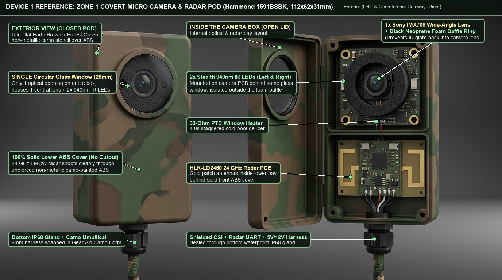
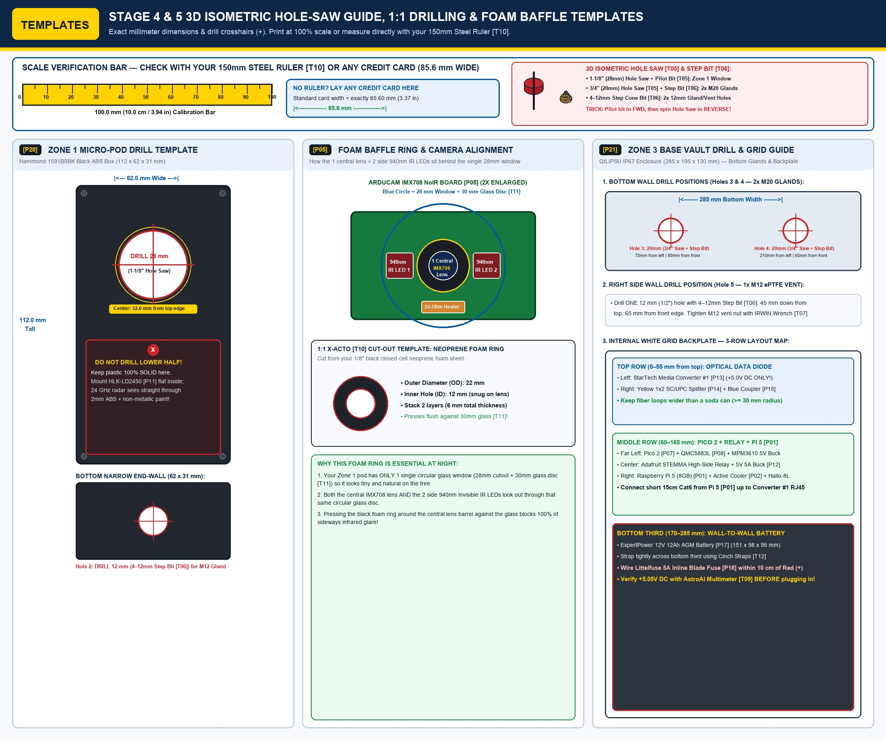
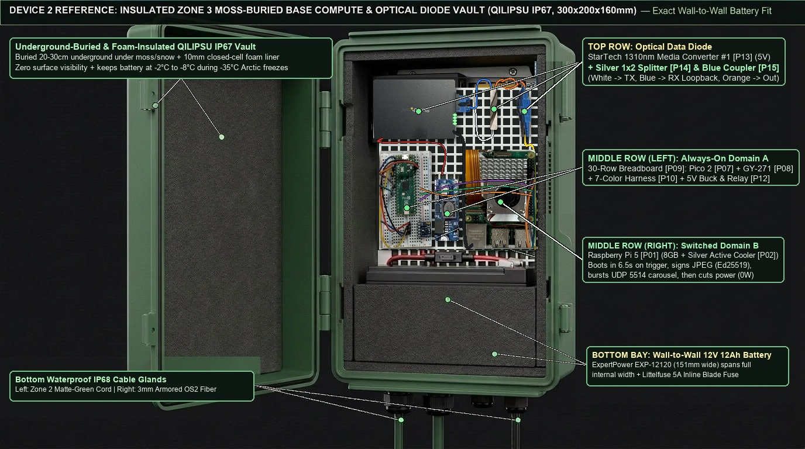
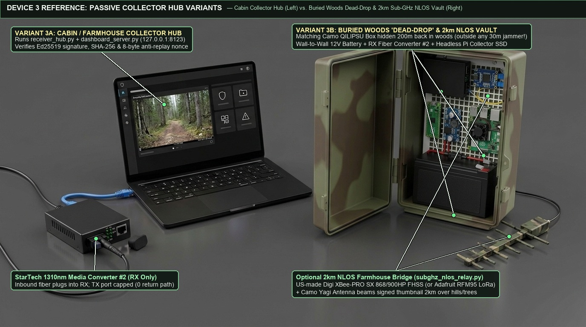

# Arctic Trail Cam System — IKEA-Style Manual Part 2: 3-Zone Enclosure Build, Camouflage, Tree Installation & Field Operation (Stages 4–6)

> **Zero Electronics Experience Required:** Before starting this manual, complete **[Part 1: Indoor Benchtop Assembly & Bring-Up (Stages 1–3)](BENCHTOP_QUICKSTART_GUIDE.md)** on your kitchen table so you know your camera, Pico 2, Raspberry Pi 5, and optical fiber links work.
>
> * Single electrical pin reference: [Wiring & Pinout Schedule](WIRING_PINOUT.md)
> * Parts list & planning BOM: [Hardware Configuration & BOM](HARDWARE_SPECS_AND_BOM.md)
> * Acceptance & 48-hour soak test checklist: [Field Testing & Validation Guide](FIELD_TESTING_AND_VALIDATION_GUIDE.md)


---

## Tools (`[T04]`–`[T12]`) & 5-Hole Enclosure Drilling Schedule Reference

The complete workshop tool schedule (`[T01]`–`[T12]`) and the **Exact 5-Hole Enclosure Drilling Table (`Holes 1–5`)** are maintained in **[`HARDWARE_SPECS_AND_BOM.md`](HARDWARE_SPECS_AND_BOM.md#complete-tools--workshop-equipment-schedule-t01t12-with-retail-prices)**.
* **Plastic Hole-Saw Rule (`[T04]` + `[T05]`):** Always drill the central `1/4"` pilot hole in **`FORWARD`**, then flip your cordless drill to **`REVERSE`** before the outer circular hole-saw cup touches the ABS/polycarbonate box so the teeth score and shear cleanly without cracking the plastic.

---

## STAGE 4: Build & Camouflage the Zone 1 Tree Micro-Pod (`Hammond 1591BSBK` `[P20]`)

The **Zone 1 Micro-Pod** is the tiny, fist-sized black ABS box (`112 × 62 × 31 mm`, `[P20]`) that mounts at eye level (`1.8 m–2.2 m`) inside a vertical pine bark crevice. Look at the reference illustration and `1:1` drilling template below before drilling or gluing.





### Parts & Tools Used in Stage 4

* **Parts:** `[P05]` (`Arducam IMX708 NoIR` Camera — `$44.99`), `[P06]` (`200 mm` `22-to-15-pin` Ribbon `$9.99` + **`Arducam CSI-to-HDMI Extension Kit w/ 2.0 m Shielded Cable` `ASIN B06XDNBM63` `$18.99` for 2 m split-pod umbilical**), `[P11]` (`HLK-LD2450` $24\text{ GHz}$ Radar PCB + Harness — `$10.94`), `[P20]` (`Hammond 1591BSBK` Black ABS Box `$7.45` [factory `IP54` lap-joint; requires `Permatex 81158` perimeter lid-channel silicone gasket] or drop-in **`Hammond 1554EGY` factory `IP68` gasketed box** `$13.50` + `30 mm` Glass Disc `$6.49` + Black Neoprene Foam Ring `$7.99` + **`39-Ohm 5W` Ceramic De-Icer Resistor (`3.69 W` @ `12.0V`)** `$1.99` + `M12 IP68` bottom cable gland `$1.99` = `$25.91`), `[P22]` (`Rust-Oleum` Ultra-Flat Earth Brown `$8.98` & Deep Forest Green `$8.98` spray paint + `Gear Aid Camo Form` `$14.95` = `$32.91`).
* **Tools:** `[T04]` (Cordless drill with `Forward / Reverse`), `[T05]` (`1-1/8"` / `28 mm` Bi-Metal Hole Saw Cup + Center Pilot Drill Bit), `[T06]` (Center awl/nail + `4–22 mm` Titanium Cone Step Drill Bit for `12 mm` bottom hole), `[T07]` (`#1` Phillips screwdriver & pliers), `[T10]` (Scissors/craft knife, ruler, file & `400-grit` sandpaper), `[T11]` (Black waterproof silicone, rubbing alcohol, `3M` blue painter's tape & sea sponge), `[T12]` (Safety glasses & gloves).

### Step 4.1 — Drill the Single `28 mm` Viewport Window & `12 mm` Bottom Cable Hole

1. Put on your **Safety Glasses (`[T12]`)**, unscrew the 4 corner Phillips screws (`[T07]`) on the `Hammond 1591BSBK` box (`[P20]`), and place the empty lid flat on a scrap piece of wood on your worktable.
2. **Mark & Dimple the Single Upper Window Crosshair (`Hole 1`):**
   * Measure `32 mm` down from the top edge of the box lid, dead-center between the left and right edges (`31 mm` from either side edge), or tape the `1:1` paper template (`Panel A`) directly onto the lid.
   * Press your **Center Awl or a Sharp Nail (`[T06]`)** firmly into the center `+` crosshair to make a `1 mm` starter dimple so the drill bit cannot wander on the smooth plastic.
3. **Cut the `28 mm` (`1-1/8"`) Circular Window Using the Hole Saw (`[T05]`) in REVERSE:**
   * Thread the **`1-1/8"` (`28 mm`) round hole saw cup (`[T05]`)** onto its central pilot drill bit mandrel and tighten it into your **Cordless Drill chuck (`[T04]`)**.
   * **Step A (Pilot Hole in `FORWARD`):** Set the drill to **`FORWARD`**, place the tip of the central `1/4"` pilot drill bit into your center dimple, and drill straight down at medium speed until the center pilot bit pokes through the plastic—**STOP immediately before the outer circular saw teeth touch the lid!**
   * **Step B (Outer Circle in `REVERSE` — Zero Cracks!):** Flip your drill's direction switch to **`REVERSE`** (`counter-clockwise`). Hold the box steady and spin the hole saw in **`REVERSE`** at medium speed with gentle downward pressure. The backwards-spinning teeth will score and shear a glass-smooth `28 mm` circle through the `2 mm` ABS plastic in ~15 seconds without grabbing or cracking the box!
   * Wipe away any plastic fuzz around the rim with your half-round file or `400-grit` sandpaper (`[T10]`).
   * **DO NOT drill a hole for the radar in the lower half!** The `HLK-LD2450` $24\text{ GHz}$ radar (`[P11]`) sees straight through the solid `2 mm` unpainted/non-metallic ABS plastic wall with $<0.4\text{ dB}$ loss. Keeping the lower front face solid prevents water entry over the radar.
4. **Drill the `12 mm` (`1/2"`) Bottom Umbilical Hole (`Hole 2`):**
   * On the **bottom narrow end-wall** of the box (`62 × 31 mm` bottom face), press a center dimple (`[T06]`) dead-center (`31 mm` from left/right, `15.5 mm` from front/back).
   * Put the **Titanium Cone Step Drill Bit (`[T06]`)** into your drill (`[T04]`), drill straight down until you reach the **`12 mm` (`1/2"`) step**, and stop.
   * Thread the small **`M12 / PG7 IP68` waterproof cable gland** into the bottom hole and snug the inside locknut with your pliers (`[T07]`).

### Step 4.2 — Glue the Glass Window, Install the Foam Baffle & Mount the `39 Ω, 5W` De-Icer

1. Wipe the inside rim of the `28 mm` circular hole with a drop of rubbing alcohol (`[T11]`) and let it dry for 1 minute.
2. Squeeze a thin, continuous bead of `Permatex 81158` black weatherproof silicone (`[T11]`) around the inside rim of the `28 mm` hole, press the **`30 mm` Mineral Glass Disc (`[P20]`)** flat against the inside face, and let it cure.
3. **Install the Anti-Glare Neoprene Foam Ring (`✓ CRITICAL FOR NIGHT VISION`):**
   * Using your scissors or craft knife (`[T10]`) and the `1:1` template in `Panel B`, check or cut your **black closed-cell neoprene foam donut ring (`22 mm` outer diameter, `12 mm` inner hole, `5–6 mm` thick, `[P20]`)**.
   * Pick up the **`Arducam IMX708 NoIR` camera board (`[P05]`)**. Notice it has **1 square camera lens in the center** and **2 rectangular `940 nm` IR LEDs** on the left and right sides.
   * Press the **black neoprene foam ring (`[P20]`)** directly around the **central camera lens barrel** so the foam sits **between** the central lens and the two side `940 nm` IR LEDs.
   * When you mount the camera board behind the `28 mm` glass window (`4× M2` nylon standoffs), the black foam ring presses flush against the inside of the glass. This creates a light-tight tunnel around the central lens so the side `940 nm` IR LEDs illuminate the trail outside without bouncing sideways through the glass into the lens!
4. **Mount the `39 Ω, 5W` Window De-Icer Resistor (`3.69 W` @ `12.0V`, `[P20]`):**
   * Bond the **`39 Ω, 5W` ceramic de-icer resistor (`[P20]`)** against the lower inside edge of the glass window (outside the foam ring) with thermal tape. Driven from the switched `+12.0V` rail via `STEMMA Relay #2` (`GP16`), it delivers $P = 12.0^2 / 39\,\Omega = 3.69\text{ W}$ (`~3.6 W`, `308 mA`, operating safely at $74\%$ of its `5.0 W` continuous rating during the `4.0 s` sub-zero pre-capture pulse).
   * Connect the short `15-pin` camera ribbon from `Arducam IMX708 NoIR [P05]` into the **`Arducam CSI-to-HDMI Pod Adapter (`ASIN B06XDNBM63`, `[P06]`)** inside the upper bay (and land the two `39 Ω` heater leads on the adapter's `AUX1`/`AUX2` pass-through pads).

### Step 4.3 — Mount the `HLK-LD2450` $24\text{ GHz}$ Radar (`[P11]`), Route the `2.0 m` Umbilical & Gasket-Seal the Lid

1. Place the **`HLK-LD2450` radar board (`[P11]`)** inside the **lower half** of the `Hammond 1591BSBK` box, below the camera board.
2. **Which way it fits (`✓ CORRECT`):**
   * The flat side of the radar board with the **shiny copper patch antenna rectangles** MUST face **FORWARD** (flat against the solid inside front wall of the black plastic box, pointing toward the trail).
   * Secure it with double-sided foam tape or nylon standoffs.
3. **Route the `2.0 m` Shielded Umbilical Harness (`[P06]` + `[P11]`):**
   * Feed the **`2.0 m` shielded `CSI-to-HDMI` camera/heater cable (`[P06]`)** and the 4-wire `2.0 m` `HLK-LD2450` radar cable (`5V_RADAR_SW`, `GND`, `UART0_TX`, `UART0_RX`, `[P11]`) out through the bottom `M12 IP68` gland and tighten the outer dome sealing nut (`[T07]`) until the rubber seal grips the jacket snugly.
4. **Seal the Enclosure Lid Joint (`IP54` Factory Disclosure & Silicone Gasket Procedure):**
   * **Important Engineering Note:** Hammond rates the unmodified **`1591BSBK` at `IP54`** (splash-resistant lap-joint lid without a factory elastomer gasket). Before closing the lid for outdoor tree use, lay a continuous `1.5 mm` bead of **`Permatex 81158` black silicone (`[T11]`)** along the perimeter tongue-and-groove channel of the `1591BSBK` lid and tighten all 4 corner screws evenly. *(For deployments requiring a factory-certified `IP68` gasketed enclosure without manual lid sealing, use the drop-in **`Hammond 1554EGY`** listed in `[P20]`.)*

### Step 4.4 — Camouflage-Paint the Zone 1 Pod Like Pine Bark (`[P22]`)

1. Stick a circle of **`3M` blue painter's tape (`[T11]`)** completely over the outside of the **`28 mm` glass window** so zero paint touches the glass.
2. Lightly rub the outside of the black plastic box with **400-grit sandpaper (`[T10]`)** for 60 seconds until the shiny plastic looks dull and matte. Wipe away dust with rubbing alcohol (`[T11]`).
3. Shake the can of **`Rust-Oleum Specialty Camouflage Ultra-Flat Earth Brown` (`[P22]`)** for 1 minute and spray 2 light, even base coats from `25 cm` (`10 inches`) away. Let dry for 20 minutes. *(Never use metallic or glossy paint—metallic flakes block $24\text{ GHz}$ radar; `Rust-Oleum Specialty Camouflage` is non-metallic mineral pigment and radar-transparent.)*
4. Spray a small puddle of **`Rust-Oleum Deep Forest Green` (`[P22]`)** and **`Flat Black`** onto a piece of cardboard, dip a torn corner of a natural sea sponge (`[T11]`) into the paint, and dab vertical bark-like streaks along the front and sides of the box.
5. Peel off the blue painter's tape from the `28 mm` glass window once dry.

---

## STAGE 5: Pack, Wire & Commission the Zone 3 Moss-Buried Base Vault (`QILIPSU IP67` `[P21]`)

The **Zone 3 Base Vault** sits on the ground in a root hollow at the base of the pine tree, hidden under `2 cm` of moss and pine needles. It holds the heavy `12V 12Ah` battery (`[P17]`), the `Pico 2` gatekeeper (`[P07]`), the `Raspberry Pi 5` (`[P01]`), and the `1×2` Optical Data Diode (`[P13]`–`[P15]`).

Look at the exact physical layout in the diagram below—it matches your physical `QILIPSU` enclosure (`285 × 195 × 130 mm`, `[P21]`) with the **`ExpertPower 12V 12Ah` battery (`151 × 98 × 95 mm`, `[P17]`) sitting wall-to-wall across the bottom third**.



### Step 5.1 — Drill the 3 Gland/Vent Holes, Mount the Grid Backplate & Strap the Battery

> [!CAUTION]
> **KEEP BATTERY TERMINALS UNPLUGGED UNTIL STEP 5.4!** Cover both silver metal tabs (`Red +` and `Black -`) on top of the `12V 12Ah` battery (`[P17]`) with a piece of blue painter's tape (`[T11]`) while placing components inside the box.

1. **Drill the 3 Holes in the Empty `QILIPSU` Box (`[P21]`) Before Installing Electronics:**
   * **Holes 3 & 4 (`2× Bottom M20 Cable Glands — 20 mm / 3/4"`):** On the bottom wall (`285 × 130 mm`), mark and dimple two crosshairs with your center awl (`[T06]`): one at `75 mm` from the left edge (`65 mm` from front) and one at `210 mm` from the left edge (`65 mm` from front). Using your **Cordless Drill (`[T04]`)** and **`3/4"` (`19–20 mm`) Hole Saw Cup (`[T05]`)**, drill the center pilot holes in `FORWARD` and cut the circular openings in **`REVERSE`**, then pass the **`20 mm` step of your Cone Step Bit (`[T06]`)** through each hole so the **`M20 IP68` cable glands** thread in smoothly.
   * **Hole 5 (`1× Right-Side M12 Breather Vent — 12 mm / 1/2"`):** On the right side wall (`45 mm` down from top, `65 mm` from front), dimple the crosshair and drill a **`12 mm` (`1/2"`) hole** using the `12 mm` step on your **Titanium Cone Step Drill Bit (`[T06]`)**.
   * Thread the two **`M20 IP68` cable glands** into the bottom holes and the **`M12 ePTFE` breather vent** into the side hole, and tighten their internal locknuts `1/4` turn past finger-tight with your wrench/pliers (`[T07]`).
2. Open the hinged lid of the **`QILIPSU IP67` enclosure (`[P21]`)** and screw the white ABS grid mounting plate into the back of the box using the 4 included corner Phillips screws (`[T07]`).
3. Place the **`ExpertPower 12V 12Ah` AGM battery (`[P17]`)** horizontally across the **bottom third of the enclosure** (terminals facing up toward the middle of the box). Wrap a heavy-duty Velcro cinch strap (`[T12]`) through the white grid slots around the battery belly so it cannot shift when carrying the box.

### Step 5.2 — Mount the Middle Row (`Pico 2`, `5V Buck`, `Switches`, `Pi 5`) & Top Row (`Fiber Diode`)

Using M2.5/M3 nylon standoffs or heavy-duty 3M Dual-Lock strips on the white grid backplate **above the battery**:

1. **Middle Row (Left to Right, directly above the battery):**
   * **Far Left:** Mount the **`Pico 2` (`[P07]`)** + **`QMC5883L` (`[P08]`)** + optional **`ADS1115` (`[P11-SEIS]`)** on your compact breadboard/perma-proto carrier, alongside the tiny **`Adafruit MPM3610` `5V` Buck Converter (`[P12]` — Domain A Always-On Power)** and the **`Pololu 2810` High-Side MOSFET Switch (`[P12]` — `GP6` Radar Power Switch)**.
   * **Center-Left:** Mount **`Adafruit STEMMA` High-Side Relay #1 (`GP15` Domain B Power)**, **`STEMMA` High-Side Relay #2 (`GP16` `12V` Window De-Icer Switch)**, and the **`12V-to-5V 5A` Buck Converter (`[P12]` — Domain B Switched Power)**.
   * **Center-Right:** Mount the **`Raspberry Pi 5` (`[P01]`)** with its **Active Cooler (`[P02]`)**, **`Panasonic ML2020` `J5` RTC battery (`[P03]`)**, and **`Arducam CSI-to-HDMI Base Adapter (`[P06]`)** connected to `Pi 5 CAM/DISP 0` via the `200 mm` `22-to-15-pin` ribbon. Plug the `2.0 m` Zone 2 shielded HDMI umbilical cable (entering through the bottom-left `M20` gland) into the `CSI-to-HDMI Base Adapter`.
2. **Top Row (Left to Right, at the very top of the white grid plate):**
   * **Top-Left:** Mount **Field Media Converter #1 (`StarTech MCMGBSCSM10` `[P13]`)** and connect a short `15 cm` Cat6 patch cable from the **Pi 5 Ethernet port** to **Media Converter #1 `RJ45`**.
   * **Top-Right:** Secure the **Yellow `1×2 SC/UPC` Optical Splitter (`[P14]`)** and **Blue `Cable Matters SC/UPC` Coupler (`[P15]`)** in gentle loops ($\ge 30\text{ mm}$ radius, wider than a soda can):
     * Plug Splitter Input $\rightarrow$ **Media Converter #1 `TX`**.
     * Plug Splitter Output 1 $\rightarrow$ **Media Converter #1 `RX`** (local carrier-detect loopback).
     * Plug Splitter Output 2 $\rightarrow$ **Blue `SC/UPC` Coupler (`[P15]`)** $\rightarrow$ **Outbound `3 mm` Black Armored Fiber Cable (`[P16]`)** exiting through the bottom-right `M20 IP68` gland.

### Step 5.3 — Wire the Two Power Domains (`Domain A` Always-On vs. `Domain B` Switched + Radar/Heater Switches)

Using your **Wire Stripper & Crimping Pliers (`[T08]`)** and **`2.5 mm` Flathead / `#1` Phillips Screwdriver (`[T07]`)**, with the **`5A` tan blade fuse (`[P18]`) REMOVED from its fuse holder**, make the power connections below:

| Step | Wire From... | Wire To... | Why / Orientation Check |
| :---: | :--- | :--- | :--- |
| **`[Pwr 1]`** | **Battery `Red (+)` Spade Clip** | **Input wire of `Littelfuse` Holder (`[P18]`)** *(within `10 cm` of battery `+` tab)* | Protects the entire box if any wire ever shorts. |
| **`[Pwr 2]`** | **Output wire of `Littelfuse` Holder (`[P18]`)** | **`MPM3610` `VIN (+)`**, **`STEMMA` Relay #1 `COM`**, AND **`STEMMA` Relay #2 `COM`** | Feeds fused `+12V` to always-on Pico buck and both high-side relay inputs. |
| **`[Pwr 3]`** | **Battery `Black (-)` Spade Clip** | Common **`GND` Bus Strip** (`MPM3610 GND`, `Pico GND Pin 38`, `Relays GND`, `5V 5A Buck GND (-)`, Radar `GND`, Heater `-`) | Every single board MUST share the same `Black (-)` Ground reference! |
| **`[Pwr 4]`** | **`MPM3610` `5V OUT (+)`** | **`Pico 2` `VBUS` (`Pin 40` = Right-side `Row 1`)** AND **`Pololu 2810` Radar Switch `VIN`** | Powers the `Pico 2` gatekeeper continuously at `<4 mW` and supplies `+5V` to the radar switch input. |
| **`[Pwr 5]`** | **`Pico 2` `GP15` (`Pin 20` = Left-side `Row 20`)** | **`STEMMA` Relay #1 `SIGNAL (IN)` pin** *(plus `3V3` to Relay `VCC`)* | Lets the Pico turn the heavy Pi 5 + Fiber Converter ON and OFF. |
| **`[Pwr 6]`** | **`STEMMA` Relay #1 `NO` (Normally Open) screw terminal** | **`+12V IN (+)` of the `12V-to-5V 5A` Buck Converter (`[P12]`)** | Sends `+12V` to the heavy `5V 5A` buck **only** when Relay #1 closes! |
| **`[Pwr 7]`** | **`+5.0V DC OUT` of the `12V-to-5V 5A` Buck Converter** | **Both** the **Pi 5 USB-C power plug** AND the **`StarTech` Media Converter #1 `5V` barrel cable (`[P19]`)** | **CRITICAL:** Both the Pi 5 and the `StarTech` Media Converter receive **strictly regulated `+5.0V DC`**—never `12V`! |
| **`[Pwr 8]`** | **`Pico 2` `GP6` (`Pin 9` = Left-side `Row 9`)** | **`Pololu 2810` Switch `CTRL/ON` pin**; Switch **`VOUT`** $\rightarrow$ **Zone 1 `HLK-LD2450` Radar `5V` (`[P11]`)** | Switches the `180 mA` `+5V` radar load cleanly from `3.3 V` logic (`0.00 W` radar standby in Eco mode). |
| **`[Pwr 9]`** | **`Pico 2` `GP16` (`Pin 21` = Right-side `Row 20`)** | **`STEMMA` Relay #2 `SIGNAL (IN)`**; Relay #2 **`NO`** $\rightarrow$ **Zone 1 `39 Ω, 5W` De-Icer Resistor (`+`)** (`[P20]`) | Pulses `+12.0V` (`3.69 W` / `308 mA`) into the `39 Ω, 5W` window heater for `4.0 s` only when sub-zero & humid. |

Also confirm your sensor & handshake wires on the Pico 2 (`[P07]`):
* **Magnetometer (`QMC5883L` `[P08]`) & Seismic ADC (`ADS1115` `[P11-SEIS]`):** `3V3_OUT (Pin 36 / Right Row 5)` $\rightarrow$ `VCC`; `GND (Pin 38 / Right Row 3)` $\rightarrow$ `GND`; `GP4 (Pin 6 / Left Row 6)` $\rightarrow$ `SDA`; `GP5 (Pin 7 / Left Row 7)` $\rightarrow$ `SCL`.
* **Radar (`HLK-LD2450` `[P11]`):** `GP0 (Pin 1 / Left Row 1)` $\rightarrow$ Radar `RX`; `GP1 (Pin 2 / Left Row 2)` $\rightarrow$ Radar `TX`; `GP6 (Pin 9 / Left Row 9)` $\rightarrow$ `Pololu 2810` Radar `+5V` switch control (`[Pwr 8]`).
* **Pi 5 Handshake (`UART1` + `DONE`):** `GP8 (Pin 11 / Left Row 11)` $\rightarrow$ Pi 5 `Pin 10 (GPIO15 RX)`; Pi 5 `Pin 16 (GPIO23)` $\rightarrow$ Pico `GP17 (Pin 22 / Right Row 19)` (or `GP2` `Pin 4 / Left Row 4`); `GND (Pin 13 / Left Row 13)` $\rightarrow$ Pi 5 `Pin 14 (GND)`.

### Step 5.4 — The Mandatory Multimeter `+5.0V DC` Safety Check (`[T09]`)

> [!IMPORTANT]
> **DO NOT SKIP THIS 30-SECOND CHECK!** Before plugging the USB-C power plug into the Raspberry Pi 5 (`[P01]`) or the barrel plug into the `StarTech` Media Converter (`[P13]`), verify the voltage with your **Digital Multimeter (`[T09]`)**.

1. Leave the **Pi 5 USB-C power cable** and **Media Converter barrel plug UNPLUGGED** from those two devices.
2. Push the **`5A` tan blade fuse** into the **`Littelfuse` holder (`[P18]`)** and slide the red and black spade clips onto the **`12V 12Ah` battery (`[P17]`)** (`Red` to `Red +`, `Black` to `Black -`).
3. Turn your **Digital Multimeter (`[T09]`)** dial to **`DC Volts (V= / 20V)`**:
   * **Check 1 (Battery):** Touch Red probe to Fuse output and Black probe to Battery `Black (-)`. You should read **`+12.4V` to `+13.0V DC`**.
   * **Check 2 (Domain A — Pico 5V):** Touch Red probe to `MPM3610 5V OUT` (`Pico Pin 40`) and Black probe to `GND`. You should read **`+4.95V` to `+5.15V DC`**.
   * **Check 3 (Domain B — Pi 5 & Converter 5V):** Wave your screwdriver (`[T03]`) over the magnetometer/radar so `STEMMA` Relay #1 clicks ON (its red LED lights up). Touch Red probe to the `5V 5A` buck output (and the center hole of the Media Converter barrel plug `[P19]`) and Black probe to `GND`. Confirm it reads **strictly `+4.95V` to `+5.15V DC`** (never `12V`!).
4. Remove the `5A` fuse, plug the USB-C power plug into the Pi 5 and the `5V` barrel plug into Media Converter #1, and put the `5A` fuse back in.

### Step 5.5 — Autonomous Field Commissioning: Provision Unique Node Keys & Install `diode-node.service`

Before closing the `QILIPSU` vault for unattended field operation, transition the `Raspberry Pi 5 [P01]` from manual bench mode to **autonomous cold-boot service execution** (`ALLOW_EXAMPLE_KEYS=0`, unique `Ed25519` node identity, hardware Wi-Fi/BT disabled, and read-only `OverlayFS` enabled):

1. **Generate the Unique `Ed25519` Keypair & Node Identity on `Raspberry Pi 5 [P01]`:**
   ```bash
   cd ~/pi-diode-trailcam/pi5_sender_node
   python3 generate_keys.py CAMERA-NORTH-01
   ```
   * This writes `node_key.json` (containing both `"node_id": "CAMERA-NORTH-01"` and `"private_key_hex"`) and prints the public-key registry snippet.
2. **Register the Node's Public Key on Your Cabin Collector Hub (`[T02]`):**
   * Copy the printed `CAMERA-NORTH-01` public key entry into `pi-diode-trailcam/collector_hub/authorized_nodes.json` on your Collector laptop/hub. *(Once `authorized_nodes.json` is present on the Collector Hub, `receiver_hub.py` automatically clears the demo `NODE-NORTH-01` example key and trusts **only** the provisioned nodes in `authorized_nodes.json`.)*
3. **Run the One-Command Production Fast-Boot & Service Installer on `Raspberry Pi 5 [P01]`:**
   ```bash
   sudo bash install_pi5_fastboot.sh CAMERA-NORTH-01
   ```
   * **What `install_pi5_fastboot.sh` configures automatically:**
     1. Copies `/opt/trailcam/sender_node.py`, installs `/etc/trailcam/node_key.json` (`chmod 600`), and writes `/etc/trailcam/node.env` (`NODE_ID=CAMERA-NORTH-01`, `ALLOW_EXAMPLE_KEYS=0`).
     2. Configures `/boot/firmware/config.txt` with `enable_uart=1`, `dtoverlay=disable-wifi`, and `dtoverlay=disable-bt` (`0.00 W` RF at hardware boot).
     3. Enables `/etc/systemd/system/diode-node.service` (`EnvironmentFile=-/etc/trailcam/node.env`) so every time `Pico 2` closes `STEMMA` Relay #1, `Pi 5` boots directly into `sender_node.py`, signs the alert as `CAMERA-NORTH-01`, blasts the `3×` optical carousel, asserts `GPIO23 (DONE)`, and halts cleanly.
     4. Enables read-only `OverlayFS` (`raspi-config nonint do_overlayfs 0`) so sudden power cuts can never corrupt the MicroSD card.
4. **Autonomous Cold-Boot Verification (`✓ STAGE 5 SUCCESS CHECK`):**
   * Reboot/power-cycle once with no SSH session attached. Wave your magnetic screwdriver (`[T03]`) over the sensor: Relay #1 clicks ON, `Pi 5` + Media Converter #1 boot in $<7\text{ seconds}$, the Collector Hub dashboard (`http://127.0.0.1:8123`) receives a verified alert signed by `CAMERA-NORTH-01`, `GPIO23 (DONE)` goes HIGH, and Relay #1 clicks OFF (`0.00 W` Pi standby)!

---

## STAGE 6: Tree Installation, Collector Setup & Operating the System in the Field


### Step 6.1 — Strap Zone 1 to the Pine Trunk & Bury Zone 3 Under Moss

1. **Pick the Right Tree (`3–5 meters` off the trail edge):**
   * Choose a mature pine or spruce tree (`>25 cm` trunk diameter) with deep vertical bark grooves and low branches that shade the trunk from direct sky view.
2. **Mount the Zone 1 Micro-Pod (`[P20]`) at `1.8 m–2.2 m` Height (`25°` Oblique Angle):**
   * Tuck the camouflaged `Hammond 1591BSBK` pod into a vertical bark crevice at eye level (`1.8 m–2.2 m`).
   * **Aiming Rule (`25°` Oblique):** Point the single circular glass window **`25°` obliquely down the trail or driveway** (not `90°` straight across the road). This gives the camera and radar a `45 m` view down the approach path so walking intruders or vehicles stay in the frame for several seconds.
   * Secure the pod with a matte brown bark strap or two stainless wood screws through the rear mounting tabs, and tuck a piece of natural pine bark / lichen over the top seam.
3. **Wrap the Zone 2 Trunk Umbilical in `Gear Aid Camo Form` (`[P22]`):**
   * Press the `2 m` umbilical cable straight down a natural vertical groove in the tree bark to the ground, and wrap it with self-clinging matte **`Gear Aid Camo Form`** fabric tape (`[P22]`) so no black wire is visible.
4. **Hide the Zone 3 Base Vault (`[P21]`) in the Root Hollow:**
   * Set the closed, latched `QILIPSU IP67` Base Vault in the hollow between the tree roots (or a shallow `15 cm` depression beside a boulder).
   * Cover the top of the vault with **`2–3 cm` of natural forest moss, pine needles, and bark** so zero plastic is visible from the trail.

### Step 6.2 — Connect Your Collector Unit (Choose Your Scenario: `A`, `B1`, `B2`, or `B3`)

Look at the two illustrations below to choose the exact Collector setup that matches your property:




* **If You Have a Cabin Within `30 m` to `10 km` (`Scenario A — Direct Moss-Buried Fiber`):**
  1. Unroll the `3 mm` black steel-tube armored single-mode OS2 fiber cable (`[P16]`) from the tree's Zone 3 Base Vault to your cabin, pressing it `2 cm` under the soft forest moss with a garden trowel (`no trench digging needed`).
  2. Inside the cabin, plug the incoming blue `SC/UPC` fiber connector into the **`RX` port** of **Media Converter #2 (`[P13]`)** (leave `TX` capped!), power Media Converter #2 with its `5V` adapter (`[P19]`), and connect Cat6 Ethernet to your cabin computer (`10.10.0.100`).
* **If There Is NO Cabin Nearby (`Scenario B1 — 200 m Buried Dead-Drop Vault`):**
  1. Run `200 m` of moss-buried armored fiber (`[P16]`) from the trail tree deep into the woods to a second buried **`QILIPSU` Collector Vault (`Variant 3B`)** containing a `12V` battery, `5V` buck, Media Converter #2 (`RX` only), and a headless Collector Pi storing verified JPEGs to a `512 GB` NVMe SSD. Even if an intruder finds and smashes the camera at the trail, the signed photos are already safe `200 m` away under the moss.
* **If You Need Alerts Sent `200 m – 20 km` Over a Forested Hill With NO Line of Sight (`Scenario B3 — 200 m Lateral Fiber + Build D 2.4 GHz Troposcatter & Canopy-Bounce Bridge`):**
  1. **How Scenario B3 (`sky-diode-relay` `Build D`) Defeats Jamming & Interference (6-Layer Defense-in-Depth):**
     * **Layer 1 — `200 m` Lateral Fiber Separation + `L-com HG2414P` `14 dBi` Flat-Panel Spatial Nulling:** Because the camera at the trail (`Zone 1`–`Zone 3`) uses **100% passive glass fiber (`[P16]`)**, a handheld RF jammer carried down the trail has **zero effect** on the camera or its `200 m` fiber link to the buried woods vault. By routing the `200 m` fiber **laterally into the forest** and mounting the weatherproof square **`L-com HG2414P` `14 dBi` Flat-Panel Patch Antenna (`203 × 203 × 38 mm`)** tilted $+2^\circ$ into the sky/canopy scatter volume toward the farmhouse (plus the matching `HG2414P` `14 dBi` flat-panel antenna at the farmhouse aimed at the woods vault's sky scatter volume, NOT the trail), any jammer on the trail sits in the `>20 dB` off-axis/rear null of both flat-panel antennas and is attenuated by dense trees and terrain!
     * **Layer 2 — Out-of-ISM Guard-Band Hopping (`2380.373 MHz`, `2487.818 MHz`, `2459.496 MHz`) & `Mini-Circuits VBF-2435+` Bandpass Filtering:** The `ADALM-PLUTO` SDR + `Skyworks SE2576L-EK1` (`1 W` / `+30 dBm`) PA hops across 3 cryptographic frequencies derived from `SHA256(shared_secret || time_slot)` outside standard Wi-Fi (`2412–2462 MHz`), while the gold `Mini-Circuits VBF-2435+` (`2370–2500 MHz`) coaxial bandpass filter ahead of the `Skyworks SKY65405-21EK1` (`1.2 dB NF`) LNA provides `>40 dB` stopband rejection against LTE/5G/VHF/UHF/GPS blockers.
     * **Layer 3 — `VK7MO` Coherent Lock-In Integration (`+55.8 dB` Processing Gain) & FFT Spectral Excision:** Demodulates signals **`22.0 dB` BELOW the thermal noise floor** (`+14.1 dB` to `+62.3 dB` SNR margin from `200 m` to `20 km` in clear sky, `24h` summer sun, rain, fog, and blizzard snow) while automatically zeroing narrowband/swept jammers in the FFT domain.
     * **Layer 4 — Zero-Data-Loss `512 GB` NVMe Vault Storage & `Ed25519` Anti-Spoofing:** Even against a military-grade wideband barrage jammer, the signed JPEG is **already permanently stored on the `512 GB` NVMe SSD inside the buried `200 m` woods vault** (`<2 ms` after capture) and re-transmits automatically via persistent store-and-forward (`5s` to `300s` exponential backoff) once jamming clears. And because the farmhouse verifies the camera's **`Ed25519` cryptographic signature** before accepting any alert, an attacker can **never inject fake photos or spoofed alerts**.
  2. For complete zero-solder assembly (`~35–45 min`) of the `Build D` `200 m – 20 km` Troposcatter & Canopy-Bounce hardware, see **[`sky-diode-relay/hardware/SKY_RELAY_HARDWARE_SPEC_AND_BOM.md`](../../sky-diode-relay/hardware/SKY_RELAY_HARDWARE_SPEC_AND_BOM.md)**. To provision production `Ed25519` keys (`pi5_sender_node/generate_keys.py`) and launch the live Collector Hub & Dashboard (`collector_hub/receiver_hub.py` + `dashboard_server.py`), follow the **[Software Stack & CLI Reference (`pi-diode-trailcam/README.md`)](../README.md)**.
  3. Once installed, execute the 20-walk acceptance test, night `940 nm` zero-glare verification, and 48-hour (`192-event`) unattended soak test in the **[Field Testing & Validation Guide (`FIELD_TESTING_AND_VALIDATION_GUIDE.md`)](FIELD_TESTING_AND_VALIDATION_GUIDE.md)**.


---

## 10. International Air-Shipping & Battery-Free Transit Guide (Shipping Pre-Assembled Units)

Because the pre-assembled **Zone 1 Micro-Pod (`[P20]`)**, **Zone 3 Base Compute Vault (`[P21]`)**, **Cabin Receiver (`[P13]`)**, and **Optics/Cables (`[P14]`–`[P16]`)** contain **zero lithium or lead-acid batteries** when shipped dry, you can legally airmail or courier the entire pre-assembled, pre-tested system anywhere in the world as **100% standard non-hazardous air cargo (`No IATA Dangerous Goods`)**.

### 10.1 What to Leave Out of the Air Parcel (3 Strict Exclusions)
1. **Lead-Acid / LiFePO4 `12V 12Ah` Main Battery (`[P17]`):** Leave out (`saves 7.72 lbs / 3.50 kg` of shipping weight and avoids `UN2800` / `UN3480` battery rules). Keep the **`Littelfuse 5A Inline Fuse Holder [P18]`** and **`6.3mm (F2)` Red/Black Slide-On Spade Terminal Leads** pre-crimped inside the `QILIPSU` box so the recipient can plug in a local `12V 12Ah` battery in 30 seconds without tools.
2. **Optional `ML2020` Lithium Coin Cell on `Raspberry Pi 5 [P01]`:** Unplug the tiny 2-pin `J5 BAT` RTC coin cell if fitted (`UN3091`). The **`Pico 2 [P07]`** hardware timer timestamps every wake event automatically without a coin cell.
3. **Aerosol Spray Cans (`[P22]`) & Uncured Liquid Silicone Tubes (`[T11]`):** Paint the enclosures and cure the `30mm` glass viewport (`24 hours`) **before** packing. Once cured, dry paint and cured silicone rubber are 100% inert solids.

### 10.2 Nesting Trick ("Russian Doll" Packing in a Single `14" × 10" × 8"` Box — `8.4 lbs / 3.81 kg`)
Because the lower third of the **`QILIPSU` Base Vault (`[P21]`, `285 × 195 × 130 mm`)** is normally occupied by the `12V 12Ah` battery, that entire bottom compartment is **empty during shipping**:
1. Wrap the pre-assembled **`Hammond 1591BSBK` Camera/Radar Pod (`[P20]`)** and the **Cabin Receiver Media Converter (`[P13]`)** in anti-static bubble wrap and nest both **inside the empty lower battery bay of the `QILIPSU` Base Vault**, strapped down with the nylon battery cinch strap (`[T12]`) so nothing shifts in transit.
2. Place a piece of bubble wrap inside the `QILIPSU` lid so the **`Raspberry Pi 5 [P01]`**, **`Active Cooler [P02]`**, and **`Pico 2 [P07]`** cannot vibrate loose, and close the `QILIPSU` latches.
3. Pack the closed `QILIPSU` box alongside the **`30 m` Armored Fiber Spool (`[P16]`)** and umbilical/Ethernet cables inside a standard **`14" × 10" × 8"` (`36 × 25 × 20 cm`)** corrugated box (`Total packed weight: ~8.4 lbs / 3.81 kg`).

| Air Carrier Service (US $\rightarrow$ Nordic / EU) | Typical Rate (`8.4 lbs / 3.81 kg`) | Transit Time | Customs / Tracking Notes |
| :--- | :--- | :--- | :--- |
| **UPS Worldwide Expedited** *(via Pirate Ship)* | **`~$62 – $72`** | `3 – 5 Days` | Door-to-door air tracking + electronic customs pre-clearance |
| **USPS Priority Mail International** *(Commercial Rate)* | **`~$68 – $74`** | `6 – 10 Days` | Handed off to national postal service (*Posti* in Finland) |
| **DHL Express Worldwide** *(via Pirate Ship)* | **`~$82 – $93`** | `2 – 3 Days` | Fastest express air courier with SMS recipient customs link |

### 10.3 Customs Declaration (`CN23`) & 5-Minute Local Battery Hookup at Destination
* **Harmonized Tariff (`HS`) Codes for Smooth Customs Clearance:**
  * `HS 8471.50` — *Single-board microcomputer & digital camera sensor module (`Raspberry Pi 5` + `IMX708`, no battery)* (**`0%` EU/Finland duty tariff**)
  * `HS 8517.62` — *Ethernet-to-optical-fiber media converter modules & passive glass fiber cable (non-RF)* (**`0%` EU/Finland duty tariff**)
  * `HS 8538.10` — *Empty polycarbonate weatherproof electrical junction enclosure (`QILIPSU` + `Hammond`, no battery)*
  * **Important Note on Box Exterior:** Tape a clear notice reading: **`"CONTAINS NO BATTERIES — PASSIVE ELECTRONICS & OPTICS ONLY (NO LITHIUM / NO LEAD-ACID)"`**.
* **5-Minute Local `12V 12Ah` Battery Hookup Upon Arrival (`~€26.90` in Finland/EU):**
  * The recipient buys a standard **`12V 12Ah` (`151 × 98 × 95 mm`, `F2 / 6.3mm` spade terminals)** AGM or LiFePO4 battery locally (e.g., **Motonet** `Product #90-0014` *Yuasa NPW45-12 / MTX Energy 12V 12Ah AGM* or **Biltema** `Product #80-412` *12V 12Ah AGM*, `~€26.90`).
  * Open the `QILIPSU` Base Vault, remove the nested `Hammond` Camera Pod and Cabin Receiver, strap the local `12V 12Ah` battery into the bottom bay, push the pre-crimped **Black (`-`)** and **Red (`+`) `6.3mm` spade connectors** onto the battery tabs (**Red to `+`**, **Black to `-`**), and insert the `5A` blade fuse (`[P18]`). The system is immediately live!

