# Arctic Trail Cam System — IKEA-Style Manual Part 1: Indoor Benchtop Assembly & Bring-Up (Stages 1–3)

> **Zero Electronics Experience Required:** This manual is written like an IKEA assembly guide. You do **not** need to know how to solder or read circuit schematics. Simply match each part in your hands to its **`[P##]` Part Code**, check the **"Which Way Round Does It Fit?"** box before plugging anything in, and follow each numbered step in order.
>
> * Single pin reference: [Wiring & Pinout Schedule](WIRING_PINOUT.md)
> * Full hardware parts list: [Hardware Configuration & BOM](HARDWARE_SPECS_AND_BOM.md)
> * Next manual after bench bring-up: [Part 2 — Enclosure Build, Camouflage & Tree Installation (Stages 4–6)](ASSEMBLY_GUIDE.md)

---

## Step 0: Check Your Parts (`[P01]`–`[P19]`) & Identify Your 3 "Raspberry Pi" Boards

Full itemized part prices (`[P01]`–`[P22]`) and tool specifications (`[T01]`–`[T12]`) are maintained in **[`HARDWARE_SPECS_AND_BOM.md`](HARDWARE_SPECS_AND_BOM.md)**.
* **Stages 1–2 (Indoor Core Benchtop — `$177.43`):** Use **`[P01]`**, **`[P02]`**, **`[P04]`–`[P10]`**, and household tools **`[T01]`–`[T03]`** (fingernails/tweezers, your laptop, and a small steel screwdriver/key—zero power tools or soldering).
* **Stage 3 (Optical Fiber Data Diode — `+$169.30` / `$346.73` total):** Adds **`[P13]`–`[P16]`** and **`[P19]`**.
* **Leave the `12V 12Ah` Battery (`[P17]`) in its box during Stages 1–3!** On the indoor table, power **`Raspberry Pi 5 [P01]`** with its `27W USB-C` wall adapter and **`Raspberry Pi Pico 2 [P07]`** via Micro-USB from your laptop (`[T02]`).


### How to Identify Your 3 "Raspberry Pi" Boards at a Glance (DO NOT Mix Them Up!)

You have **three different green circuit boards** with "Raspberry Pi" in their name. Look at the physical ports on each board before starting so you never confuse them:

| Board Code & Exact Name | Physical Size & Shape | How to Spot It Instantly in 3 Seconds | What Role It Plays in This Build |
| :--- | :--- | :--- | :--- |
| **`[P01]` `Raspberry Pi 5 (8GB)` (`$80.00`)** *(Primary Camera Computer — **USE THIS BOARD!**)* | Credit-card size (`85 × 56 mm`), flat underside with MicroSD slot | 1. Silver **Gigabit Ethernet port is on the BOTTOM-RIGHT corner** (below the blue USB 3.0 ports).<br>2. Has **two narrow vertical orange/black `22-pin` slots labeled `CAM/DISP 0` & `CAM/DISP 1`** between the micro-HDMI ports and Ethernet.<br>3. Has **two round mounting holes** beside the silver CPU for the **`[P02]` Active Cooler** + a white 4-pin `FAN` socket at top-right. | **Main Field Camera & AI Computer (Stages 1–6).** All `[P02]` Active Cooler, `[P03]` Hailo-8L, and `[P06]` `22-pin` Camera Ribbon steps use **this exact board (`Raspberry Pi 5 8GB [P01]`)**. |
| **`[P01-ALT]` `Raspberry Pi 4 Model B (8GB)` (`$75.00`)** *(Secondary Board — **SET ASIDE**)* | Credit-card size (`85 × 56 mm`), looks similar to Pi 5 at first glance! | 1. Silver **Gigabit Ethernet port is on the TOP-RIGHT corner** (above the blue USB 3.0 ports — the exact opposite of the Pi 5!).<br>2. Has only **one wide (`15-pin`) white/black `CAMERA` slot**.<br>3. Has **NO mounting holes** and **NO 4-pin `FAN` socket** for the Pi 5 Active Cooler (`[P02]`). | **Do NOT use for the `22-pin` camera cable `[P06]` or Active Cooler `[P02]`!** Keep this Pi 4 aside as a spare or for a remote Collector Hub (`Variant 3B`). |
| **`[P07]` `Raspberry Pi Pico 2 (RP2350H)` (`$6.00`)** *(Tiny Gatekeeper Microcontroller)* | Stick-of-gum size (`51 × 21 mm`, $1/4$ the size of Pi 5) | 1. Has **40 long metal legs soldered down both long edges** (`20 legs on the left`, `20 legs on the right`) so it presses into the white **Solderless Breadboard (`[P09]`)**.<br>2. Has a tiny silver **Micro-USB port** at one end and a tiny white button labeled **`BOOTSEL`**.<br>3. **Has NO MicroSD card slot** and NO Ethernet/HDMI ports! | **Always-On `<4 mW` Sensor Gatekeeper (Stages 1–6).** Plugs into the white breadboard (`[P09]`), reads the `QMC5883L` magnetometer (`[P08]`) & radar (`[P11]`), and wakes the Pi 5 (`[P01]`). |

---

## Step 0.5: "Which Way Round Does It Fit?" (`✓ CORRECT` vs. `✗ WRONG` Isometric Guide)

Before plugging any part in, check its isometric panel in the visual orientation guide below. Every connector in this build has a clear physical feature that tells you which way it goes.

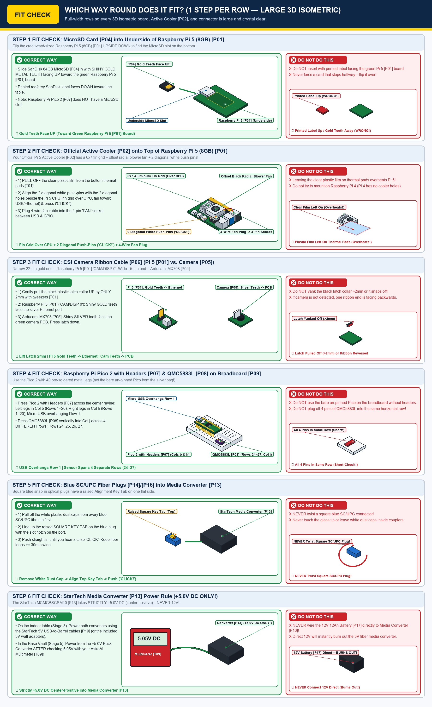

---

## STAGE 1: Prepare the `Raspberry Pi 5 (8GB)` (`[P01]`), Flash the MicroSD (`[P04]`) & Flash the `Pico 2` (`[P07]`)

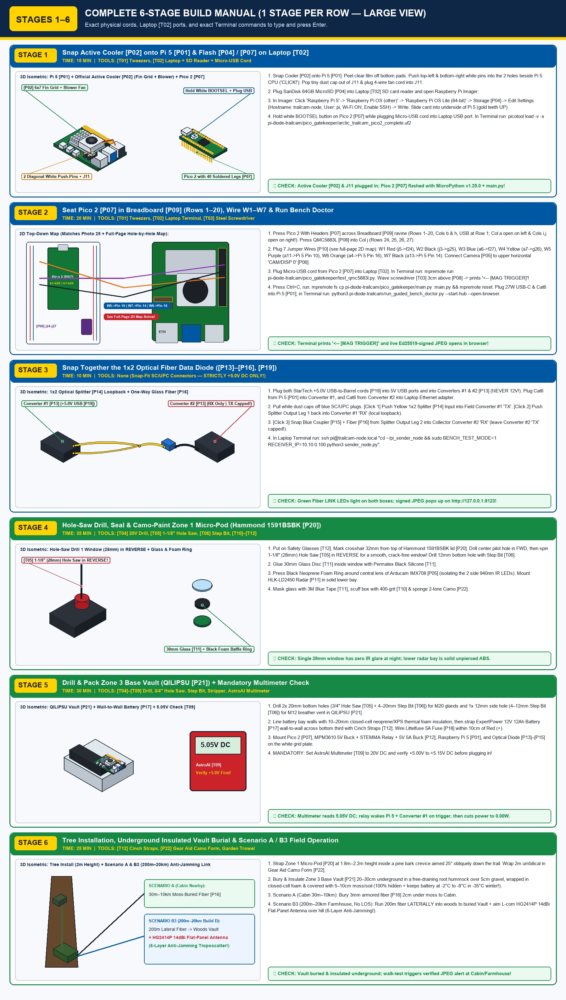

### Step 1.1 — Snap the Active Cooler (`[P02]`) onto the `Raspberry Pi 5 (8GB)` (`[P01]`)

1. Unplug all power cables from the **`Raspberry Pi 5 (8GB)` (`[P01]`)** and set it flat on the table with the silver USB and Ethernet ports facing right. *(Confirm you are holding the **`Raspberry Pi 5 (8GB)` `[P01]`**—its silver Ethernet port is at the **bottom-right corner**, and you will see **two empty round mounting holes** on either side of the silver processor chip.)*
2. Pick up the **Pi 5 Official Active Cooler (`[P02]`)** and turn it upside down.
3. **CRITICAL:** Use your fingernail or tweezers (`[T01]`) to **peel off the clear plastic protective sheet** covering the pink/blue sticky thermal pads on the bottom of the cooler.
4. Hold the cooler right-side up over the **`Raspberry Pi 5 (8GB)` (`[P01]`)** so the two white plastic push-pins line up with the **two round mounting holes** on either side of the silver processor chip.
5. Press both white push-pins straight down with your thumbs until you hear two crisp **`CLICK`** sounds.
6. **Pop out the factory plastic dust cap from `J11` & plug in the 4-wire fan cable:** Look at the tiny white **4-pin `FAN` socket (`J11`)** at the top-right corner of the **`Raspberry Pi 5 (8GB)` (`[P01]`)** (between the black USB 2.0 ports and the 40 gold GPIO pins). A brand-new `Raspberry Pi 5` ships with a tiny removable cream-white plastic **pick-and-place dust cap** sitting inside `J11`. Use a fine tip, fingernails, or tweezers (`[T01]`) to gently lift and pop that tiny plastic cap straight up out of `J11`, then push the white 4-pin connector on the cooler's **4-wire cable** (`black/red/yellow/blue`) straight down into the open `J11` socket. *Which way it fits:* The tiny raised plastic guides on one side of the plug slide into the matching notch on the socket—do not force it upside down.

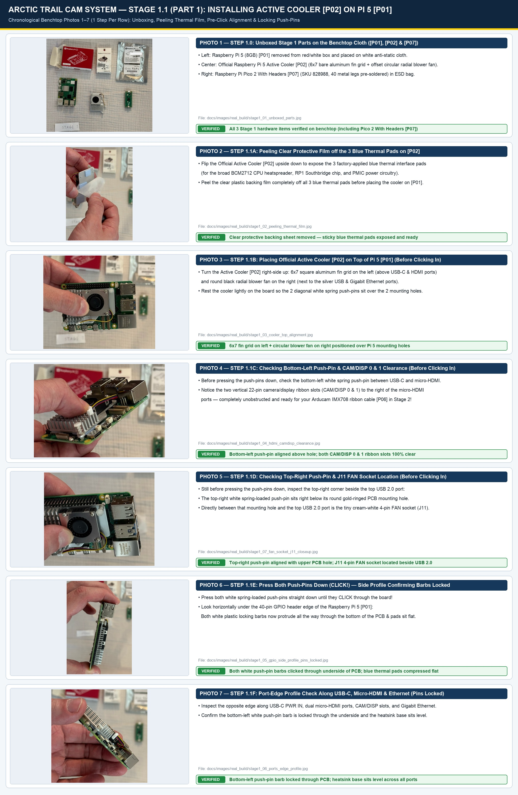


* **Documented Real-World Stage 1.1 Prototype Build Photos (`11` Chronological Shots, `Photos 1–11`):**
  1. [Photo 1 (`stage1_01_unboxed_parts.jpg`)](images/real_build/stage1_01_unboxed_parts.jpg) — **Step 1.0:** Unboxed `Raspberry Pi 5 [P01]`, `Official Active Cooler [P02]`, and `Raspberry Pi Pico 2 With Headers [P07]` (`SKU 828988`, 40 pins pre-soldered) on the anti-static cloth.
  2. [Photo 2 (`stage1_02_peeling_thermal_film.jpg`)](images/real_build/stage1_02_peeling_thermal_film.jpg) — **Step 1.1A:** Peeling the clear protective backing sheet off the 3 blue thermal pads on the underside of `Official Active Cooler [P02]`.
  3. [Photo 3 (`stage1_03_cooler_top_alignment.jpg`)](images/real_build/stage1_03_cooler_top_alignment.jpg) — **Step 1.1B (Before Clicking Pins In):** Top-down alignment of `Active Cooler [P02]` (`6×7` bare aluminum fin grid on left, offset circular radial blower fan on right) positioned lightly over `Raspberry Pi 5 [P01]`.
  4. [Photo 4 (`stage1_04_hdmi_camdisp_clearance.jpg`)](images/real_build/stage1_04_hdmi_camdisp_clearance.jpg) — **Step 1.1C (Before Clicking Pins In):** Checking the bottom-left white spring push-pin by `USB-C` and clearance beside the two `22-pin` `CAM/DISP 0 & 1` ribbon slots prior to pressing the pins down.
  5. [Photo 5 (`stage1_07_fan_socket_j11_closeup.jpg`)](images/real_build/stage1_07_fan_socket_j11_closeup.jpg) — **Step 1.1D (Before Clicking Pins In):** Checking the top-right white spring push-pin aligned over its upper PCB mounting hole and locating the cream-white `J11` 4-pin `FAN` socket right beside the top `USB 2.0` port.
  6. [Photo 6 (`stage1_05_gpio_side_profile_pins_locked.jpg`)](images/real_build/stage1_05_gpio_side_profile_pins_locked.jpg) — **Step 1.1E (Push-Pins Clicked In):** Press both white push-pins straight down (`CLICK!`). Side profile along the 40-pin GPIO header confirming both white push-pin barbs clicked completely through the underside of the `Raspberry Pi 5` PCB with blue thermal pads compressed flat.
  7. [Photo 7 (`stage1_06_ports_edge_profile.jpg`)](images/real_build/stage1_06_ports_edge_profile.jpg) — **Step 1.1F (Push-Pins Clicked In):** Port-edge profile along `USB-C`, dual `micro-HDMI`, `CAM/DISP`, and Gigabit Ethernet confirming the bottom-left push-pin barb is locked through the PCB and the heatsink sits level.
  8. [Photo 8 (`stage1_07b_pointing_at_j11_dust_cap.jpg`)](images/real_build/stage1_07b_pointing_at_j11_dust_cap.jpg) — **Step 1.1G:** With both push-pins locked in, pointing at the tiny cream-white factory plastic pick-and-place dust cap sitting inside the `J11` 4-pin `FAN` socket.
  9. [Photo 9 (`stage1_07c_prying_j11_dust_cap.jpg`)](images/real_build/stage1_07c_prying_j11_dust_cap.jpg) — **Step 1.1H:** Gently levering and popping the tiny cream-white factory dust cap straight up out of the `J11` `FAN` socket.
  10. [Photo 10 (`stage1_07d_j11_cap_removed_socket_open.jpg`)](images/real_build/stage1_07d_j11_cap_removed_socket_open.jpg) — **Step 1.1I:** Removed factory dust cap held in the right hand, exposing the 4 vertical metal pins inside the open `J11` `FAN` socket on `Raspberry Pi 5 [P01]` (left hand).
  11. [Photo 11 (`stage1_07e_fan_cable_plugged_into_j11.jpg`)](images/real_build/stage1_07e_fan_cable_plugged_into_j11.jpg) — **Step 1.1J:** White 4-pin fan plug (`black/red/yellow/blue`) seated all the way down into `J11` beside the top `USB 2.0` port — **Active Cooler `[P02]` installation 100% complete!**

### Step 1.2 — Flash the MicroSD Card (`[P04]`) for the `Raspberry Pi 5 (8GB)` (`[P01]`) on Your MacBook Pro (`[T02]`)

1. **Plug the SD card into your MacBook Pro (`[T02]`):** Slide the **`SanDisk 64GB` MicroSD card (`[P04]`)** into its SD adapter sleeve and push it into the **SDXC slot on the right side of your MacBook Pro** (or plug your USB MicroSD card reader into a **`USB-C` port on the side of your MacBook Pro**).
2. **Open Terminal on your MacBook Pro:** Press **`⌘ Cmd + Space`** on your MacBook Pro keyboard to open Spotlight Search, type **`Terminal`**, and press **`Enter` (`Return`)**.
3. **Launch Raspberry Pi Imager from Terminal:** Type this exact command in Terminal and press **`Enter`**:
   ```bash
   open -a "Raspberry Pi Imager"
   ```
   *(If Raspberry Pi Imager is not installed yet, type `brew install --cask raspberry-pi-imager && open -a "Raspberry Pi Imager"` and press **`Enter`**).*
4. Follow the exact screens below in the Raspberry Pi Imager window (click each choice in order):
   * **Screen 1 — Choose Device:** Click **`Raspberry Pi 5`** (for your `Raspberry Pi 5 (8GB) [P01]`).
   * **Screen 2 — Choose OS:** Click **`Raspberry Pi OS (other)`** $\rightarrow$ select **`Raspberry Pi OS Lite (64-bit)`** (no desktop needed, boots fastest).
   * **Screen 3 — Choose Storage:** Select your `SanDisk 64GB` MicroSD card (`[P04]`).
   * **Screen 4 — OS Customisation (`Edit Settings`):**
     * **Hostname:** Check **`Set hostname:`** and type `trailcam-node`
     * **Username & Password:** Check **`Set username and password:`** $\rightarrow$ type username `pi` and password `trailcam` (or your own password).
     * **Wireless LAN (Bench Setup Only):** Check **"Configure wireless LAN"** and enter your home Wi-Fi name (`SSID`) and password so your MacBook Pro can talk to the Pi 5 over Wi-Fi during initial setup.
     * **Services Tab:** Click the **`SERVICES`** tab at the top $\rightarrow$ check **"Enable SSH"** and select **"Use password authentication"**.
   * **Screen 5 — Write:** Click **`SAVE`** $\rightarrow$ click **`YES`** $\rightarrow$ enter your MacBook Pro password when prompted, and wait ~2 minutes until Raspberry Pi Imager says **"Write Successful — You can now remove the SD card from the reader"**.

````carousel
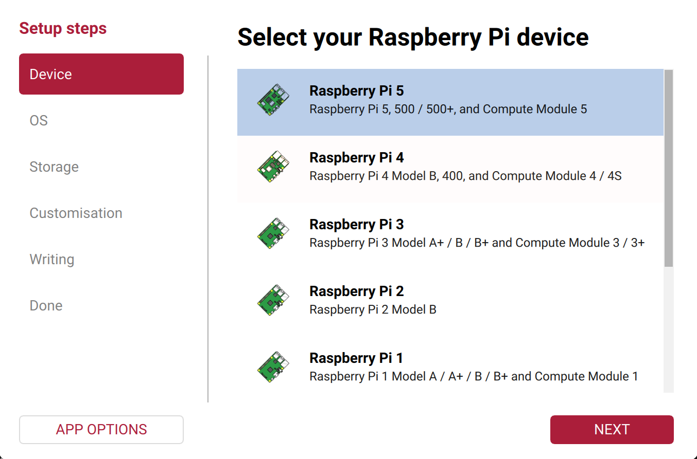
<!-- slide -->

<!-- slide -->

<!-- slide -->
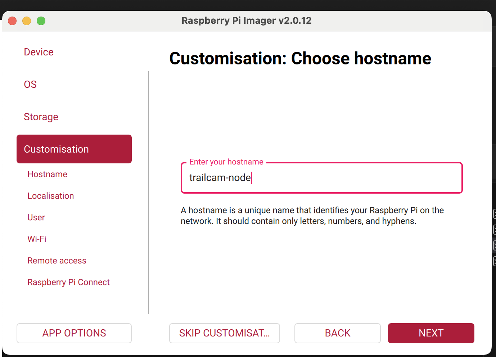
<!-- slide -->
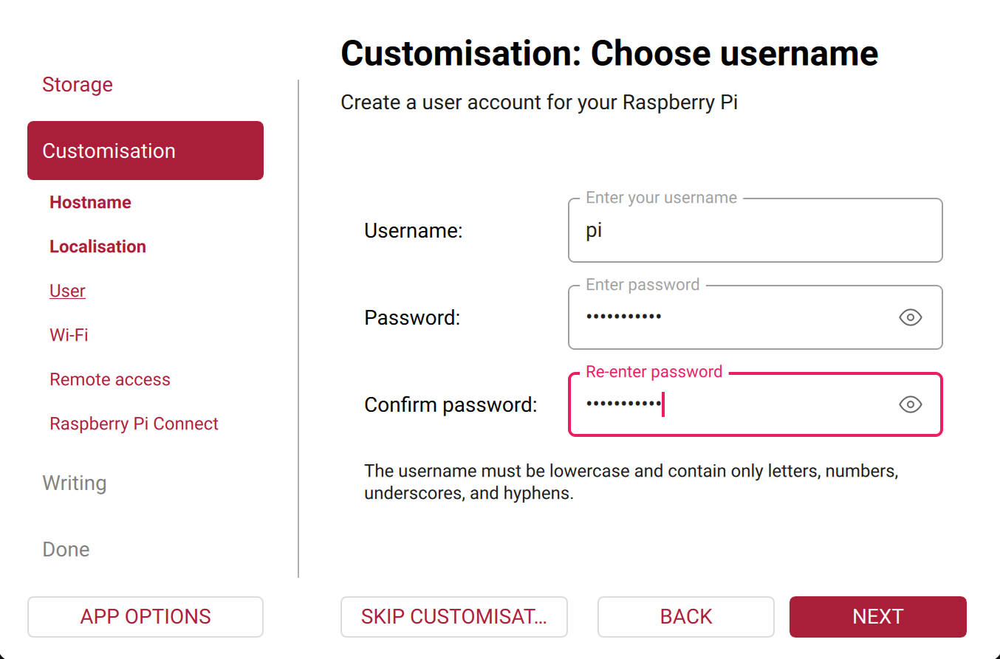
<!-- slide -->
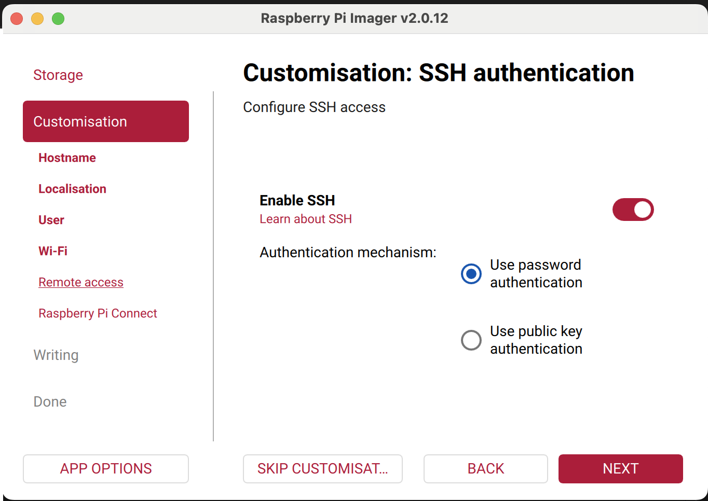
<!-- slide -->
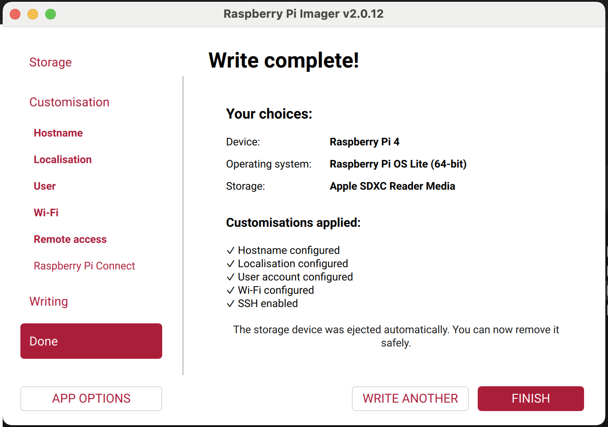
````

### Step 1.3 — Insert the MicroSD Card (`[P04]`) into the Underside of the `Raspberry Pi 5 (8GB)` (`[P01]`)

* **Which board & where the slot is:**
  * The MicroSD card (`[P04]`) goes into the **`Raspberry Pi 5 (8GB)` (`[P01]`)**—*not* the tiny `Pico 2` (`[P07]`), which has no SD slot.
  * On the **`Raspberry Pi 5 (8GB)` (`[P01]`)**, the metal MicroSD card slot is on the **flat green UNDERSIDE (bottom face)** of the board, under the left edge opposite the USB/Ethernet ports.
* **Which way it fits (`✓ CORRECT` — See Panel 1 of the Isometric Orientation Guide):**
  1. Flip the **`Raspberry Pi 5 (8GB)` (`[P01]`)** **upside down** so you are looking at the flat green underside of the board.
  2. Hold the **`SanDisk 64GB` MicroSD card (`[P04]`)** so its **shiny gold metal contact teeth face UP toward the green `Raspberry Pi 5` circuit board** (and the printed red/grey SanDisk label faces DOWN toward the tabletop, away from the green board).
  3. Slide the card straight into the silver metal slot until it stops flat (`~12 mm` deep). Flip the **`Raspberry Pi 5 (8GB)` (`[P01]`)** back right-side up.

### Step 1.4 — Plug the `Pico` into Your MacBook Pro (`[T02]`) & Flash MicroPython from Terminal

1. Take a **Micro-USB data cable** (with a `USB-C` plug or `USB-A to USB-C` adapter on the computer end). Plug the **`USB-C` end into a USB-C port on the left side of your MacBook Pro (`[T02]`)** (right beside the `esc` / `tab` / `caps lock` keys)—leave the small **Micro-USB end** unplugged in your hand.
2. Pick up the stick-of-gum-sized **`Raspberry Pi Pico 2 with Headers` (`[P07]`, 40 metal legs underneath)** *(or your bare Pico from the silver bag to test Stage 1)*. Find the tiny white rectangular button on top of the board labeled **`BOOTSEL`** (near the silver Micro-USB port).
3. **Press and hold down the white `BOOTSEL` button with your fingertip**, and **while still holding `BOOTSEL` down**, push the **Micro-USB plug** **firmly all the way in** (past the 2 tiny silver retention barbs on the metal tongue) into the Pico's silver Micro-USB port. Release your finger after 1 second.
4. Go to the **Terminal window on your MacBook Pro**, copy-paste this **exact command** (which flashes the all-in-one `arctic_trailcam_pico2_complete.uf2` containing **both** official MicroPython `v1.25.0` **and** pre-loaded `main.py` + `test_qmc5883l.py` at `0x10100000` with zero macOS metadata files), and press **`Enter`**:
   ```bash
   export COPYFILE_DISABLE=1; UF2="pi-diode-trailcam/pico_gatekeeper/arctic_trailcam_pico2_complete.uf2"; xattr -c "$UF2" 2>/dev/null; if command -v picotool >/dev/null 2>&1; then picotool load -v -x "$UF2" && echo "SUCCESS: Flashed Pico 2 (RP2350) with MicroPython v1.25.0 + main.py + test_qmc5883l.py!"; elif [ -d /Volumes/RP2350 ]; then mdutil -i off /Volumes/RP2350 >/dev/null 2>&1; rm -rf /Volumes/RP2350/.Spotlight-V100 /Volumes/RP2350/.fseventsd /Volumes/RP2350/._* 2>/dev/null; cp -X "$UF2" /Volumes/RP2350/ && echo "SUCCESS: Flashed Pico 2 (RP2350)!"; else echo "Pico drive not found — unplug USB-C, hold white BOOTSEL button, and plug back in!"; fi
   ```
5. **What you should see:** Terminal prints **`Verifying Flash: 100% OK`** and **`SUCCESS: Flashed Pico 2 (RP2350) with MicroPython v1.25.0 + main.py + test_qmc5883l.py!`** — installing both MicroPython and the complete Gatekeeper application in one single step!

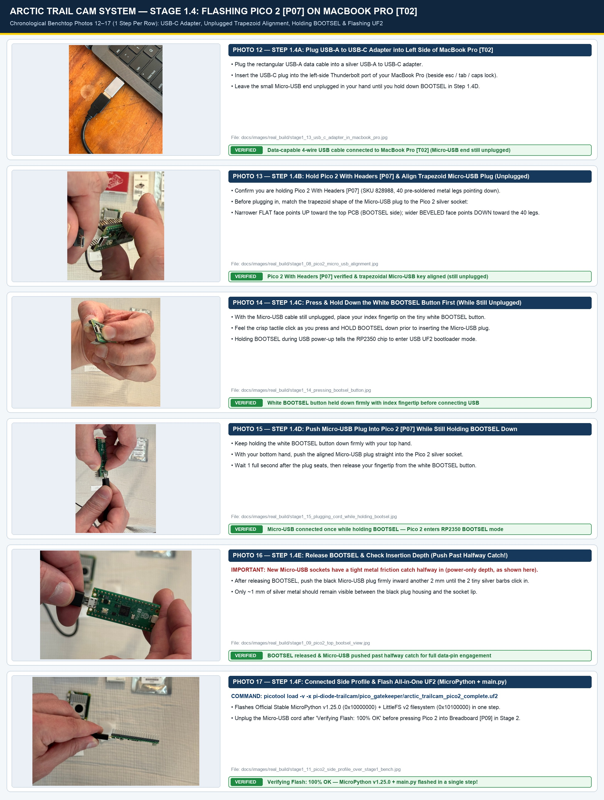

* **Documented Real-World Stage 1 `Pico 2 [P07]` & `MacBook Pro [T02]` USB Setup & `BOOTSEL` Flashing Photos (`6` Chronological Shots Connecting `Pico 2` Once With `BOOTSEL` Pressed, `Photos 12–17`):**
  12. [Photo 12 (`stage1_13_usb_c_adapter_in_macbook_pro.jpg`)](images/real_build/stage1_13_usb_c_adapter_in_macbook_pro.jpg) — **Step 1.4A (Pico Unplugged):** Plugging the rectangular `USB-A` cable + silver `USB-A to USB-C` adapter into the left-side `USB-C` (`Thunderbolt`) port of the MacBook Pro (`[T02]`) beside `esc` / `tab` / `caps lock`, leaving the small Micro-USB end unplugged in your hand.
  13. [Photo 13 (`stage1_08_pico2_micro_usb_alignment.jpg`)](images/real_build/stage1_08_pico2_micro_usb_alignment.jpg) — **Step 1.4B (Pico Unplugged):** Holding `Pico 2 With Headers [P07]` (`SKU 828988`, 40 pre-soldered metal legs pointing down) and aligning the trapezoid key of the unplugged Micro-USB plug to the `Pico 2 [P07]` socket (`narrow flat face toward top of PCB / BOOTSEL`, `wider beveled face toward the 40 long metal header pins`).
  14. [Photo 14 (`stage1_14_pressing_bootsel_button.jpg`)](images/real_build/stage1_14_pressing_bootsel_button.jpg) — **Step 1.4C (Pico Unplugged):** Pressing and holding down the white **`BOOTSEL` button** on `Pico 2 With Headers [P07]` with the index fingertip before inserting the Micro-USB plug.
  15. [Photo 15 (`stage1_15_plugging_cord_while_holding_bootsel.jpg`)](images/real_build/stage1_15_plugging_cord_while_holding_bootsel.jpg) — **Step 1.4D (Connecting With `BOOTSEL` Held):** Pushing the Micro-USB plug straight into `Pico 2 [P07]` with the bottom hand **while keeping the white `BOOTSEL` button pressed down** with the top hand.
  16. [Photo 16 (`stage1_09_pico2_top_bootsel_view.jpg`)](images/real_build/stage1_09_pico2_top_bootsel_view.jpg) — **Step 1.4E (Connected — Depth Check):** Release `BOOTSEL` 1 second after plugging in and check insertion depth on `Pico 2 [P07]` — push firmly past the halfway friction catch so the 2 tiny silver retention barbs on the Micro-USB tongue slide inside the socket!
  17. [Photo 17 (`stage1_11_pico2_side_profile_over_stage1_bench.jpg`)](images/real_build/stage1_11_pico2_side_profile_over_stage1_bench.jpg) — **Step 1.4F (Connected — Flashing UF2):** `Pico 2 With Headers [P07]` flashed in `BOOTSEL` mode via `picotool load -v -x arctic_trailcam_pico2_complete.uf2` (`Verifying Flash: 100% OK`, bundling `MicroPython v1.25.0 + main.py + test_qmc5883l.py` at `0x10100000`) over the Stage 1 work cloth.

---

## STAGE 2: Exact Hole-by-Hole Breadboard (`[P09]`) & `Raspberry Pi 5 (8GB)` (`[P01]`) Wiring (`7 Wires Total`)

> [!CAUTION]
> **UNPLUG ALL USB POWER CABLES FIRST!** Never plug or unplug breadboard wires while the `Raspberry Pi 5 (8GB)` (`[P01]`) or `Raspberry Pi Pico 2` (`[P07]`) is plugged into power.

Look at the **Isometric Hole-by-Hole Breadboard & `Raspberry Pi 5 (8GB)` GPIO Wiring Map** below. Every single connection is listed by its exact **Row Number (`1–30`)** and **Column Letter (`a–j`)**.

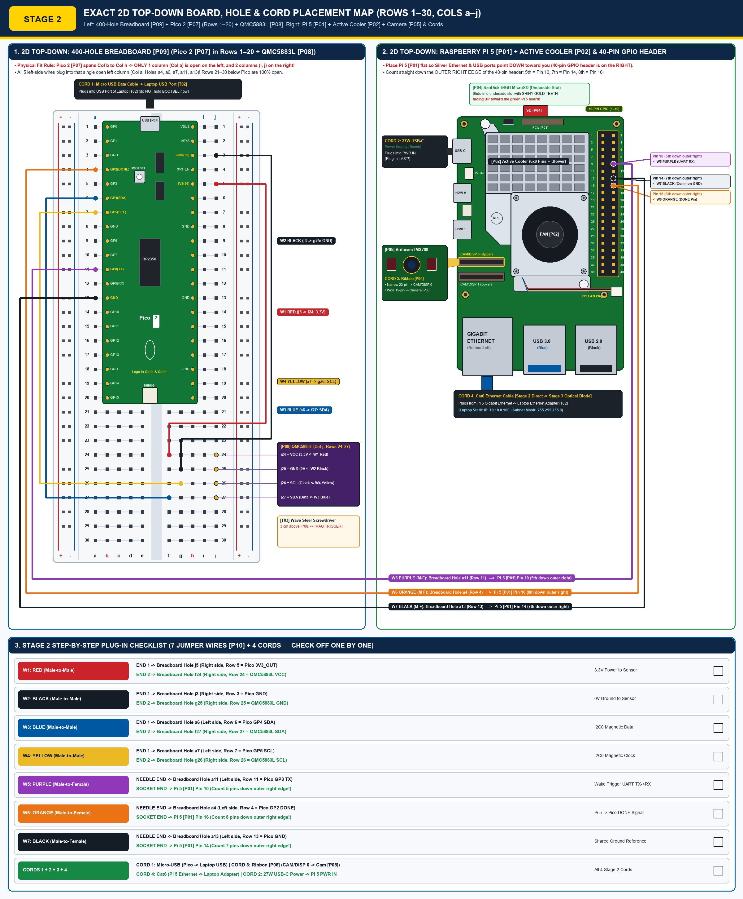

### How Your Half-Size Breadboard (`[P09]`) Works (In 20 Seconds)

* Turn the white breadboard (`[P09]`) so **`Row 1` is at the TOP** and **`Row 30` is at the BOTTOM**.
* Down the middle runs a deep vertical groove called the **center canyon (ravine)**.
* On the **left side** of the canyon, in any single row (for example, `Row 6`), the 5 holes **`a6`, `b6`, `c6`, `d6`, `e6`** are connected together underneath by one hidden metal clip.
* On the **right side** of the canyon, in any single row (for example, `Row 5`), the 5 holes **`f5`, `g5`, `h5`, `i5`, `j5`** are connected together underneath by a separate metal clip.
* The left side (`a–e`) and right side (`f–j`) are **not** connected to each other across the center canyon.

### Step 2.1 — Press the `Raspberry Pi Pico 2` (`[P07]`) into `Rows 1–20` (`Columns b & h` — **DONE in Photos 18–23!**)

1. Hold the **`Raspberry Pi Pico 2 With Headers` (`[P07]`)** over the top of the breadboard (`[P09]`) so its **silver Micro-USB port points UP at `Row 1`**.
2. Line up the **left row of 20 metal legs** over **Column `b`, `Rows 1 to 20`** (`Hole b1` at the top down to `Hole b20`).
3. Line up the **right row of 20 metal legs** over **Column `h`, `Rows 1 to 20`** (`Hole h1` at the top down to `Hole h20`).
4. Check that the green `Pico 2` board bridges straight across the center canyon, leaving **1 open column on the left (`Column a`: `a1–a20`)** and **2 open columns on the right (`Columns i, j`: `i1–j20`)** in every row from `1` to `20`.
5. Press straight down firmly and evenly with both thumbs until the black plastic pin strips sit completely flat against the white breadboard surface (verified in `Photos 18–23` below!).

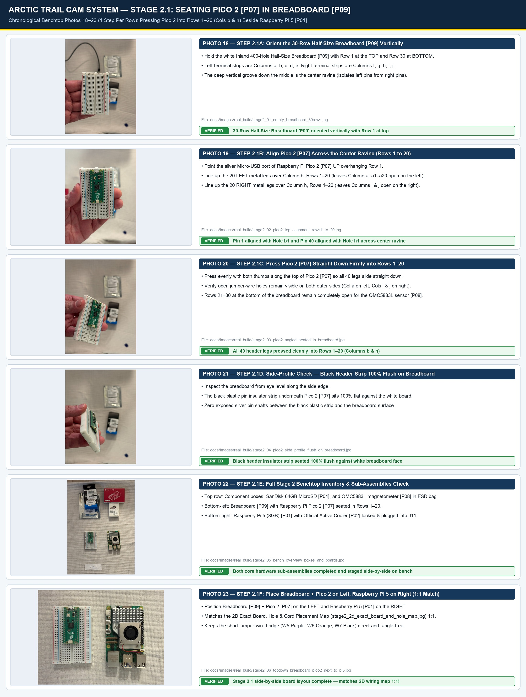

* **Documented Real-World Stage 2.1 `Breadboard [P09]` + `Pico 2 [P07]` Seating Photos (`6` Chronological Shots, `Photos 18–23`):**
  18. [Photo 18 (`stage2_01_empty_breadboard_30rows.jpg`)](images/real_build/stage2_01_empty_breadboard_30rows.jpg) — **Step 2.1A:** Holding the empty `30-Row` **`Inland 400-Hole Half-Size Breadboard [P09]`** vertically (`Row 1` at top, `Row 30` at bottom, center ravine between `Column e` and `Column f`, plus outer red `+` and blue `-` power rails).
  19. [Photo 19 (`stage2_02_pico2_top_alignment_rows1_to_20.jpg`)](images/real_build/stage2_02_pico2_top_alignment_rows1_to_20.jpg) — **Step 2.1B:** Top-down alignment of **`Raspberry Pi Pico 2 With Headers [P07]`** across the center ravine (`Rows 1 to 20`), with the silver Micro-USB port overhanging `Row 1` at the top.
  20. [Photo 20 (`stage2_03_pico2_angled_seated_in_breadboard.jpg`)](images/real_build/stage2_03_pico2_angled_seated_in_breadboard.jpg) — **Step 2.1C:** Angled inspection after pressing `Pico 2 [P07]` straight down into `Rows 1–20`, leaving open holes beside the Pico on both left and right, with `Rows 21–30` completely open below.
  21. [Photo 21 (`stage2_04_pico2_side_profile_flush_on_breadboard.jpg`)](images/real_build/stage2_04_pico2_side_profile_flush_on_breadboard.jpg) — **Step 2.1D:** Side-profile seating check confirming the black plastic header strip of `Pico 2 [P07]` is pressed 100% flush against the white plastic face of `Breadboard [P09]` with zero exposed silver pin metal.
  22. [Photo 22 (`stage2_05_bench_overview_boxes_and_boards.jpg`)](images/real_build/stage2_05_bench_overview_boxes_and_boards.jpg) — **Step 2.1E:** Full benchtop overview showing the component boxes, `SanDisk 64GB MicroSD Card [P04]` (in blue/black pack), and `QMC5883L [P08]` (in silver anti-static bag) at top, and the two assembled sub-units (`Breadboard + Pico 2` on left, `Raspberry Pi 5 + Active Cooler` on right) at bottom.
  23. [Photo 23 (`stage2_06_topdown_breadboard_pico2_next_to_pi5.jpg`)](images/real_build/stage2_06_topdown_breadboard_pico2_next_to_pi5.jpg) — **Step 2.1F:** High-resolution close-up of `Breadboard [P09] + Pico 2 [P07]` (`Rows 1–20`) side-by-side next to `Raspberry Pi 5 [P01] + Official Active Cooler [P02]` — matching the 2D diagram above 1:1!

### Step 2.2 — Press the `QMC5883L` Magnetometer (`[P08]`) into `Rows 24–27` (`Column j`)

1. Pick up the tiny **`QMC5883L` sensor (`[P08]`)** and look at the 4 white letters printed next to its 4 metal legs: **`VCC`**, **`GND`**, **`SCL`**, **`SDA`**.
2. Move down below the `Pico 2` on the **outer right edge** of the breadboard (**Column `j`**), leaving `Rows 21, 22, 23` completely empty as a gap.
3. Line the 4 metal legs of the `QMC5883L` up vertically in **Column `j`, `Rows 24, 25, 26, and 27`** so that:
   * **`Row 24, Hole j24`** = **`VCC`** leg *(leaves `Holes f24, g24, h24, i24` in the same row open for the Red `W1` wire)*
   * **`Row 25, Hole j25`** = **`GND`** leg *(leaves `Holes f25, g25, h25, i25` in the same row open for the Black `W2` wire)*
   * **`Row 26, Hole j26`** = **`SCL`** leg *(leaves `Holes f26, g26, h26, i26` in the same row open for the Yellow `W4` wire)*
   * **`Row 27, Hole j27`** = **`SDA`** leg *(leaves `Holes f27, g27, h27, i27` in the same row open for the Blue `W3` wire)*
   *(Note: If the pin order printed on your specific `GY-271` board puts `SDA` at `Row 26` and `SCL` at `Row 27`, simply match the `Blue SDA wire` to the `SDA` row and the `Yellow SCL wire` to the `SCL` row in Step 2.3!)*
4. Press the sensor straight down until its 4 legs seat firmly into **`Holes j24, j25, j26, j27`**.

### Step 2.3 — Plug the 7 Color-Coded Jumper Wires (`[P10]`, Arriving Tomorrow Oct 16 in Amazon Batch 2) One at a Time

Check off each wire (`[ ]`) as you push its metal pin straight into the exact hole listed below:

| Check | Wire ID & Color | Wire Type | Plug END 1 Into Breadboard Hole... | Plug END 2 Into... | What This Wire Does |
| :---: | :--- | :--- | :--- | :--- | :--- |
| `[ ]` | **`W1` — RED** | Male-to-Male *(needle both ends)* | **`Hole j5`** *(Right side, Row 5 = `Pico 2` Pin 36 `3V3_OUT`)* | **`Hole f24`** *(Right side, Row 24 = `QMC5883L VCC`)* | Sends safe `3.3V` power from `Pico 2` to Magnetometer. |
| `[ ]` | **`W2` — BLACK** | Male-to-Male *(needle both ends)* | **`Hole j3`** *(Right side, Row 3 = `Pico 2` Pin 38 `GND`)* | **`Hole g25`** *(Right side, Row 25 = `QMC5883L GND`)* | Connects Ground (`0V`) to Magnetometer. |
| `[ ]` | **`W3` — BLUE** | Male-to-Male *(needle both ends)* | **`Hole a6`** *(Left side open Col a, Row 6 = `Pico 2` Pin 6 `GP4 SDA`)* | **`Hole f27`** *(Right side, Row 27 = `QMC5883L SDA`)* | Carries `I2C` Magnetic Data (`SDA`). |
| `[ ]` | **`W4` — YELLOW** | Male-to-Male *(needle both ends)* | **`Hole a7`** *(Left side open Col a, Row 7 = `Pico 2` Pin 7 `GP5 SCL`)* | **`Hole g26`** *(Right side, Row 26 = `QMC5883L SCL`)* | Carries `I2C` Magnetic Clock (`SCL`). |
| `[ ]` | **`W5` — PURPLE** | Male-to-Female *(needle + socket)* | **Needle end $\rightarrow$ `Hole a11`** *(Left side open Col a, Row 11 = `Pico 2` Pin 11 `GP8 TX`)* | **Socket end $\rightarrow$ `Raspberry Pi 5 [P01]` `Pin 10` (`GPIO15 RX`)** *(**5th pin down** on the **outer right edge** of Pi 5)* | Sends `TRIG,...` wake reason from `Pico 2` to `Raspberry Pi 5`. |
| `[ ]` | **`W6` — ORANGE** | Male-to-Female *(needle + socket)* | **Needle end $\rightarrow$ `Hole a4`** *(Left side open Col a, Row 4 = `Pico 2` Pin 4 `GP2 DONE`)* | **Socket end $\rightarrow$ `Raspberry Pi 5 [P01]` `Pin 16` (`GPIO23`)** *(**8th pin down** on the **outer right edge** of Pi 5)* | Sends `DONE` signal from `Raspberry Pi 5` back to `Pico 2`. |
| `[ ]` | **`W7` — BLACK** | Male-to-Female *(needle + socket)* | **Needle end $\rightarrow$ `Hole a13`** *(Left side open Col a, Row 13 = `Pico 2` Pin 13 `GND`)* | **Socket end $\rightarrow$ `Raspberry Pi 5 [P01]` `Pin 14` (`GND`)** *(**7th pin down** on the **outer right edge** of Pi 5)* | Shared Ground reference between `Pico 2` and `Raspberry Pi 5`. |

> [!TIP]
> **How to Count the 3 Pins on the `Raspberry Pi 5 (8GB)` (`[P01]`) Without Ever Making a Mistake:**
> 1. Place the **`Raspberry Pi 5 (8GB)` (`[P01]`)** flat on the table so the **silver USB and Gigabit Ethernet ports point DOWN toward you**, and the **2 long rows of 20 gold pins (`40 pins total`) run vertically along the RIGHT-HAND EDGE**.
> 2. Look only at the **OUTER RIGHT COLUMN of gold pins** (the column closest to the right-hand edge of the green board).
> 3. Starting from the **very top-right corner pin (`Pin 2`)**, count straight down that outer right edge:
>    * `1st down (Pin 2)` — skip
>    * `2nd down (Pin 4)` — skip
>    * `3rd down (Pin 6)` — skip
>    * `4th down (Pin 8)` — skip
>    * **`5th down (Pin 10)` $\rightarrow$ Push `W5 PURPLE` Female socket straight down onto this pin!**
>    * `6th down (Pin 12)` — skip
>    * **`7th down (Pin 14)` $\rightarrow$ Push `W7 BLACK` Female socket straight down onto this pin!**
>    * **`8th down (Pin 16)` $\rightarrow$ Push `W6 ORANGE` Female socket straight down onto this pin!**

### Step 2.4 — Connect the Camera Ribbon Cable (`[P06]`) Between `Raspberry Pi 5 (8GB)` (`[P01]`) & `Arducam IMX708` (`[P05]`)

1. Make sure the **`Raspberry Pi 5 (8GB)` (`[P01]`)** is still **unplugged from power**.
2. Find the narrow vertical camera slot labeled **`CAM/DISP 0`** on top of the **`Raspberry Pi 5 (8GB)` (`[P01]`)** (located between the two micro-HDMI ports and the bottom-right silver Ethernet port).
3. Use your pointed tweezers or two fingernails (`[T01]`) to gently pull the thin black plastic locking collar on `CAM/DISP 0` **straight up by `2 mm`** until it slides loose (do not pull it off the board!).
4. Take the **narrower end (`22-pin`, `12 mm` wide)** of the Camera Ribbon Cable (`[P06]`) and slide it straight down into `CAM/DISP 0` with the **shiny gold metal teeth facing TOWARD the silver Ethernet port** (and the blue/black backing tape facing the micro-HDMI ports). Push the black locking collar back down `2 mm` to lock it (`CLICK`).
5. On the bottom of the **`Arducam IMX708 NoIR` camera board (`[P05]`)**, pull its black plastic latch collar out by `2 mm`, slide the **wider end (`15-pin`, `16 mm` wide)** of the ribbon cable in with the **shiny silver metal contacts facing TOWARD the green camera circuit board** (and the blue backing tape facing away from the green board), and push the latch closed. Gently tug the ribbon with two fingers to confirm neither end slips out.

### Step 2.5 — Connect `Pico 2` (`[P07]`), Pre-Stage Refactored Code onto `SanDisk 64GB MicroSD` (`[P04]` — **DONE in Photos 24–30!**) & Test `QMC5883L` (`0x0d`)

1. **Connect Micro-USB to `Pico 2 [P07]` on `Breadboard [P09]` & Pre-Stage Refactored `pi5_sender_node/` Code onto `SanDisk 64GB MicroSD [P04]` with Zero macOS Metadata (`DONE — Photos 24–30`):**
   * Plug the black Micro-USB data cable (`CORD 1`) firmly all the way into `Pico 2 [P07]` on `Breadboard [P09]` (`Photo 24`).
   * Slide the **`SanDisk 64GB MicroSD Card [P04]`** into the **`SanDisk microSD Adapter`** (`Photos 25–27`) and insert it into the **right-side SDXC slot of your MacBook Pro (`[T02]`)** (`Photo 28`).
   * On `/Volumes/bootfs`, our automated staging helper (`stage_sd_card_without_macos_metadata()` in `run_guided_bench_doctor.py`) disables macOS Spotlight indexing (`mdutil -i off /Volumes/bootfs`), writes the refactored [`pi5_sender_node/`](../pi5_sender_node/sender_node.py) files as pure byte streams (`COPYFILE_DISABLE=1`, zero `._*` or `.DS_Store` files), enables `dtparam=uart0=on` & `enable_uart=1` in `config.txt`, configures `cloud-init` (`user-data`) to auto-install `/home/pi/pi5_sender_node`, and safely ejects `/Volumes/bootfs`.
   * Flip **`Raspberry Pi 5 [P01]`** upside down (`FCC ID: 2ABCB-RPI5`) and slide the `SanDisk 64GB MicroSD Card [P04]` into the underside metal `J9` slot with the **shiny gold contact teeth facing UP toward the green Pi 5 board** (`Photos 29–30`).

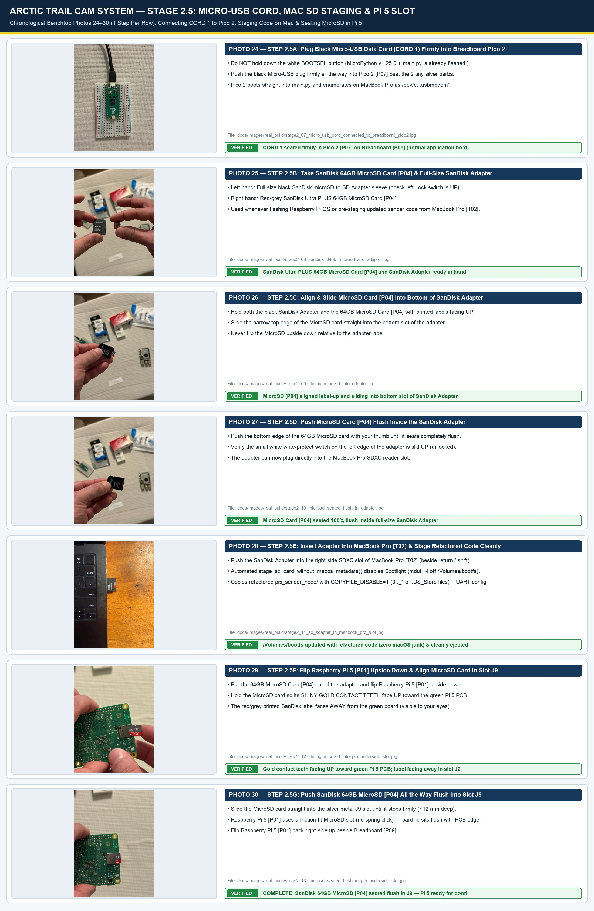

* **Documented Real-World Stage 2.5 `Pico 2 [P07]` USB Cord, `SanDisk 64GB MicroSD [P04]` Adapter, MacBook Pro Staging & `Raspberry Pi 5 [P01]` Insertion Photos (`7` Chronological Shots, `Photos 24–30`):**
  24. [Photo 24 (`stage2_07_micro_usb_cord_connected_to_breadboard_pico2.jpg`)](images/real_build/stage2_07_micro_usb_cord_connected_to_breadboard_pico2.jpg) — **Step 2.5A:** Connecting the black Micro-USB data cord (`CORD 1`) to `Pico 2 [P07]` on `Breadboard [P09]` **without holding `BOOTSEL`** (push the Micro-USB plug firmly all the way in past the 2 tiny silver retention barbs!).
  25. [Photo 25 (`stage2_08_sandisk_64gb_microsd_and_adapter.jpg`)](images/real_build/stage2_08_sandisk_64gb_microsd_and_adapter.jpg) — **Step 2.5B:** Holding the black `SanDisk microSD Adapter` in the left hand and the red/grey `SanDisk Ultra Plus 64GB MicroSD Card [P04]` in the right hand.
  26. [Photo 26 (`stage2_09_sliding_microsd_into_adapter.jpg`)](images/real_build/stage2_09_sliding_microsd_into_adapter.jpg) — **Step 2.5C:** Sliding the `SanDisk 64GB MicroSD Card [P04]` into the bottom slot of the `SanDisk Adapter` with both printed labels facing up.
  27. [Photo 27 (`stage2_10_microsd_seated_flush_in_adapter.jpg`)](images/real_build/stage2_10_microsd_seated_flush_in_adapter.jpg) — **Step 2.5D:** Pushing the `SanDisk 64GB MicroSD Card [P04]` all the way flush into the bottom of the `SanDisk Adapter`.
  28. [Photo 28 (`stage2_11_sd_adapter_in_macbook_pro_slot.jpg`)](images/real_build/stage2_11_sd_adapter_in_macbook_pro_slot.jpg) — **Step 2.5E:** Inserting the `SanDisk Adapter + 64GB MicroSD Card [P04]` into the right-side SDXC slot of the `MacBook Pro [T02]` beside the `delete`, `\`, `return`, and `shift` keys.
  29. [Photo 29 (`stage2_12_sliding_microsd_into_pi5_underside_slot.jpg`)](images/real_build/stage2_12_sliding_microsd_into_pi5_underside_slot.jpg) — **Step 2.5F:** Sliding the updated `SanDisk Ultra PLUS 64GB MicroSD Card [P04]` into the metal `J9` underside slot of `Raspberry Pi 5 [P01]` (`FCC ID: 2ABCB-RPI5`), with shiny gold contact teeth facing UP toward the green board and the red-and-grey printed label facing away.
  30. [Photo 30 (`stage2_13_microsd_seated_flush_in_pi5_underside_slot.jpg`)](images/real_build/stage2_13_microsd_seated_flush_in_pi5_underside_slot.jpg) — **Step 2.5G:** `SanDisk 64GB MicroSD Card [P04]` pushed all the way in and seated flush inside the `Raspberry Pi 5 [P01]` underside `J9` slot — 100% ready for first boot!

2. **Upload Gatekeeper Code to `Pico 2` (`[P07]`) & Test the `QMC5883L` Magnetometer (`0x0d`):**
   * Plug the **Micro-USB data cable** (`Photo 24`) from the **`Raspberry Pi Pico 2` (`[P07]`)** into a **`USB-C` port on your MacBook Pro (`[T02]`)** *(do NOT hold `BOOTSEL` once MicroPython has been flashed via `picotool load -v -x`)*.
   * Go to **Terminal on your MacBook Pro**, type this exact command from the project folder, and press **`Enter`**:

```bash
mpremote run pi-diode-trailcam/pico_gatekeeper/test_qmc5883l.py
```

3. **What you should see:**
   * Terminal prints **`Found QMC5883L at 0x0d`** (decimal `[13]`) and a steady stream of `X / Y / Z / Delta` magnetic readings.
   * Pick up your **small steel screwdriver (`[T03]`)** and wave it within `3 cm` of the `QMC5883L` sensor (`[P08]`). You will immediately see **`<-- [MAG TRIGGER]`** appear on your MacBook Pro screen!
4. Press **`Ctrl + C`** on your MacBook Pro keyboard to stop the test, then copy the gatekeeper firmware onto the `Pico 2` by typing these exact commands and pressing **`Enter`**:

```bash
mpremote fs cp pi-diode-trailcam/pico_gatekeeper/main.py :main.py
mpremote reset
```

> **Note on Sensor Profiles:** At boot, `main.py` automatically detects connected sensors (`FULL_TRIPLE` when both `0x0d` and `0x48` are present, or `MAG_RADAR_DUTY` when only `0x0d` is present). To test automatic single-sensor magnetic wake on the bench before connecting the `HLK-LD2450` radar, either plug a jumper wire from **Breadboard `Hole a19` (`GP14`) to `Hole a18` (`GND`)** at boot or set `BENCH_MAG_ONLY = True` in `pico_gatekeeper/main.py` (`PROFILE_BENCH_MAG_ONLY`).

### Step 2.6 — Plug Power & Ethernet into `Raspberry Pi 5 (8GB)` (`[P01]`), Copy the Sender Software & Send Your First Live Alert on Your MacBook Pro

1. Plug the official **`27W USB-C` power supply** into a wall outlet and plug its `USB-C` cord into the **`USB-C PWR IN` port on the `Raspberry Pi 5 (8GB)` (`[P01]`)**. Wait **`45 seconds`** for it to boot.
2. In **Terminal on your MacBook Pro**, type these two commands one at a time (pressing **`Enter`** after each line, and entering your Pi password `trailcam` when asked) to install the required packages on the `Raspberry Pi 5` and copy the sender folder (with `COPYFILE_DISABLE=1` so no macOS `._*` files are transferred):

```bash
ssh pi@trailcam-node.local "sudo apt update && sudo apt install -y python3-opencv python3-nacl python3-serial python3-picamera2"
COPYFILE_DISABLE=1 scp -r pi-diode-trailcam/pi5_sender_node pi@trailcam-node.local:~/pi_sender_node
```

3. Enable the hardware UART serial port on the `Raspberry Pi 5` (`dtparam=uart0=on`, `enable_uart=1` with serial login console disabled) by typing this exact command in Terminal and pressing **`Enter`**:

```bash
ssh pi@trailcam-node.local "sudo raspi-config nonint do_serial_hw 0 && sudo raspi-config nonint do_serial_cons 1 && sudo reboot"
```

4. Plug a **Cat6 Ethernet cable** between the **`Raspberry Pi 5 (8GB)` (`[P01]`) Gigabit Ethernet port** and your **MacBook Pro's USB-C Ethernet adapter**. Set your MacBook Pro's Ethernet adapter IP address to **`10.10.0.100`** (subnet mask `255.255.255.0` / `/24`, allowing UDP port `5514`). *(In MacBook Pro Terminal, type `networksetup -listallhardwareports` and press **`Enter`** to see your adapter name, then type e.g. `sudo ifconfig en8 10.10.0.100 netmask 255.255.255.0 up` and press **`Enter`**.)*
5. In **Terminal Window #1 on your MacBook Pro**, type this single command and press **`Enter`** to verify your setup, start both the Collector Receiver and Live Web Dashboard (`http://127.0.0.1:8123`), and open your browser automatically (or start the two servers manually below; `ALLOW_EXAMPLE_KEYS=1` is for isolated bench testing only—before field deployment, generate unique keys with `python3 pi5_sender_node/generate_keys.py --node NODE-NORTH-01 --write-node-key ./node_key.json --register-hub ./verified_alerts/authorized_nodes.json`):

```bash
python3 pi-diode-trailcam/run_guided_bench_doctor.py --start-hub --open-browser
```

```bash
# Or manually in Terminal Tab 1 on your MacBook Pro (Collector Receiver):
cd pi-diode-trailcam
ALLOW_EXAMPLE_KEYS=1 python3 collector_hub/receiver_hub.py --out-dir ./verified_alerts
```

```bash
# And manually in Terminal Tab 2 on your MacBook Pro (Live Web Dashboard):
cd pi-diode-trailcam
python3 collector_hub/dashboard_server.py --alerts-dir ./verified_alerts --port 8123
```

6. Open a new tab in **Terminal on your MacBook Pro** (press **`⌘ Cmd + T`**), type this exact command, and press **`Enter`** to trigger a live camera capture from the **`Raspberry Pi 5 (8GB)` (`[P01]`)** (`BENCH_TEST_MODE=1` keeps the Pi 5 powered on after sending so your SSH session does not shut down):

```bash
ssh pi@trailcam-node.local "cd ~/pi_sender_node && sudo BENCH_TEST_MODE=1 RECEIVER_IP=10.10.0.100 python3 sender_node.py"
```

7. **What you should see (`✓ STAGE 2 SUCCESS CHECK`):**
   * Open **`http://127.0.0.1:8123`** in your web browser.
   * Your live camera photo appears in the dashboard gallery with a green **`Ed25519 VERIFIED`** badge!
   * Check `verified_alerts/alerts_journal.jsonl` and confirm `"camera_ok": true`, and verify that UART telemetry (`TRIG,...`) and the `DONE` signal (`GPIO23 -> GP2`) were recorded.

---

## STAGE 3: Snap Together the 1-Way Optical Fiber Data Diode (`[P13]`–`[P16]`, `[P19]`)

Once your copper Ethernet bench test works, replace the direct Cat6 cable with the **One-Way Optical Fiber Data Diode**. Every connection is a tool-free **`CLICK`** snap-fit.

> [!CAUTION]
> **5V ONLY RULE FOR `StarTech MCMGBSCSM10` (`[P13]`):**
> Both black `StarTech` Media Converters operate on **strictly `+5.0V DC` (center-positive)**. Power them using the included `5V` wall adapters or the **`StarTech USB-to-Type-M` `5V` barrel cables (`[P19]`)** plugged into a `5V` USB port. **NEVER connect `12V` battery power directly to the Media Converter barrel jack!**

### Step 3.1 — Click the Blue `SC/UPC` Fiber Plugs Together

1. Set **Media Converter #1 (`[P13]` — Field Side)** next to the Raspberry Pi (`[P01]`), and set **Media Converter #2 (`[P13]` — Collector Side)** next to your computer.
2. Plug a short Cat6 Ethernet cable from the **Raspberry Pi Ethernet port** into **Media Converter #1 `RJ45`**.
3. Plug a second Cat6 Ethernet cable from **Media Converter #2 `RJ45`** into your **computer's Ethernet adapter (`10.10.0.100`)**.
4. Pull the small white plastic **dust caps** off the blue square `SC/UPC` fiber connectors (`[P14]`, `[P16]`) and snap them together in this exact order (match the **raised plastic key tab** on each blue plug to the slot on the socket and push straight in until it **`CLICKS`**):
   * **`[Click 1]` Field Optical Output (`TX`):** Plug the single **Input** plug of the **Yellow `1×2 SC/UPC` Optical Splitter (`[P14]`)** into the **`TX` (Transmit)** port on **Media Converter #1**.
   * **`[Click 2]` Local Carrier-Detect Loopback (`RX`):** Plug **Output Leg 1** of the Yellow `1×2` Splitter into the **`RX` (Receive)** port on **Media Converter #1**. *(Why? Gigabit fiber converters only turn on their RJ45 port when their `RX` eye sees laser light. Looping half the Pi's own laser back into its own `RX` port tricks it into transmitting blindly!)*
   * **`[Click 3]` Outbound One-Way Fiber to Collector (`RX`):** Snap a **Blue `Cable Matters SC/UPC` Coupler (`[P15]`)** onto **Output Leg 2** of the Yellow `1×2` Splitter, click your **Single-Mode OS2 Fiber Cable (`[P16]`)** into the other side of the blue coupler, and plug the far end of that fiber cable into the **`RX` (Receive)** port on **Media Converter #2 (Collector Side)**.
   * **`[Click 4]` Physical Return-Path Air Gap:** Leave the **`TX` (Transmit)** port on **Media Converter #2 completely UNPLUGGED** with its white plastic dust cap pushed firmly on.

### Step 3.2 — Power the Converters & Verify One-Way Optical Delivery

1. Plug both **`5V` USB-to-Barrel power cables (`[P19]`)** (or `5V` AC adapters) into Media Converter #1 and Media Converter #2.
2. **What you should see (`✓ STAGE 3 SUCCESS CHECK`):**
   * The green **`PWR`** and **`Fiber LINK`** LEDs light up on **both** Media Converter #1 and Media Converter #2!
   * Run the manual alert command from Step 2.6 again (`sudo BENCH_TEST_MODE=1 RECEIVER_IP=10.10.0.100 python3 sender_node.py`).
   * A brand-new verified JPEG photo pops up on **`http://127.0.0.1:8123`** over a **100% physically unidirectional strand of glass**!

---

## Step 5: Unpowered Enclosure Dry Fit & Next Steps

Before drilling or wiring the outdoor battery, place the actual `12V 12Ah` battery (`[P17]`) and mounting components inside the `QILIPSU` enclosure (`[P21]`) **without connecting the battery terminals**. Verify board clearances, fiber loop radii ($\ge 30\text{ mm}$, wider than a soda can), lid closure, insulation, and service access.

* Proceed to **[Part 2: IKEA-Style Enclosure Build, Camouflage & Tree Installation Manual (Stages 4–6)](ASSEMBLY_GUIDE.md)** for step-by-step instructions to build the weatherproof pods, wire the `12V` battery safely, camouflage the tree unit, and run the complete system in the field.
* Follow the **[Field Testing & Validation Plan](FIELD_TESTING_AND_VALIDATION_GUIDE.md)** for full off-grid acceptance checks.
* The **[`200 m – 20 km` All-Weather Troposcatter & Canopy-Bounce Relay (`sky-diode-relay` `Build D`)](../../sky-diode-relay/README.md)** is assembled separately in `~35–45 minutes` (zero soldering) and is not required for Stages 1–3 indoor camera/fiber bring-up.
