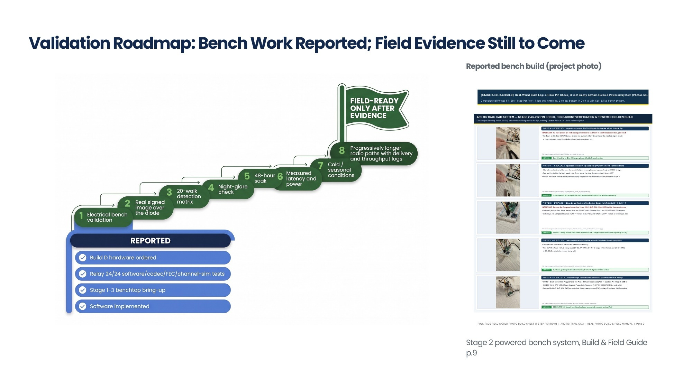

# Validation plan

This document owns acceptance procedures. The [master decisions and roadmap](../../PROJECT_DECISIONS_AND_ROADMAP.md) owns the 1–2 week delivery timeline and architecture gates; a passing simulation is not a substitute for these measurements. Record exact hardware, software revision, settings, ambient conditions, and raw logs for every run. Agree required thresholds before testing.



## Stage 1 — bench and actual software path

Use a current-limited supply and corrected [wiring](WIRING_PINOUT.md). Confirm the selected sensors, power outputs, camera images, model execution, UART telemetry, and DONE cutoff individually. Exercise the actual sender and receiver with rejected signatures, blank/reused nonces, restarts, lost/corrupted chunks, repeated identical images, model failure, and disk failure.

Deliver more than 100 sequential alerts plus bursts. Count every submitted, accepted, rejected, stored, and displayed event. Open the saved JPEGs and compare them with actual captured scenes. Dashboard appearance alone is insufficient.

## Stage 2 — short physical fiber pilot

Use the exact proposed converters and splitter. Log negotiation and successful delivery over repeated power cycles; disconnect and reconnect the optical path. Record transmitted and recovered event counts and time to first complete verified image. Check the topology has no connected reverse path. A copper test exercises application transport only.

## Stage 3 — mission coverage and power

Test a controlled approach with independently counted person/vehicle events at the intended direction, speed, distance, and lighting. Add intended wildlife classes separately; do not infer them from car/person results. Include no-target periods, foliage motion, precipitation, and site vibration.

| Measure | Required record |
|---|---|
| Detection | Ground-truth events, triggers, misses, and false wakes/day |
| Useful images | Images in which the intended target is actually visible at required detail |
| Latency | Trigger-to-power, power-to-capture, capture-to-store; p50 and p95 |
| Energy | Battery-side standby watts and integrated Wh/event, including failed wakes and IR/heater use |
| Delivery | Sent, reconstructed, corrupted, duplicate, and missing events |
| Recovery | Sensor faults, hung Pi, link loss, restart, low battery, and full storage |

Compute endurance from measured daily energy and usable battery capacity at the intended temperature. Include collector-computer power separately. Repeated wake cycles alone do not prove months of autonomy.

## Stage 4 — environmental pilot

Start with component operating limits and a defined enclosure thermal strategy. Cold-soak before boot tests; exercise condensation, frost on the viewport, battery sag, and wet cable entries. Measure window temperature and image clarity to test de-icing. A die-temperature reading is not a window measurement.

Run an attended pilot before unattended operation. Keep an independent event counter and maintenance log so silent failures and missed events remain visible. Report results by weather and temperature, rather than a single success percentage.

## Stage 5 — Optical Focus Lock, Viewport Sealing & Transport Vibration Acceptance

Before transporting the assembled node by car or snowmobile to a field trail, verify the four critical mechanical and optical design decisions enacted after Stage 2 bench integration:

### 1. Fixed Hyperfocal Optical Lock (`AfMode = 0, LensPosition = 0.5` Diopters)
* **Why Continuous PDAF Autofocus Fails in Forest Field Deployments:** On an outdoor pine trail, `Picamera2` Continuous Autofocus (`AfMode = 2`) either locks onto overhanging pine needles/snowflakes at `0.4 m` (blurring the `3 m – 15 m` trail background where people and vehicles pass) or hunts for `400–900 ms` in low twilight/night contrast before firing the shutter.
* **Implemented Software Lock (`pi5_sender_node/sender_node.py`):** The camera is locked to manual hyperfocal focus (`AfMode = 0`, `LensPosition = float(os.getenv("CAM_LENS_POSITION", "0.5"))` diopters = **`2.0 m` focus center**). Because the `Camera Module 3 NoIR Wide [P05]` (`f/2.2`, `2.75 mm` focal length, `102°` HFOV) has a hyperfocal distance of $\sim 1.5\text{ m}$, locking at `0.5 diopters` keeps every target from **`1.0 m` to infinity (`∞`)** in crisp optical focus with **`0.0 ms` autofocus hunting delay** for both `YOLOv8n` / `Hailo-8L` object detection and human evidence review.
* **Field Acceptance Check:** Capture a daytime and night `940 nm` test frame of a person walking at `3 m`, `8 m`, and `15 m` with an overhanging branch at `0.8 m` in the corner of the frame; confirm `0 ms` focus hunting and sharp target crops at all three distances.

### 2. Stage 4 Camera Viewport Drilling, Glass Sealing & Anti-Fog Verification
* **Stepped Cone Bit (`20 mm`, `[T06]`) Option vs. `28 mm` Hole Saw (`[T05]`):** When using the `Raspberry Pi Camera Module 3 NoIR Wide [P05]` (`11.5 × 11.5 mm` central lens barrel), drilling a **`20 mm` aperture** with the **`4–20 mm` Titanium Stepped Cone Bit (`[T06]`)** provides a smooth, self-centering hole with zero tooth snagging and leaves a wide **`5.0 mm` (`360°`) solid overlap shelf** for bonding the `30 mm` optical glass disc (`[T11]`). (If using the wider `Arducam IMX708` board with twin side-mounted `940 nm` LEDs, use the `28 mm` hole saw cup `[T05]` in `REVERSE` after piercing the pilot hole in `FORWARD`, plus the internal black neoprene foam baffle ring `[P20]`.)
* **Smudge-Free `3M` Tape Center-Mask Handle:** Stick a `20 × 20 mm` square of `3M Blue Painter's Tape [T11]` onto the center of both faces of the `30 mm` glass disc (folding a `10 mm` finger tab on the back) before applying `Permatex Black Silicone [T11]` so zero silicone ever touches the optical viewing zone; peel the tape off after a `15-minute` skin-tack cure.
* **Front-Look Lens Centering, Ribbon Strain Relief & Desiccant:** Look straight through the front glass window while pressing the camera onto the internal `Black Neoprene Foam Ring [P20]` to verify `100%` centering, tape the flat `CSI Ribbon [P06]` to the interior floor of the `Hammond [P20]` box for strain relief before installing the cable gland, and seal **`1–2` silica-gel desiccant packets** inside the dry indoor box so trapped moisture never condenses on the glass at `-30°C`.

### 3. Zero-Redesign COTS Breadboard (`[P09]`) 3-Step Vibration Lock Acceptance
* **Design Decision Rationale (No Custom PCB / No Second Build):** To preserve **100% procurement OPSEC and supply-chain anonymity** (zero custom `Gerber` files or third-party PCB fab records), avoid any second wiring build, incur `$0` extra cost, and retain `5-second` field modification flexibility, the Stage 2 `30-Row` COTS Breadboard (`[P09]`) and `2.54 mm` jumpers (`[P10]`) are retained directly in the final `QILIPSU [P21]` vault.
* **Pre-Transport Mechanical Lock Verification (`<2%` Transport Risk):**
  1. **Empty-Hole Landmark & Pliers Press-Fit Check:** Confirm `W1–W4` (`Col f, Rows 24–27`) leave **`3 empty bottom holes` (`f28–f30`)**, the 5-pin `GY-271 [P08]` strip (`Col j, Rows 24–28`) leaves **`2 empty bottom holes` (`j29–j30`)** with the `15°–20°` pliers press-fit twist applied to the 4 active pins, and all jumper pins enter at a straight `90°` angle.
  2. **Co-Mounted Grid Plate + `3M` Block Binding + Peelable Silicone Bead:** Confirm `Breadboard [P09]` is stuck and zip-tied onto the `QILIPSU [P21]` grid plate `3 cm` from `Raspberry Pi 5 [P01]`, the jumper housings (`Col f`, `Col a`, and `Pi 5 Pins 10/14/16`) are bound into unified blocks with `3M` tape, and a `2 mm` peelable bead of `Permatex Black Silicone [T11]` bridges the plastic jumper shells to the breadboard face (`>1,500 g` pull-out retention).
  3. **Manual Shake & Bump Test:** Before closing the `QILIPSU [P21]` lid, subject the mounted grid plate to 30 seconds of firm manual shaking and table-edge taps along all 3 axes while `Pico 2` is running; confirm `I2C0` (`0x0D`) and `UART1` (`GPIO15`) deliver `10/10` consecutive magnetic triggers with zero intermittent resets.

### 4. Estimated Schedule to Complete Prototype (`3.5 – 4.5 Hours` Across Two Sessions)

| Session | Stages Covered | Active Hands-On Time | Key Milestone & Curing Gate |
| :--- | :--- | :---: | :--- |
| **Session 1 (Evening 1)** | **Stage 2.5** (`First Live USB Power-Up & Screwdriver Mag Test`) + **Stage 3** (`1x2 Optical Fiber Diode Verification`) + **Stage 4.1–4.2** (`Drill Hammond [P20] Viewport & Glue 30mm Glass Disc [T11]`) | **`1.5 – 2.0 Hours`** | Verify live end-to-end signed JPEG alerts over the `1x2` optical splitter on the bench, then drill the `Hammond [P20]` viewport and bond the `30 mm` glass disc last so the `Permatex Black Silicone [T11]` cures overnight (`12–24 hrs`) with zero waiting time. |
| **Session 2 (Day 2)** | **Stage 4.3–4.4** (`Mount Camera [P05], Neoprene Baffle, Radar [P11], Desiccant & Matte Forest Green Paint`) + **Stage 5** (`Pack QILIPSU [P21] Base Vault, 12V Battery [P17] & 3-Step Breadboard Vibration Lock`) | **`2.0 – 2.5 Hours`** | Complete the weatherproof `Zone 1` camera/radar pod and `Zone 3` base vault, apply the `2 mm` peelable silicone damper bead to the breadboard jumpers, pass the 3-axis shake test, and deploy for outdoor trail testing (**`3.5 – 4.5 Hours` total active build time**). |

### 5. Automated `-18 °C` Freezer Soak & Cold-Start Acceptance (`run_freezer_soak_acceptance.py`)
* **4-Hour Household Freezer Soak Protocol:** Place the sealed camera pod (`Hammond [P20]` with silica-gel desiccant) and `QILIPSU [P21]` base vault inside a `-18 °C` freezer with only the `30 m` armored single-mode fiber exiting the door gasket to the indoor `StarTech MCMGBSCSM10` RX converter and Collector Hub. Trigger `>= 5` cold-start wakes over 4 hours and verify zero `Ed25519` signature failures, zero `SHA-256` chunk losses, and core temperature telemetry `<= -10.0 °C`:
  ```bash
  python3 -B pi-diode-trailcam/run_freezer_soak_acceptance.py --self-test
  python3 -B pi-diode-trailcam/run_freezer_soak_acceptance.py --journal-dir pi-diode-trailcam/verified_alerts --max-temp-c -10.0 --min-frames 5 --report-out pi-diode-trailcam/verified_alerts/freezer_soak_report.json
  ```

## Separate track — `200 m – 20 km` Troposcatter & Optical Sky-Relay (`sky-diode-relay`)

For the ordered **`Build D` (`200 m – 20 km` All-Weather `2.4 GHz` Troposcatter, Hydrometeor & Canopy-Bounce Relay)**, complete the `35–45 minute` zero-solder coaxial assembly in [`SKY_RELAY_HARDWARE_SPEC_AND_BOM.md`](../../sky-diode-relay/hardware/SKY_RELAY_HARDWARE_SPEC_AND_BOM.md) and execute the 3-stage validation protocol in [`FIELD_TESTING_AND_CLIENT_READINESS.md`](../../sky-diode-relay/docs/FIELD_TESTING_AND_CLIENT_READINESS.md):

1. **Stage 1 (Indoor Coaxial & Over-the-Air Bench Verification — Completed `L5`):** Verify `+5.00V` output on both `TDK-Lambda LS50-5` supplies, attach `HG2414P` antennas (or `50 Ω` load) before powering the `SE2576L-EK1` `1W` PA, run `python3 -B sky-diode-relay/tests/test_sky_relay_simulation.py` (`25/25` tests passing), and verify indoor `DD\x01` + `DD\x02` JPEG reconstruction in `receiver_hub.py` (`+19.31 dB` LNA carrier jump and `+50.50 dB` PA carrier jump verified across `2× ADALM-PLUTO` SDRs at `2.425 GHz`).
2. **Stage 2 (`200 m – 2 km` Forest Canopy / Building Bounce & `run_gate3_outdoor_range_acceptance.py`):** Aim the `L-com HG2414P` `14 dBi` flat-panel antennas (`30° × 30°` beamwidth, `+2°` upward tilt) along the reciprocal compass bearing and run `python3 -B sky-diode-relay/run_gate3_outdoor_range_acceptance.py --self-test` (or `--checkpoint-m 100|500|1000`) to certify `100 m`, `500 m`, and `1,000 m` directional range checkpoints.
3. **Stage 3 (`10 km – 20 km` Over-the-Hill Troposcatter & All-Weather Acceptance):** Validate `100%` frame reconstruction across clear night, daytime sun, and rain/snow conditions (`+14.1 dB` to `+29.8 dB` post-correlation SNR) and confirm 6-layer out-of-ISM guard-band (`2380 / 2488 / 2459 MHz`) anti-jamming immunity.
