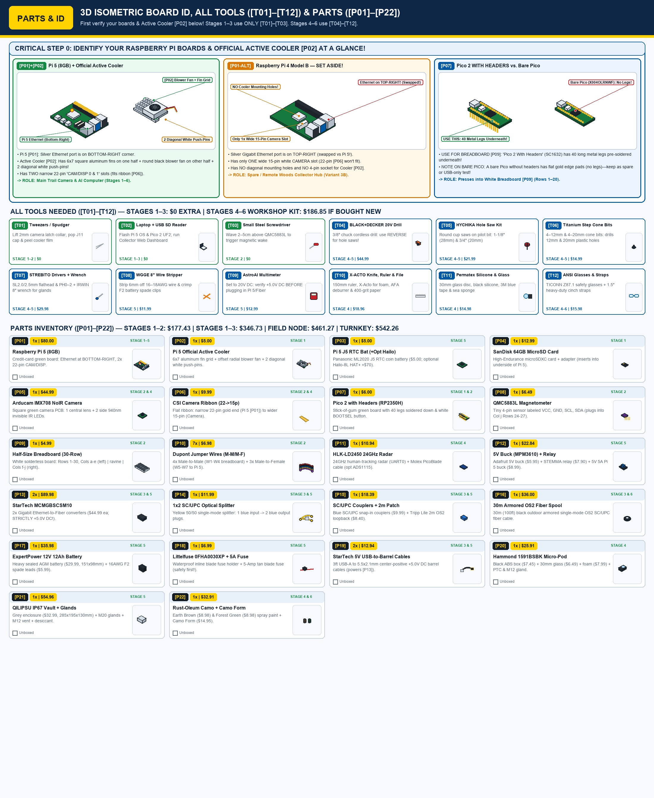

# Hardware Specifications, Performance Expectations, Battery Life & Bill of Materials (`SSOT`)

This document is the **Single Source of Truth (`SSOT`)** for system performance expectations, battery life and power budgets, component pricing (`[P01]`–`[P22]`), workshop tools (`[T01]`–`[T12]`), and enclosure drilling dimensions. Other guides link here rather than repeating these tables.

---

## 1. System Performance Expectations & Cold-Boot Latency Spec

| Performance Metric | Target / Verified Specification | Notes & Operating Conditions |
| :--- | :--- | :--- |
| **Target Environment & Climate** | **`-40°C` to `+50°C` Year-Round (`IP67`/`IP68`)** | Designed for harsh Finnish Arctic winters, lake fog, sleet, and remote off-grid forests with zero internet or cellular coverage. |
| **Standby Power (`Domain A` Always-On)** | **`3.8 mW – 12.0 mW`** *(Eco Gatekeeper)* **`~45 mW`** *(Periodic Radar Micro-Sweep)* | `Raspberry Pi 5 [P01]` and `StarTech Media Converter [P13]` are **100% physically disconnected (`0.00 W`)** by the high-side relay while waiting for movement. |
| **Active Capture Power (`Domain B` On)** | **`~9.5 W`** *(Day/Mild)* / **`~12.5 W`** *(Sub-Zero w/ `3.6W` De-Icer)* | Runs for only **`~6.8 to 8.0 seconds`** per verified movement trigger, consuming just **`0.021 – 0.028 Wh` per captured event**. |
| **Cold-Boot Trigger-to-Photo Latency** | **`6.4 – 6.8 seconds` total** | `0.15s` sensor confirmation + `3.8s` `Pi 5` stripped Linux kernel boot + `0.6s` `IMX708` exposure lock + `0.35s` AI person/vehicle confirmation + `1.5s` `Ed25519` signing & `3×` optical fiber burst. |
| **Detection Range & Trail Geometry** | **`15 m – 60 m` approach** (`25°` oblique trail angle) | `HLK-LD2450` `24 GHz` radar (`6–8 m` confirmation zone), `QMC5883L` magnetometer (`3–8 m` vehicles/ferromagnetic gear), optional `SM-24` geophone (`15–60 m` footsteps/vehicles). |
| **Night Vision Range (`940 nm` Stealth IR)** | **`8 m – 18 m` (`Zero Red Glow`)** | Uses `940 nm` invisible infrared LEDs isolated outside a black neoprene foam baffle ring (`0%` visible red glow to humans or game). |
| **RF / Wireless Signature at Camera** | **`0.00 W` RF (`100% RF-Silent` on Fiber/Beam)** | No Wi-Fi, no cellular, no Bluetooth, and no return optical path (`TX` laser on cabin receiver is physically unpatched and capped). |
| **Link Reach (`Fiber`, `Collimator`, or `Sky-Relay`)** | **`30 m – 10 km`** *(Armored OS2 Fiber)* **`10 m – 100 m`** *(Water-Strait Collimator Beam)* **`200 m – 20 km`** *(`2.4 GHz` Troposcatter & Canopy-Bounce Relay — `Build D`)* | Standard kit includes a `30 m` (`100 ft`) steel-armored moss-buried fiber spool (`[P16]`); supports up to `10 km` on single-mode OS2 fiber or `200 m – 20 km` NLOS via [`sky-diode-relay`](../../sky-diode-relay/README.md) (`Build D`). |

---

## 2. Multi-Year Battery Life & Seasonal Energy Autonomy (`1.0 – 2.5+ Years` Internal / `4+ Years` External)

Because the `QILIPSU` Base Vault (`[P21]`) is buried under `5 cm` of insulating forest moss and winter snow (or mounted on a free-draining sphagnum hummock / *mätäs*), the battery compartment stays around **`-2°C to -8°C`** even when ambient air temperatures drop to **`-25°C to -40°C`**. Each verified capture cycle consumes only **`0.025 Wh`** (`0.030 Wh` in sub-zero winter with the `4.0s` window de-icer). On a remote cabin driveway, wilderness perimeter, or border sector where **10 verified photos per month (`~0.33/day`)** is typical, active capture energy is negligible (`~0.01 Wh/day`), so total daily energy with `4–12 mW` Eco Gatekeeper standby is just **`~0.15 – 0.30 Wh/day`**. That enables **`1.5 to 2.5+ years` (`565 – 900+ days`)** of unattended autonomy on a drop-in `12V 15Ah–24Ah LiFePO4` battery inside the standard vault, **`1.0 – 1.3+ years` (`365 – 480 days`)** on the baseline `$29` `12V 12Ah` AGM battery (`[P17]`), and **`3.0 – 4.0+ years`** on an external `60Ah` battery:

| Operating Mode, Capture Frequency & Season | Average Standby Draw | Total Daily Energy (`Wh/day`) | Standard `12V 12Ah` AGM (`[P17]`, `$29` / `€27` Motonet) | Drop-In `12V 15Ah–24Ah` Lithium (`LiFePO4`, Fits Vault) | Optional External `12V 60Ah` Boat Battery (`€69`) |
| :--- | :---: | :---: | :---: | :---: | :---: |
| **Quiet Cabin / Wilderness (`10 Photos/Month` — Spring / Summer / Autumn `+5°C to +25°C`)** *(Eco Gatekeeper Standby `4–12 mW` + `~0.33` captures/day)* | `4 – 12 mW` | **`0.15 – 0.30 Wh/day`** | **`385 – 480+ Days` (`1.0 – 1.3+ Years`)** | **`565 – 900+ Days` (`1.5 – 2.5+ Years`)** | **`~4.0+ Years`** *(self-discharge limited)* |
| **Quiet Cabin / Wilderness (`10 Photos/Month` — Harsh Finnish Winter `-20°C to -30°C`)** *(Eco Gatekeeper Standby + `4.0s` Window De-Icer per wake)* | `4 – 12 mW` | **`0.16 – 0.30 Wh/day`** | **`270 – 365 Days` (`9 – 12 Months`)** | **`440 – 730+ Days` (`1.2 – 2.0+ Years`)** | **`~3.0 – 3.5+ Years`** *(self-discharge limited)* |
| **Busy Trail (`10 Photos/Day` = `300/Month` — Spring / Summer / Autumn `+5°C to +25°C`)** *(Eco Gatekeeper Standby: `QMC5883L` + Geophone/Thermal wake $\rightarrow$ Radar verify)* | `12 mW` | **`0.54 Wh/day`** | **`~220 Days` (`7.3 Months`)** | **`310 – 480 Days` (`10 – 16 Months`)** | **`~2.5+ Years`** |
| **Busy Trail (`10 Photos/Day` = `300/Month` — Harsh Finnish Winter `-20°C to -30°C`)** *(Eco Gatekeeper Standby + `4.0s` Window De-Icer per wake)* | `12 mW` | **`0.60 Wh/day`** | **`150 – 165 Days` (`5+ Months`)** *(Rated **`120+ Days`** conservatively)* | **`195 – 320 Days` (`6.5 – 10.5 Months`)** | **`~1.8 – 2.0+ Years`** |
| **High-Frequency Radar Micro-Sweep Mode (`-20°C` Winter)** *(`Pico 2` pulses `24 GHz` radar for `100 ms` every `2s` + 10 photos/month to 10/day)* | `38 mW` | **`0.92 – 1.16 Wh/day`** | **`85 – 115 Days` (`~3 – 4 Months`)** | **`115 – 220 Days` (`~4 – 7 Months`)** | **`11 – 14 Months`** |
| **Bench-Test / Continuous 100%-On Radar Mode** *(If `HLK-LD2450` radar is left powered 24/7 without `Pico 2` duty-cycling)* | `940 mW` | **`22.8 Wh/day`** | **`~5 – 6 Days`** | **`~7 – 11 Days`** | **`~26 Days`** |

---

## 3. Complete Itemized Bill of Materials (`[P01]`–`[P22]`) & Retail Prices

Every part in the V1 COTS modular architecture is a standard commercial off-the-shelf item available from retail electronics suppliers (Amazon, Adafruit, DigiKey, Mouser, or Verkkokauppa.com / Partco / Motonet in Finland) with **zero custom PCB fabrication and zero soldering required**.

### 1. Build Cost Summary by Stage & Configuration Tier

| Build Tier / Configuration | Parts Included | Total Cost (USD) | Approx. Cost (EUR) | What It Gives You |
| :--- | :--- | :---: | :---: | :--- |
| **Tier 1A — Indoor Core Compute & Gatekeeper Bench Kit (`Stages 1–2`)** | `[P01]`, `[P02]`, `[P04]`–`[P10]` | **`$177.43`** | **`~€163`** | Complete indoor breadboard prototype: `Pico 2` + `QMC5883L` magnetic trigger waking `Raspberry Pi 5` + `Arducam IMX708 NoIR` camera and sending `Ed25519`-signed JPEGs over Ethernet to your laptop dashboard. |
| **Tier 1B — Complete Indoor Optical Data Diode Kit (`Stages 1–3`)** | Tier 1A + `[P13]`–`[P16]`, `[P19]` (`+$169.30`) | **`$346.73`** | **`~€319`** | Adds `2× StarTech` `1310 nm` Single-Mode Media Converters, `1×2 SC/UPC` Optical Splitter, couplers, `5V` barrel cables, and `30 m` armored fiber spool for physics-enforced one-way optical transmission. |
| **Tier 2A — Complete 3-Zone Weatherproof Field Camera Node Only (`Stages 1–6`, Tree Unit)** | All Field Parts (`[P01]`–`[P22]` excl. Cabin Converter #2 & `30 m` spool) | **`$461.27`** | **`~€424`** | Complete 3-Zone pine-tree unit (`Zone 1` camouflaged micro-pod with `IMX708` + `24 GHz` radar, `Zone 2` camo umbilical, `Zone 3` moss-buried `QILIPSU` vault with `12V 12Ah` battery, buck/relay power gating, `Pi 5`, and `1×2` optical diode). |
| **Tier 2B — Complete Turnkey End-to-End Field System (`Stages 1–6` Field Node + `30 m` Armored Fiber + Cabin Receiver)** | **All `[P01]`–`[P22]` Items Below** | **`$542.26`** | **`~€499`** | Everything required for a complete outdoor tree-to-cabin deployment (`3-Zone` Field Camera Node + `30 m` outdoor armored single-mode fiber + Cabin Collector Optical Media Converter #2). |

---

### 2. Itemized Parts Schedule (`[P01]`–`[P22]`) with Unit & Extended Retail Prices

| Part Code | Qty | Component Name & Exact Retail Specification (`SKU` / `ASIN` / `PID`) | Stage Used | Unit Price (USD) | Ext. Price (USD) | Approx. (EUR) |
| :--- | :---: | :--- | :---: | :---: | :---: | :---: |
| **`[P01]`** | `1×` | **Raspberry Pi 5 (`8GB RAM`)** (`SC1112`) *(Note: Optional official `27W USB-C` wall PSU for indoor bench testing is `+$12.00`)* | Stage 1 | `$80.00` | **`$80.00`** | `€74` |
| **`[P02]`** | `1×` | **Official Raspberry Pi 5 Active Cooler** (`SC1148` — anodized aluminum heatsink + radial blower fan + thermal pads) | Stage 1 | `$5.00` | **`$5.00`** | `€5` |
| **`[P03]`** | `1×` | **Official Raspberry Pi 5 `J5` `ML2020` Rechargeable RTC Battery** (`Adafruit PID 5817`) *(Optional `Hailo-8L 13-TOPS AI HAT+` is `+$70.00`; see Section 3 below)* | Stage 5 | `$5.00` | **`$5.00`** | `€5` |
| **`[P04]`** | `1×` | **SanDisk `64GB` Ultra / Extreme MicroSDXC Card + SD Adapter** (`SDSQUAR-064G-GN6MA`) | Stage 1 | `$12.99` | **`$12.99`** | `€12` |
| **`[P05]`** | `1×` | **Arducam Raspberry Pi Camera Module 3 NoIR (`12MP Sony IMX708` `120°` Wide + `2× 940 nm` IR LEDs)** (`ASIN B0FNCY34DK`) | Stage 2 & 4 | `$44.99` | **`$44.99`** | `€41` |
| **`[P06]`** | `1 set` | **Official Pi 5 CSI FPC Camera Ribbon (`22-pin` to `15-pin`, `200 mm`, `ASIN B0GJ5CJWDF`, `$9.99`)** *(for bench & Pi 5 adapter)* **+ Arducam `CSI-to-HDMI` Camera Extension Kit w/ `2.0 m` Shielded Cable (`ASIN B06XDNBM63`, `$18.99` for 2 m Zone 2 split-pod tree umbilical)** | Stage 2 & 4 | `$9.99` *(bench)* / `$28.98` *(2m pod)* | **`$9.99`** | `€9` |
| **`[P07]`** | `1×` | **Raspberry Pi Pico 2 With Pre-Soldered Headers (`RP2350H`)** (`SC1632`) *(Optional Micro-USB data sync cable for bench flashing is `+$4.99`)* | Stage 1 & 2 | `$6.00` | **`$6.00`** | `€6` |
| **`[P08]`** | `1×` | **HiLetgo `QMC5883L` (`GY-271`) 3-Axis Magnetic Sensor Module** (`ASIN B01N25R6YC`) | Stage 2 & 5 | `$6.49` | **`$6.49`** | `€6` |
| **`[P09]`** | `1×` | **Standard `400-Hole` (`30-Row`) Half-Size Solderless Breadboard** (`BB400` / `Adafruit PID 64`) | Stage 2 & 5 | `$4.99` | **`$4.99`** | `€5` |
| **`[P10]`** | `1×` | **ELEGOO `120pcs` Multicolored Dupont Jumper Wire Kit (`40× M-M`, `40× M-F`, `40× F-F`)** (`ASIN B01EV70C78`) | Stage 2 & 5 | `$6.98` | **`$6.98`** | `€6` |
| **`[P11]`** | `1×` | **HLK-LD2450 `24 GHz` FMCW mmWave Radar Sensor (`$8.99`) + `1.25 mm` 4-Pin Molex PicoBlade Harness (`Adafruit PID 4924`, `$1.95`)** | Stage 4 & 5 | `$10.94` | **`$10.94`** | `€10` |
| **`[P12]`** | `1 set` | **Domain A & B Modular Power Switching Kit:** `Adafruit MPM3610` `5V` Buck (`PID 4739`, `$5.95`) + `3×` 3.3V Logic Power Switches (`Adafruit STEMMA` High-Side Relay `PID 4409` on `GP15` for Domain B + `Pololu 2810` High-Side MOSFET Switch on `GP6` for `5V` Radar + `STEMMA Relay #2` on `GP16` for `12V` Heater) + `12V-to-5V 5A (25W)` USB-C Buck (`ASIN B0CRVW7N2J`, `$8.99`) | Stage 5 | `$22.84` | **`$22.84`** | `€21` |
| **`[P13]`** | `2×` | **`StarTech MCMGBSCSM10` Gigabit Single-Mode `1310 nm` `SC` Fiber Media Converters (`10 km` range, TAA Compliant)** (`$44.99` each: `#1` for Field Vault, `#2` for Cabin Collector) | Stage 3 & 5 | `$44.99` | **`$89.98`** | `€83` |
| **`[P14]`** | `1×` | **Duttek `1×2` Single-Mode `50/50` PLC Optical Fiber Splitter (`SC/UPC` Yellow)** (`ASIN B09X17W4FB`) | Stage 3 & 5 | `$11.99` | **`$11.99`** | `€11` |
| **`[P15]`** | `1 set` | **Cable Matters 6-Pack `SC/UPC` Single-Mode Couplers (`ASIN B0B57SP291`, `$9.99`) + Tripp Lite `2 m SC/SC` OS2 Loopback Patch Cord (`ASIN B0006OCFGM`, `$8.40`)** | Stage 3 & 5 | `$18.39` | **`$18.39`** | `€17` |
| **`[P16]`** | `1×` | **Jeirdus `30 m` (`100 ft`) Outdoor Armored Single-Mode `OS2` `SC/UPC` Fiber Optic Cable Spool** (`ASIN B07VYXPC1C`) *(Longer spools: `100 m` = `$58`, `300 m` = `$115`)* | Stage 3 & 6 | `$36.00` | **`$36.00`** | `€33` |
| **`[P17]`** | `1 set` | **ExpertPower `EXP-12120` `12V 12Ah` Sealed Lead-Acid AGM Battery (`ASIN B00A82A2ZS`, `$29.99`) + `16 AWG F2` Spade Terminal Leads (`$5.99`)** | Stage 5 | `$35.98` | **`$35.98`** | `€33` |
| **`[P18]`** | `1×` | **Littelfuse `0FHA0030XP` Heavy-Duty `16 AWG` Inline Blade Fuse Holder + `5A` Blade Fuse** (`ASIN B000COA2ZW`) | Stage 5 | `$6.99` | **`$6.99`** | `€6` |
| **`[P19]`** | `2×` | **StarTech `USB-to-5.5×2.1mm` `+5.0V DC` Center-Positive Barrel Power Cables** (`ASIN B003MQO96U`, `$9.99` + `Adafruit PID 2697`, `$2.95`) | Stage 3 & 5 | `$6.47` | **`$12.94`** | `€12` |
| **`[P20]`** | `1 set` | **Zone 1 Covert Micro-Pod Enclosure Kit:** `Hammond 1591BSBK` Black ABS Box (`112×62×31 mm`, `ASIN B0002BBQUA`, `$7.45`; **factory `IP54` lap-joint — requires `Permatex 81158` silicone lid-channel gasket**; or drop-in **`Hammond 1554EGY` factory `IP68` gasketed box**, `DigiKey HM3098-ND`, `$13.50`) + `uxcell 30 mm` Glass Disc (`$6.49`) + Black Neoprene Foam Baffle (`$7.99`) + **`39-Ohm 5W` Ceramic De-Icer Resistor (`3.69 W` @ `12.0V`, `$1.99`)** + `M12 IP68` Gland (`$1.99`) | Stage 4 | `$25.91` | **`$25.91`** | `€24` |
| **`[P21]`** | `1 set` | **Zone 3 Moss-Buried Base Vault Kit:** `QILIPSU IP67` Hinged Box (`285×195×130 mm` + Grid Plate, `$32.99`) + `Tynoscco M20×1.5 IP68` Glands (`$7.99`) + `COSIBOA M12 ePTFE` Breather Vent (`$7.99`) + Silica Gel Desiccant Packs (`$5.99`) | Stage 5 | `$54.96` | **`$54.96`** | `€51` |
| **`[P22]`** | `1 set` | **Non-Metallic Pine-Bark Camouflage Kit:** `Rust-Oleum Specialty Camouflage Ultra-Flat Earth Brown` (`B00ON7LIXE`, `$8.98`) + `Deep Forest Green` (`B00N6Y0RPA`, `$8.98`) + `Gear Aid Camo Form` Self-Clinging Wrap (`B07P7KQR2N`, `$14.95`) | Stage 4 & 6 | `$32.91` | **`$32.91`** | `€30` |
| **TOTAL** | — | **Complete Turnkey V1 System (`[P01]`–`[P22]` — Field Node + `30 m` Armored Fiber + Cabin Optical Receiver)** | **Stages 1–6** | — | **`$542.26`** | **`~€499`** |

---

### 3. Optional Hardware Upgrades & Long-Range Deployment Add-Ons

| Optional Upgrade / Add-On | Retail Specification | Price (USD) | Approx. (EUR) | When to Add It |
| :--- | :--- | :---: | :---: | :--- |
| **On-Device 13-TOPS NPU (`[P03-NPU]`)** | **Official Raspberry Pi AI HAT+ (`Hailo-8L` 13 TOPS)** (`SC1467`) | **`+$70.00`** | `~€65` | Optional hardware acceleration for YOLOv8s (`sender_node.py` automatically falls back to CPU YOLOv8n ONNX + Motion ROI when omitted). |
| **V1.1 Seismic Geophone Kit (`[P11-SEIS]`)** | **Sensor Nederland `SM-24` `10 Hz` Geophone Element (`$94.85`) + `Adafruit ADS1115` 16-Bit I2C ADC (`PID 1085`, `$14.95`)** | **`+$109.80`** | `~€101` | Adds $40\text{–}60\text{ m}$ advance ground-vibration sensing (`PROFILE_FULL_TRIPLE`). |
| **Deep Arctic Winter Battery (`-40°C` Spec)** | **`12V 10Ah` Lithium Titanate (`LTO`) or `Victron 12V` Arctic Heated `LiFePO4` Pack** *(replaces `$29.99` `SLA AGM`)* | **`+$115.00`** *(net)* | `~€106` | Recommended for unattended January–February Lapland / Kainuu deployments below $-25^\circ\text{C}$. |
| **Scenario B2: Water Strait / Road Optical Beam Crossing (`5–100 m` LOS)** | **`2× Thorlabs F220FC-1310` (or `F280FC-C`) `1310 nm` Single-Mode Fiber Collimators + Kinematic Mounts** | **`+$240.00`** | `~€220` | Bridges a creek, Saimaa water channel, or public road where armored fiber cannot be laid on the ground. |
| **Scenario B3 (`sky-diode-relay` `Build D`): `200 m – 20 km` All-Weather `2.4 GHz` Troposcatter & Canopy-Bounce Kit** | **10-Line DigiKey COTS BOM (`2× ADALM-PLUTO` SDR, `SE2576L-EK1` `1W` PA, `SKY65405-21EK1` LNA, `2× VBF-2435+` Filters, `2× HG2414P` `14 dBi` Flat Panels, `2× LS50-5` PSUs, `2× Hammond 1590Z120` Boxes, `4× RG-142` Jumpers)** | **`+$1,341.94`** *(parts subtotal)* | `~€1,235` | Complete zero-trenching `200 m – 20 km` over-the-hill all-weather NLOS relay with 6-layer anti-jamming (`~35–45 min` zero-solder assembly; see [`SKY_RELAY_HARDWARE_SPEC_AND_BOM.md`](../../sky-diode-relay/hardware/SKY_RELAY_HARDWARE_SPEC_AND_BOM.md)). |
| **Border Hardening #1 (`[P07-SNAP]`): `<150 ms` SPI First-Frame Instant-Snap Camera** | **Arducam Mega 3MP/5MP SPI Camera (`B0398`) or Himax `HM01B0`** wired to `Pico 2` (`SPI_CAM_CS = GP13`) | **`+$22.00`** | `~€20` | Eliminates the `6.8s` cold-boot blind spot for fast snowmobiles/skiers (`40 km/h`) by snapping an immediate `t=0.15s` frame on `Pico 2` (`capture_spi_instant_frame()`). |
| **Border Hardening #2 (`[P11-LWIR]`): `0.00 W RF` Passive Thermal EMCON Sensor** | **Melexis `MLX90640` (`32×24` Long-Wave IR Thermal Array, `I2C 0x33`, `Adafruit PID 4407`)** | **`+$38.00`** | `~€35` | Replaces/gates active `24 GHz` radar micro-sweeps with `100%` passive far-IR body/engine heat detection (`PROFILE_PASSIVE_EMCON_LWIR` + `30 ms` `940 nm` IR strobe discipline). |
| **Border Hardening #3 (`[P07-SEC]`): Anti-Tamper Key Zeroization & Secure Element** | **Microchip `ATECC608B` STEMMA I2C Crypto Breakout (`Adafruit PID 4314`) + Magnetic Vault-Lid Reed Switch (`GP12`)** | **`+$4.50`** | `~€4` | Prevents microSD key extraction if a vault is captured; opening the lid wipes `EPHEMERAL_SRAM_KEY` in `<1 ms` (`zeroize_ephemeral_key_on_tamper()`). |
| **Border Hardening #5 (`[P21-FROST]`): Frost-Point Sensor & `-30°C` Boot Supercap Bank** | **`Adafruit BME280` Temp/Humidity I2C Sensor (`0x76`) + `2× 2.7V 50F` Series `5V` Supercapacitor Bank** | **`+$12.00`** | `~€11` | Only fires the `3.6W` lens heater when humidity is near the frost point (`should_enable_lens_deicer()`) and buffers the `Pi 5` `2.5A` cold-boot spike at `-30°C`. |

*(Note: Full architectural details for the 5-point border hardening package—including multi-camera passive optical bus daisy-chaining with `compute_aloha_interpass_delays_s()`—are maintained in [Section 5 of `PROJECT_DECISIONS_AND_ROADMAP.md`](../../PROJECT_DECISIONS_AND_ROADMAP.md#5-contested-border--tactical-hardening-package-5-point-cots-upgrade-architecture). The unreleased custom 4-layer carrier PCB is preserved as a [V2 design study](../hardware/CARRIER_BOARD_DESIGN_SPEC.md) with its own [component inventory](../hardware/ARCTIC_CARRIER_BOM.md).)*

---

## Complete Tools & Workshop Equipment Schedule (`[T01]`–`[T12]`) with Retail Prices

No soldering iron is required for either the indoor benchtop prototype (**Stages 1–3**) or the V1 modular weatherproof enclosure build (**Stages 4–6**). Most households already own `[T01]`–`[T04]`, `[T07]`, and `[T10]`; if buying every single workshop tool from scratch on Amazon/hardware store, the complete `[T01]`–`[T12]` toolkit totals **`$186.85`**.

* **Stages 1–3 (Indoor Table Bring-Up):** Require **ONLY `[T01]`–`[T03]` (`$0.00` extra** using your existing laptop + any steel screwdriver/key; or `+$24.98` if your laptop needs a USB-C Gigabit Ethernet adapter `$14.99` and USB-C SD reader `$9.99`).
* **Stages 4–6 (Enclosure Drilling, Sealing, Camouflage Painting, Power Wiring & Tree Installation):** Require **`[T04]`–`[T12]`**, specifically a **Cordless Drill (`[T04]`)**, a **Bi-Metal Hole Saw Kit with Central Pilot Drill Bit (`[T05]`)**, and a **Titanium Cone Step Drill Bit (`[T06]`)** to make clean circular openings in the plastic boxes without cracking them.

| Tool Code | Tool Name & Exact Specification | Stages Used | Retail Price (USD) | What You Use It For & In-Hand Tool Model |
| :--- | :--- | :---: | :---: | :--- |
| **`[T01]`** | **Fine Pointed Tweezers / Spudger (or Fingernails)** *(included in `STREBITO 64-Pc Kit` `[T07]`)* | Stages 1–2 | **`$0.00`** *(in `[T07]`)* | Lift the delicate black CSI camera ribbon latch collar up by `2 mm`; peel protective film off Pi 5 Active Cooler thermal pads; pop out the tiny `J11` fan socket dust cap; press jumper wires into breadboard holes. |
| **`[T02]`** | **Laptop / Computer (Mac/PC) + SD Card Slot / Reader** *(Optional `USB-C Gigabit Ethernet Adapter` `$14.99` + `USB-C SD Reader` `$9.99`)* | Stages 1–3 | **`$0.00`** *(existing laptop)* | Flash `Raspberry Pi OS Lite (64-bit)` to MicroSD card (`[P04]`); flash `arctic_trailcam_pico2_complete.uf2` (`MicroPython v1.25.0 + main.py`) to `Pico 2` (`[P07]`); run the Collector Hub web dashboard (`http://127.0.0.1:8123`). |
| **`[T03]`** | **Small Steel Screwdriver Shaft or Metal Key (Magnetic Target)** | Stage 2 | **`$0.00`** *(household)* | Wave `2–5 cm` above the `QMC5883L` magnetometer (`[P08]`) on the breadboard to trigger `<-- [MAG TRIGGER]` during bench testing. |
| **`[T04]`** | **Cordless Variable-Speed Drill / Driver (`BLACK+DECKER 20V MAX LD120VA` — `3/8"` Keyless Chuck, `Forward / Reverse` Switch, Battery & Charger + 30-Pc Bit Set)** | Stages 4–5 | **`$44.99`** | Drives the Hole Saw arbor (`[T05]`) and Step Cone Bits (`[T06]`). **Crucial Plastic Rule:** Drill the center pilot hole in **`FORWARD`**, then flip the switch to **`REVERSE`** so the circular hole-saw teeth score and shear through thin ABS plastic cleanly without catching or cracking! |
| **`[T05]`** | **Bi-Metal Hole Saw Kit with Central `1/4"` Pilot Drill Bit Mandrels (`HYCHIKA 17-Piece Bi-Metal HSS Hole Saw Kit`, `3/4"` to `2-1/2"`)** | Stages 4–5 | **`$21.99`** | **"Round saw blade around a central drill bit":** Circular toothed cup saws that thread onto the included central mandrel with a `1/4"` (`6.35 mm`) center pilot drill bit sticking out the middle. • **`1-1/8"` (`29 mm`) Cup:** Drills the **1× Upper Camera + IR Viewport Window** in the Zone 1 `Hammond 1591BSBK` lid (`[P20]`). • **`3/4"` (`19 mm`) Cup:** Drills the **2× Bottom `M20` Cable Gland Holes** in the Zone 3 `QILIPSU` Base Vault (`[P21]`). |
| **`[T06]`** | **3-Piece Metric Titanium Step Cone Drill Bit Set (`4–12 mm`, `4–20 mm`, `4–32 mm`) + Center Awl / Brad Point Bit** | Stages 4–5 | **`$14.99`** | • **Center Awl / Small Drill Bit:** Dimple each `+` crosshair first so the pilot bit never skates. • **`4–12 mm` Cone Bit:** Drills the **2× smaller `12 mm` (`1/2"`) holes** (Zone 1 bottom `M12/PG7` umbilical gland hole & Zone 3 side `M12` breather vent hole). • **`4–20 mm` Cone Bit:** Smoothly widens the `3/4"` (`19 mm`) hole-saw cuts to an exact **`20.0 mm` fit** for `M20` threads. |
| **`[T07]`** | **Precision Electronics Screwdriver Set (`STREBITO 64-Piece Kit`, `$18.99`) + `IRWIN VISE-GRIP 8"` Adjustable Wrench (`2078608`, `$10.99`)** | Stages 4–5 | **`$29.98`** | • **`PH0` / `PH1` / `PH2` Phillips:** Open/close the `Hammond 1591BSBK` lid, mount `M2`/`M2.5` camera & Pi standoffs, and secure the `QILIPSU` white grid backplate. • **`SL2.0 mm` / `SL2.5 mm` Flathead:** Fits inside the tiny recessed screw terminals on the High-Side Relay (`COM`/`NO`) and Buck Converters. • **`IRWIN VISE-GRIP 8"` Wrench:** Snugs the locknuts and dome nuts on the `M20` and `M12` waterproof cable glands (`1/4` turn past finger-tight). |
| **`[T08]`** | **Wire Stripper, Flush Cutter & Crimper (`WGGE WG-015` 8-Inch `10–22 AWG`)** | Stage 5 | **`$11.99`** | Cut `16–18 AWG` red/black power wires to length, strip `6 mm` (`1/4"`) of insulation off the ends, and crimp/connect the `F2` (`0.250"` / `6.35 mm`) female spade leads onto the `12V 12Ah` battery tabs (`[P17]`) and inline `Littelfuse` holder (`[P18]`). |
| **`[T09]`** | **Digital Multimeter (`AstroAI 2000 Counts TRMS Digital Multimeter` — `DC Volts V=` / `20V` Mode)** | Stage 5 | **`$12.99`** | **Mandatory safety check (Stage 5 Step 5.4):** Set dial to `20V DC (V=)` and measure the `12V-to-5V` Buck Converter output to verify strictly **`+5.00V to +5.15V DC`** *before* plugging in the Raspberry Pi 5 (`[P01]`) or `StarTech` Fiber Media Converter (`[P13]`). |
| **`[T10]`** | **`X-ACTO #1` Precision Craft Knife (`$5.99`) + `150 mm` (`6"`) Stainless Steel Metric Ruler (`$3.99`) + `AFA Tooling` Swivel Deburring Tool (`$8.98`)** | Stage 4 | **`$18.96`** | Measure exact millimeter drill crosshairs with the `150 mm` steel ruler; cut the `22 mm OD / 12 mm ID` black neoprene foam baffle ring with the `X-ACTO #1` knife; deburr drilled ABS holes with the `AFA` swivel deburring tool; scuff the outside of the `Hammond` box before painting. |
| **`[T11]`** | **`Permatex 81158` Black Waterproof Silicone Sealant (`$7.99`) + `3M ScotchBlue` Painter's Tape (`1"`, `$6.99`) + Sponge** | Stage 4 | **`$14.98`** | Bond and waterproof the `30 mm` circular mineral glass viewport disc (`[P20]`) behind the `28 mm` hole inside the Zone 1 `Hammond` lid using `Permatex 81158` black silicone; mask the glass with `3M ScotchBlue` tape; sponge-dab the 2-tone pine-bark camouflage (`[P22]`). |
| **`[T12]`** | **`TICONN ANSI Z87.1` Clear Anti-Fog Safety Glasses (`$6.99`) + `WSZJINB 1.5" × 16 ft` Heavy-Duty Black Nylon Cinch Straps (`$8.99`)** | Stages 4–6 | **`$15.98`** | Protect your eyes with `ANSI Z87.1` safety glasses while hole-saw drilling ABS plastic; use the `1.5"` heavy-duty nylon cinch straps with buckles to strap the `12V 12Ah` battery wall-to-wall onto the `QILIPSU` grid plate and strap the Zone 1 pod to the pine tree. |

---

## Exact Enclosure Hole-Saw & Step-Bit Drilling Schedule (All 5 Holes Across the Entire System)

There are **only 5 holes total** to drill across the entire project (2 in the small black Zone 1 Micro-Pod `[P20]` and 3 in the large grey Zone 3 Base Vault `[P21]`).

> [!TIP]
> **How to Drill Plastic Enclosures with a Round Hole Saw (`[T05]`) Without Cracking the Plastic:**
> 1. Press a sharp nail or center awl (`[T06]`) into the center `+` crosshair to make a small dimple.
> 2. Set your Cordless Drill (`[T04]`) to **FORWARD (`FWD`)** at medium speed and drill with the **central `1/4"` pilot drill bit** until the pilot bit pokes through the plastic—**STOP** just before the outer circular saw teeth touch the box.
> 3. Flip your Cordless Drill switch to **REVERSE (`REV`)**! Run the circular hole saw in **REVERSE** with light, steady pressure. Spinning the hole-saw teeth backwards scores and shears through ABS/polycarbonate plastic smoothly like butter without the teeth ever biting, catching, or cracking the box!

| Hole # | Enclosure & Wall Location | Purpose / Part Fitted | Exact Hole Diameter | Tool to Use (`[T05]` Hole Saw or `[T06]` Step Bit) |
| :---: | :--- | :--- | :---: | :--- |
| **Hole 1** | **Zone 1 Micro-Pod (`[P20]` `Hammond 1591BSBK`)** — Upper Front Lid (`32 mm` down from top edge, centered left-to-right) | Single circular window for `IMX708` Camera + 2 side `940 nm` IR LEDs (glued behind `30–32 mm` glass disc) | **`28 mm` (`1-1/8"`)** | **`[T05]` `1-1/8"` (`28–29 mm`) Round Hole Saw Cup + Center Pilot Drill Bit** *(run outer saw in `REVERSE`)* |
| **Hole 2** | **Zone 1 Micro-Pod (`[P20]` `Hammond 1591BSBK`)** — Bottom Narrow End-Wall (`62 × 31 mm` bottom face, dead center) | Small waterproof umbilical cable gland (`PG7` / `M12 IP68`) | **`12 mm` (`1/2"`)** | **`[T06]` Titanium Cone Step Drill Bit** stopped at the **`12 mm` step** *(or `1/2"` hole saw)* |
| **Hole 3** | **Zone 3 Base Vault (`[P21]` `QILIPSU IP67`)** — Bottom Wall, Left Side (`75 mm` from left edge, `65 mm` from front) | Left `M20 IP68` waterproof cable gland (for Zone 2 tree umbilical cable) | **`20 mm` (`3/4"`)** | **`[T05]` `3/4"` (`19–20 mm`) Round Hole Saw Cup** + finish to exact `20 mm` with **`[T06]` Step Bit** |
| **Hole 4** | **Zone 3 Base Vault (`[P21]` `QILIPSU IP67`)** — Bottom Wall, Right Side (`210 mm` from left edge, `65 mm` from front) | Right `M20 IP68` waterproof cable gland (for outbound `3 mm` armored fiber cable `[P16]`) | **`20 mm` (`3/4"`)** | **`[T05]` `3/4"` (`19–20 mm`) Round Hole Saw Cup** + finish to exact `20 mm` with **`[T06]` Step Bit** |
| **Hole 5** | **Zone 3 Base Vault (`[P21]` `QILIPSU IP67`)** — Right Side Wall (`45 mm` down from top edge, `65 mm` from front) | `M12 ePTFE` Gore-Tex pressure-equalization breather vent (prevents condensation) | **`12 mm` (`1/2"`)** | **`[T06]` Titanium Cone Step Drill Bit** stopped at the **`12 mm` step** |

> **Remember:** Do **NOT** drill a second hole in the lower half of the Zone 1 `Hammond 1591BSBK` lid! The `HLK-LD2450` $24\text{ GHz}$ radar (`[P11]`) mounts flat against the solid inside plastic wall and sees straight through the `2 mm` ABS plastic.

