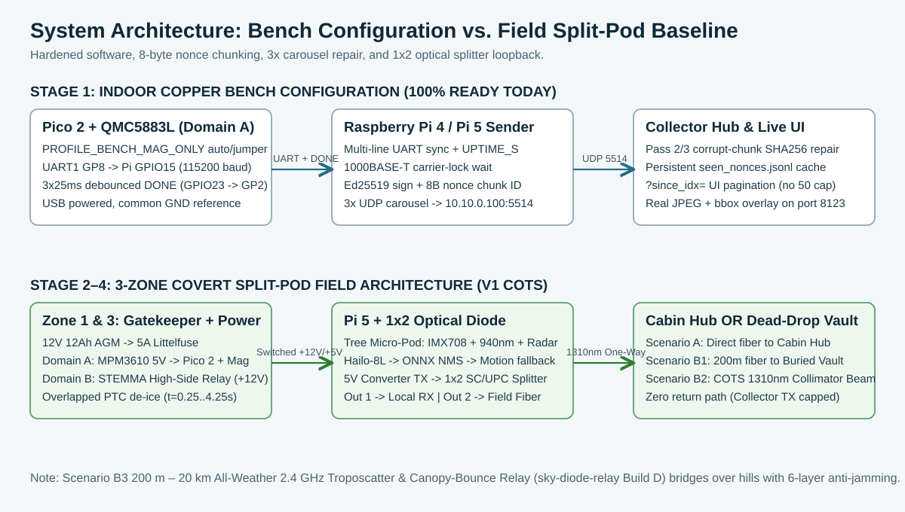
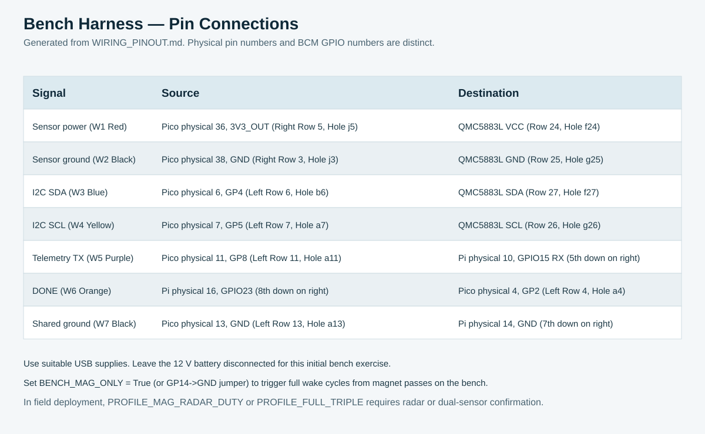
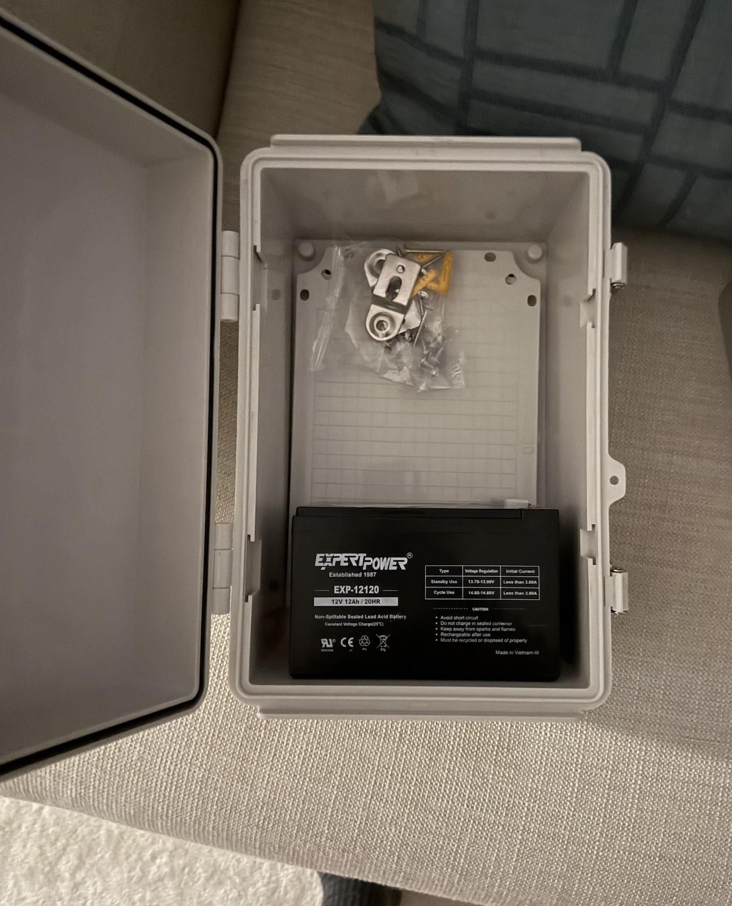

# System Guide & Visual Architecture Index

Start with the [root documentation map](../../README.md). The [engineering specification](../../technical_architecture_engineering_specification.md) owns the software/hardware interfaces, and the [master decisions and roadmap](../../PROJECT_DECISIONS_AND_ROADMAP.md) owns the 10-day sprint plan and COTS BOM decisions.

## Recommended Reading & Build Order

1. Review the COTS component list in the [BOM](HARDWARE_SPECS_AND_BOM.md) and [Missing Parts Checklist](../../PROJECT_DECISIONS_AND_ROADMAP.md#33-missing-parts--immediate-procurement-checklist-what-still-needs-to-be-ordered).
2. Execute the indoor copper bring-up in the [Benchtop Quickstart Guide](BENCHTOP_QUICKSTART_GUIDE.md) using the [Wiring & Pinout Schedule](WIRING_PINOUT.md).
3. Follow the 3-Zone Covert Split-Pod build sequence in the [Assembly Guide](ASSEMBLY_GUIDE.md).
4. Record latency, optical power, and 48-hour soak measurements using the [Field Testing & Validation Plan](FIELD_TESTING_AND_VALIDATION_GUIDE.md).
5. Apply site-specific routing (Cabin Fiber vs. Buried Dead-Drop Vault vs. COTS Optical Beam) using the [Saimaa Archipelago Deployment Guide](SAIMAA_ARCHIPELAGO_DEPLOYMENT_GUIDE.md).

---

## 1. Standalone Device Reference & Context of Use (3-Zone Covert Split-Pod Architecture)

*(Editable vector schematic: [`images/field_product_units_context.svg`](images/field_product_units_context.svg))*

The field camera node separates the small optical/radar head from the heavy battery/compute enclosure so burglars cannot spot a large box at eye level on a tree:
* **Zone 1 (Tree-Mounted Micro Sensor Pod — `Hammond 1591BSBK`, $112 \times 62 \times 31\text{ mm}$ at $1.8\text{–}2.2\text{ m}$ height):** Painted with non-metallic `Rust-Oleum Specialty Camouflage Ultra-Flat` **Earth Brown** and **Deep Forest Green** bark stencil. Features **only 1 single circular glass window ($28\text{ mm}$)** on the upper front face housing **1 central `IMX708 NoIR` camera lens** isolated by an opaque closed-cell neoprene foam baffle ring from the **2 side `940 nm` invisible IR LEDs**, while the `HLK-LD2450` $24\text{ GHz}$ radar sits in the lower internal bay behind the unpierced solid ABS front wall.
* **Zone 2 (Concealed Trunk Umbilical — $2\text{ m}$):** Bundled low-voltage harness wrapped in `Gear Aid Camo Form` matte fabric tape pressed into a natural bark crevice and entering the top waterproof gland of the Zone 3 Base Vault.
* **Zone 3 (Moss-Buried Base Vault — `QILIPSU IP67`, $300 \times 200 \times 160\text{ mm}$ at ground level):** Nestled in the root hollow and buried under moss/leaf litter at the base of the tree. The `ExpertPower EXP-12120` (`12V 12Ah` AGM battery, $151\text{ mm}$ wide) spans **wall-to-wall across the bottom third** with a `5A` Littelfuse; the internal grid backplate above it holds the `Adafruit MPM3610` $5\text{V}$ always-on Domain A buck, `Pico 2` Gatekeeper, `QMC5883L` magnetometer (+ `ADS1115` ADC & `SM-24` geophone), `Adafruit STEMMA` high-side power switch, `12V-to-5V 5A` Domain B buck, `Raspberry Pi 5` + `Hailo-8L`, $5\text{V}$ `1310 nm` Media Converter #1, and `1×2 SC/UPC` 50/50 optical splitter (with Output 1 looped back to local `RX`).

---

## 2. Supported Deployment Scenarios: Cabin Nearby vs. No Cabin Nearby

*(Editable vector schematic: [`images/deployment_scenarios_cabin_vs_remote.svg`](images/deployment_scenarios_cabin_vs_remote.svg))*

* **Scenario A — Cabin / Outbuilding Somewhat Close By ($30\text{ m}$ to $10\text{ km}$):** Simply use a pre-terminated `SC/UPC` armored single-mode OS2 fiber spool ($3\text{ mm}$ black jacket tucked $2\text{ cm}$ under forest moss) connected directly to the indoor Cabin Collector Hub (`StarTech` / `TP-Link` Media Converter #2 `RX` port). Single-mode $1310\text{ nm}$ fiber loses only $0.35\text{ dB/km}$, supporting $>10\text{ km}$ without repeaters.
* **Scenario B1 — No Cabin Nearby (Buried "Dead-Drop" Collector Vault $100\text{–}500\text{ m}$ in Woods):** A $200\text{ m}$ moss-buried armored fiber connects the tree node to a hidden, buried waterproof Collector Vault (`QILIPSU` #2 + battery + headless Pi Collector SSD running `receiver_hub.py --max-alerts 1000`). Even if an intruder destroys the camera at the trail, the signed JPEG evidence is preserved $200\text{ m}$ away in the forest.
* **Scenario B2 — Water Strait / River / Road Crossing ($5\text{ m}$ to $100\text{ m}$ Line-of-Sight):** Two COTS `1310 nm` fiber optic collimators (**Thorlabs** `F220FC-1310` / `F280FC-C` or **Edmund Optics**, mounted on low rigid bedrock/ground stakes) screw directly onto the media converter fiber leads to project a narrow invisible laser beam across water or roads where cable cannot be laid.
* **Scenario B3 — `200 m – 20 km` All-Weather Non-Line-of-Sight Troposcatter & Canopy-Bounce (`sky-diode-relay` `Build D`, 6-Layer Anti-Jamming Architecture):** Combines the $200\text{ m}$ moss-buried optical fiber standoff with the ordered **`2.4 GHz` Troposcatter, Hydrometeor & Canopy-Bounce System** ([`sky-diode-relay`](../../sky-diode-relay/README.md) `Build D`: `2× ADALM-PLUTO` SDRs, `Skyworks SE2576L-EK1` `1.0 W` PA, `Skyworks SKY65405-21EK1` `1.2 dB NF` LNA, `2× Mini-Circuits VBF-2435+` coaxial bandpass filters, `2× Hammond 1590Z120` cast-aluminum RF shield boxes, and `2× L-com HG2414P` `14 dBi` weatherproof square flat-panel patch antennas; `~35–45 min` zero-solder assembly, `23/23` tests passing):
  1. **Layer 1 — $200\text{ m}$ Optical Fiber Standoff + Receiver-Side Physics:** An intruder carrying a portable pocket/vehicle jammer ($1\text{–}10\text{ W}$ Wi-Fi / 4G / ISM jammer) at the lake cottage cannot jam the camera's $200\text{ m}$ glass fiber link—so the full-resolution `Ed25519`-signed JPEG is **100% immune** and safely stored on the buried Woods Vault SSD in $<7\text{ s}$. Furthermore, in radio physics, **jamming only affects the RECEIVER** ($200\text{ m}\text{–}20\text{ km}$ away at the Farmhouse), not the transmitter!
  2. **Layer 2 — Lateral $200\text{ m}$ Vault Offset + `L-com HG2414P` `14 dBi` Flat-Panel Spatial Nulling ($30^\circ \times 30^\circ$ Beam, $>20\text{ dB}$ Front-to-Back Rejection):** By placing the Woods Vault $200\text{ m}$ laterally in the forest and mounting the square weatherproof **`L-com HG2414P` `14 dBi` Flat-Panel Patch Antenna** (`203 × 203 × 38 mm`) tilted $+2^\circ$ into the sky/canopy scatter volume toward the Farmhouse, any jammer on the trail sits in the flat-panel antenna's off-axis/rear null.
  3. **Layer 3 — Out-of-ISM Guard-Band Frequency Hopping (`2380.373 MHz`, `2487.818 MHz`, `2459.496 MHz`) + `Mini-Circuits VBF-2435+` Cavity Pre-Selector (`>40 dB` Stopband Rejection):** Hops across 3 pseudorandom frequencies derived from `SHA256(shared_secret || time_slot)` outside standard Wi-Fi (`2412–2462 MHz`) while the `VBF-2435+` bandpass filter ahead of the `SKY65405-21EK1` LNA blocks out-of-band LTE/5G/VHF/UHF/GPS blockers from saturating the receiver.
  4. **Layer 4 — `VK7MO` Coherent Lock-In Integration (`+55.8 dB` Processing Gain, `-22.0 dB` SNR Threshold) + Spectral Excision + Persistent Store-and-Forward:** Extracts coherent `4-FSK` symbols $22\text{ dB}$ ($158\times$) below thermal noise, zeroes narrowband/swept jammers in FFT before integration, and persistently retries from the `512 GB` NVMe vault SSD with exponential backoff (`5s` to `300s`).

---

## 3. Functional Block & Bench Wiring References

### Actual In-Hand Base Vault Enclosure (`QILIPSU` + `EXP-12120` 12V 12Ah Battery)

All 5 editable SVG diagrams ([`current_configuration.svg`](images/current_configuration.svg), [`bench_connections.svg`](images/bench_connections.svg), [`field_product_units_context.svg`](images/field_product_units_context.svg), [`deployment_scenarios_cabin_vs_remote.svg`](images/deployment_scenarios_cabin_vs_remote.svg), and [`optional_sky_beam.svg`](../../sky-diode-relay/docs/images/optional_sky_beam.svg)) are stored directly inside [`docs/images/`](images/) alongside the high-resolution field deployment illustrations.
