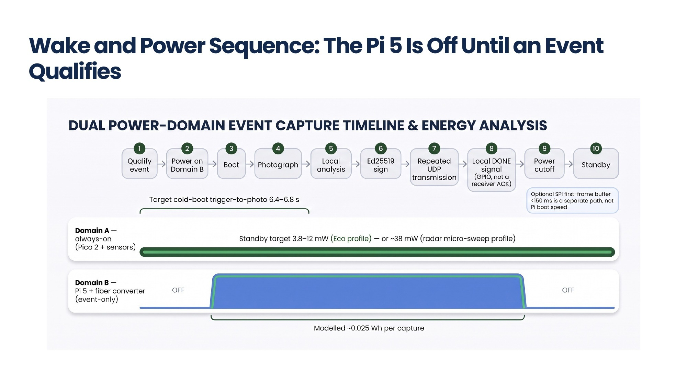
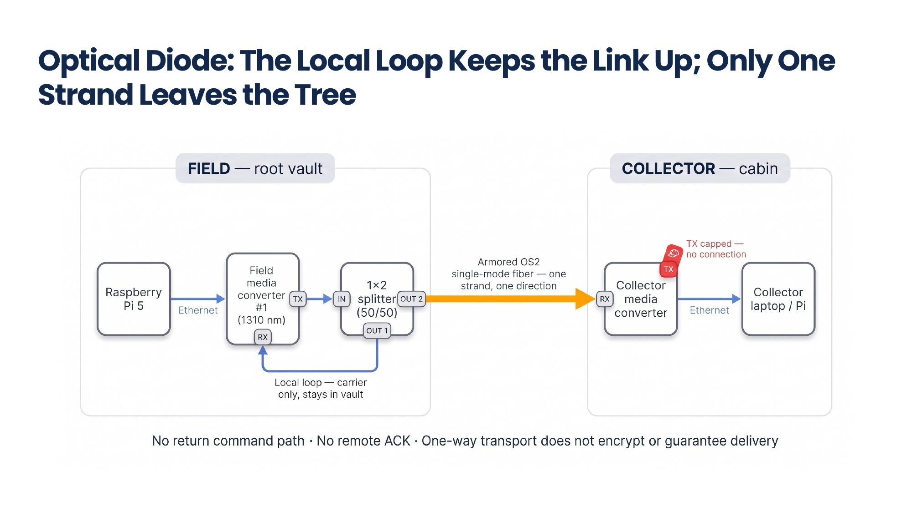

# Electrical connections

This is the maintained pin schedule for modular bench integration. Pin names describe the firmware interfaces; they do **not** certify the generated carrier layout. Check orientation against the physical board before connecting power. All Pi/Pico signal connections below use 3.3 V logic and a common ground.

## Raspberry Pi Pico 2 (`[P07]`), `QMC5883L` (`[P08]`) & Raspberry Pi 5 (8GB) (`[P01]`) Bench Harness

*(Note: Use your primary **`Raspberry Pi 5 (8GB) [P01]`** board—identified by its bottom-right Ethernet port, two narrow 22-pin `CAM/DISP` slots, and two CPU cooler mounting holes. While the 40-pin GPIO header pinout on the secondary `Raspberry Pi 4 Model B [P01-ALT]` is identical for Pins 10/14/16, only `Raspberry Pi 5 (8GB) [P01]` fits the `Active Cooler [P02]`, `Hailo-8L [P03]`, and 22-pin `Camera Ribbon [P06]`.)*

| Signal | Source | Destination |
|---|---|---|
| Sensor power (`W1 Red`) | `Raspberry Pi Pico 2 [P07]` physical 36, `3V3_OUT` (`Right Row 5, Hole j5`) | `QMC5883L / GY-271 [P08] VCC` (`Row 24: Wire in Hole f24 -> Sensor Pin 1 in Hole j24`) |
| Sensor ground (`W2 Black`) | `Raspberry Pi Pico 2 [P07]` physical 38, `GND` (`Right Row 3, Hole j3`) | `QMC5883L / GY-271 [P08] GND` (`Row 25: Wire in Hole f25 -> Sensor Pin 2 in Hole j25`) |
| I2C SDA (`W3 Blue`) | `Raspberry Pi Pico 2 [P07]` physical 6, `GP4` (`Left Row 6, Hole a6`) | `QMC5883L / GY-271 [P08] SDA` (`Row 27: Wire in Hole f27 -> Sensor Pin 4 in Hole j27`; `Pin 5 DRDY in Hole j28` left bare) |
| I2C SCL (`W4 Yellow`) | `Raspberry Pi Pico 2 [P07]` physical 7, `GP5` (`Left Row 7, Hole a7`) | `QMC5883L / GY-271 [P08] SCL` (`Row 26: Wire in Hole f26 -> Sensor Pin 3 in Hole j26`) |
| Telemetry TX (`W5 Purple`) | `Raspberry Pi Pico 2 [P07]` physical 11, `GP8` (`Left Row 11, Hole a11`) | `Raspberry Pi 5 (8GB) [P01]` physical 10, `GPIO15 RX` (`5th down on right`) |
| DONE (`W6 Orange`) | `Raspberry Pi 5 (8GB) [P01]` physical 16, `GPIO23` (`8th down on right`) | `Raspberry Pi Pico 2 [P07]` physical 4, `GP2` (`Left Row 4, Hole a4`) |
| Shared ground (`W7 Green`) | `Raspberry Pi Pico 2 [P07]` physical 13, `GND` (`Left Row 13, Hole a13`) | `Raspberry Pi 5 (8GB) [P01]` physical 14, `GND` (`7th down on right`) |

### Mechanical Verification & Field Vibration-Locking Rules (`Stage 2` $\rightarrow$ `Stage 5`)

1. **Bottom Empty-Hole Counting Landmark (`3 Empty Holes in Col f` vs. `2 Empty Holes in Col j`):**
   - The `4` breadboard jumper wires (`W1 Red`, `W2 Black`, `W4 Yellow`, `W3 Blue`) occupy **`Rows 24, 25, 26, 27` in `Column f`**, leaving **`3 empty holes` (`f28, f29, f30`)** at the bottom of `Column f` (and `3 empty holes` `f21–f23` between `Pico 2` `Row 20` and `Row 24`).
   - Because the `GY-271 / QMC5883L [P08]` module uses a **5-pin header** (`VCC`, `GND`, `SCL`, `SDA` in `Rows 24–27`, plus unused `5th pin DRDY` in `Row 28`), `Column j` has **`3 empty holes` (`j21–j23`)** between `Pico 2` and `VCC`, and **`2 empty holes` (`j29, j30`)** at the very bottom of `Column j` (`Row 30`). Always verify **`3 empty bottom holes in Col f` (`f28–f30`)** and **`2 empty bottom holes in Col j` (`j29–j30`)** so the compass is never shifted down by 1 row.
2. **Unsoldered Header Press-Fit & `90°` Straight-Pin Check:**
   - Before pressing the `GY-271 [P08]` into `Column j (Rows 24–28)`, grip each of the 4 active short gold pins (`VCC, GND, SCL, SDA`) with flat-nose pliers (`[T08]`) and give a **`15°–20°` axial twist** so the diagonal corners of the `0.64 mm` square post bite into the `0.90 mm` plated through-hole wall (`100%` gas-tight spring press-fit without soldering).
   - Inspect every jumper pin before insertion and straighten any bent `"J-hook"` tips with pliers so each pin enters its breadboard socket at a true `90°` perpendicular angle.
3. **Design Decision — Keep the COTS Breadboard (`[P09]`) + 3-Step In-Place Vibration Lock (Zero Custom PCBs / Zero Second Build):**
   - Rather than fabricating a custom PCB (which creates third-party manufacturing records, compromises supply-chain OPSEC/anonymity, saves `$0` at prototype scale, and prevents quick pin changes) or tearing down the tested Stage 2 build for a second harness, the exact Stage 2 `Breadboard [P09]` is locked for car/snowmobile transport (`<2%` failure risk) in `10 minutes` during Stage 5 using three reversible steps:
     1. **Rigid Co-Mounting on the `QILIPSU [P21]` Grid Plate:** Stick the `Breadboard [P09]` foam adhesive backing (plus one safety zip-tie) onto the white `QILIPSU` mounting grid plate **`3 cm` beside `Raspberry Pi 5 [P01]`** so zero differential wire tug can occur.
     2. **`3M` Multi-Pin Block Tape Binding:** Wrap a strip of `3M` tape (`[T11]`) across the plastic housings of `W1–W4` (`Col f`), `W3–W7` (`Col a`), and `W5–W7` on the `Pi 5` GPIO header (`Pins 10, 14, 16`) so individual pins (`~25 g` pull-out force) become a unified multi-pin block (`>500 g` pull-out force).
     3. **Peelable `2 mm` `Permatex Black Silicone [T11]` Damper Bead:** Run a thin `2 mm` bead of `Permatex Black Silicone` across the plastic base where the jumper shells meet the breadboard face and across the top of the `GY-271` 5-pin header (`>1,500 g` vibration retention, while remaining peelable in `5 seconds` with tweezers `[T01]` if a future modification is ever desired).

Power the `Raspberry Pi 5 (8GB) [P01]` (`27W USB-C`) and `Raspberry Pi Pico 2 [P07]` (`Micro-USB`) from their appropriate bench USB supplies. Keep the `12 V` battery (`[P17]`) disconnected during this bench exercise. See the [bench procedure](BENCHTOP_QUICKSTART_GUIDE.md) for flashing and diagnostic steps.

## Additional firmware interfaces & complete split-pod field harness (`Stages 4–5`)

| Function | `Pico 2 [P07]` GPIO | Exact Switching Module & Pin-Level Field Connection |
|---|---|---|
| **Domain B main power (`Pi 5` + `Media Converter #1`)** | `GP15` (`Pin 20`) | Drives `SIG` on **`Adafruit STEMMA High-Side Relay #1 (PID 4409)` (`[P12]`)** (`VIN = 3V3_OUT`, `GND = GND`). Relay `COM` connects to fused `+12.0V` battery (`[P17]`/`[P18]`); Relay `NO` feeds the `12V-to-5V 5A (25W)` Buck (`[P12]`) powering `Raspberry Pi 5 [P01]` and `StarTech Media Converter #1 [P13]`. |
| **Radar `+5.0V` power switch (`180 mA` load)** | `GP6` (`Pin 9`) | Drives `CTRL`/`ON` on **`Pololu 2810 High-Side MOSFET Switch` (or `STEMMA Relay`, `[P12]`)**. Switch `VIN` connects to Always-On `+5.0V` (`Adafruit MPM3610` output); Switch `VOUT` feeds `HLK-LD2450 [P11] Pin 1 (5V)` in the Zone 1 Pod. (`GP6` never sources the `180 mA` radar current directly.) |
| **Radar UART0 TX / RX (`256000 baud`)** | `GP0` / `GP1` (`Pins 1 / 2`) | `GP0 (UART0 TX)` $\rightarrow$ `HLK-LD2450 [P11] Pin 3 (RX)`; `GP1 (UART0 RX)` $\leftarrow$ `HLK-LD2450 [P11] Pin 2 (TX)`; `Pin 4 (GND)` $\rightarrow$ Common `GND` via the `2.0 m` Zone 2 umbilical. |
| **Window de-icer heater switch (`3.69 W` @ `12.0V`)** | `GP16` (`Pin 21`) *(bench alias `GP22`)* | Drives `SIG` on **`Adafruit STEMMA High-Side Relay #2 (PID 4409)` (`[P12]`)**. Relay `COM` connects to fused `+12.0V` (`[P17]`/`[P18]`); Relay `NO` feeds the **`39 Ω, 5W` Ceramic Window De-Icer Resistor (`[P20]`)** returned to Common `GND` ($P = 12.0^2 / 39\,\Omega = 3.69\text{ W} \approx 3.6\text{ W}$, $I = 308\text{ mA}$, operating at $74\%$ of its `5.0 W` continuous rating during the `4.0 s` sub-zero boot pulse). |
| **Seismic ADC & alert (optional V1.1)** | `GP4` SDA / `GP5` SCL / `GP14` Alert | `ADS1115 [P11-SEIS]` on shared `I2C0` bus (`0x48`); `ALERT/RDY` wired to `GP14 (Pin 19)`. |
| **Primary / bench `DONE` handshake** | `GP17` (`Pin 22`) / `GP2` (`Pin 4`) | `Raspberry Pi 5 (8GB) [P01] GPIO23 (Pin 16)` asserts `3.3 V HIGH` when optical transmission completes; `Pico 2` debounces for `75 ms` (`3 samples`) before cutting `GP15`. |
| **Gatekeeper telemetry (`UART1`, `115200 baud`)** | `GP8` TX / `GP9` RX (`Pins 11 / 12`) | `Pico 2 GP8 (Pin 11)` $\rightarrow$ `Raspberry Pi 5 [P01] GPIO15 (Pin 10, UART RX)`. |
| **`2.0 m` Split-Pod Camera Bus (`Zone 1` $\leftrightarrow$ `Zone 3`)** | `Pi 5 CAM/DISP 0` | **Indoor bench (`200 mm`):** `Raspberry Pi Camera Module 3 NoIR Wide (IMX708) [P05]` connects directly to `Pi 5 J4 CAM/DISP 0` via the `200 mm` `22-pin to 15-pin` FPC ribbon (`[P06]`). **Separated `2.0 m` Tree Pod (`Stage 4–5`):** `Pi 5 J4 CAM/DISP 0` (`200 mm` `22-to-15-pin` ribbon) $\rightarrow$ **`Arducam CSI-to-HDMI Base Adapter (ASIN B06XDNBM63, [P06])`** $\rightarrow$ **`2.0 m` Round Shielded HDMI Cable** through `M20`/`M12` glands $\rightarrow$ **`Arducam CSI-to-HDMI Pod Adapter`** inside Zone 1 $\rightarrow$ `Camera Module 3 NoIR Wide [P05]` (plus auxiliary `AUX1`/`AUX2` lines for the `39 Ω 5W` heater). |

## Converter supply and optical topology

**StarTech MCMGBSCSM10 (`[P13]`) requires 5 V DC, center positive. Do not connect it to a switched 12 V output.** Its supplied adapter is rated 5 V, 2 A (or use the `StarTech 5V USB-to-Barrel Cable [P19]`). Confirm the connector and polarity on the actual unit. These details and the standard 10 km / 0–50°C ratings come from the [manufacturer datasheet](https://media.startech.com/cms/pdfs/mcmgbscsm10_datasheet.pdf); they do not establish performance in the proposed splitter arrangement.

The proposed optical routing is:

1. `Raspberry Pi 5 (8GB) [P01]` Gigabit Ethernet to Field Media Converter #1 (`[P13]`) `RJ45`.
2. Field optical `TX` to the input of the `1x2` 50/50 single-mode splitter (`[P14]`).
3. One splitter output to field optical `RX` (local carrier-detect loopback); the other to the outdoor fiber (`[P16]`) via coupler (`[P15]`) and collector optical `RX`.
4. Collector optical `TX` unconnected/capped; collector `RJ45` to the hub Ethernet adapter or local switch.

Prove link negotiation and delivery on the short bench configuration before extending the route. The hub application listens on UDP 5514; the example hub address is `10.10.0.100/24`. A direct Cat6 bench connection remains bidirectional hardware.

## Unreleased carrier and optional sky interface

The generated carrier conflicts with earlier connector documentation: J3 is assigned always-on 3.3 V rather than the described switched radar supply, GP6 is not routed as described, and J4's generated order differs from the old harness. **No carrier connector pin order is approved for wiring.** See the [carrier design status](../hardware/CARRIER_BOARD_DESIGN_SPEC.md) and [master decisions and roadmap](../../PROJECT_DECISIONS_AND_ROADMAP.md) for the decision to use COTS modules for V1.

The [`sky-diode-relay` `Build D` (`200 m – 20 km` All-Weather `2.4 GHz` Troposcatter & Canopy-Bounce Relay)](../../sky-diode-relay/hardware/SKY_RELAY_HARDWARE_SPEC_AND_BOM.md) uses a standalone zero-solder `SMA` coaxial and `+5.0V DC` screw-terminal harness (`ADALM-PLUTO` SDR + `Skyworks SE2576L-EK1` `1W` PA + `SKY65405-21EK1` LNA + `Mini-Circuits VBF-2435+` filters + `TDK-Lambda LS50-5` `5V` PSUs; `~35–45 min` assembly) documented in [`SKY_RELAY_HARDWARE_SPEC_AND_BOM.md`](../../sky-diode-relay/hardware/SKY_RELAY_HARDWARE_SPEC_AND_BOM.md#3-exact-coaxial--dc-pinout-schedule-build-d).
