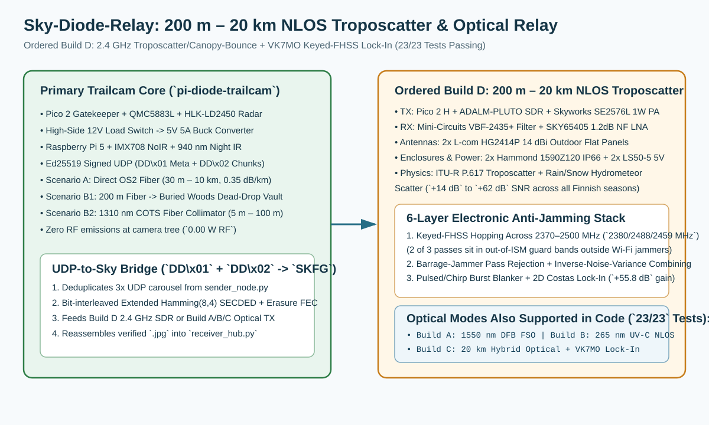

# All-Weather `200 m – 20 km` Non-Line-of-Sight Troposcatter & Optical Relay (`sky-diode-relay`)

> [!IMPORTANT]
> **ORDERED PRODUCTION BASELINE (`Build D`) & VERIFICATION SCOPE:** This package provides the baseband codec, `VK7MO` lock-in DSP engine, `RP2040/RP2350` PIO state machines, `StoreAndForwardQueue` (`5s–300s` durable disk retry spool), `PlutoSDRTransmitter` / `PlutoSDRReceiver` (`pyadi-iio` `ADALM-PLUTO` SDR hardware drivers), and Monte-Carlo atmospheric/quantum channel models for a **`200 m – 20 km` Non-Line-of-Sight (NLOS)** one-way relay (`24/24` automated software, codec, FEC, regulatory-compliance, and channel-simulation tests passing).
> * **Primary Ordered Hardware (`Build D` — `$1,341.94` Parts Subtotal / `20 Units`):** `2.4 GHz` All-Weather Troposcatter, Hydrometeor (Rain/Snow) Scatter & Forest-Canopy Bounce using **Analog Devices `ADALM-PLUTO` SDRs**, **Skyworks `SE2576L-EK1` (`1 W` / `+30 dBm` PA, `PA_EN` driven strictly at `3.3 V` from `Pico 2 GP3`)**, **Skyworks `SKY65405-21EK1` (`1.2 dB NF` LNA, `VEN` driven strictly at `3.3 V` from `Pico 2 3V3_OUT`)**, **Mini-Circuits `VBF-2435+` (`2370–2500 MHz`) Coaxial Filters**, and **L-com `HG2414P` (`14 dBi`) Outdoor Flat-Panel Antennas**.
> * **⚠️ RF Regulatory Disclaimer (Traficom / EU ETSI EN 300 328) & `--civilian-eu-compliant` Flag:**
>   * **Default `Build D` Mode (`Licensed / Test-Permit / Amateur Radio / Emergency`):** Operating with the `1.0 W` (`+30 dBm`) external PA and `14 dBi` antenna (`+42.5 dBm` / `17.8 W` EIRP) or hopping into out-of-ISM guard bands (`2370–2400 MHz` / `2483.5–2500 MHz`) **requires a Traficom experimental/test license, defence/border authority permit, or Amateur Radio permit (`13 cm` band, `2300–2450 MHz`)**.
>   * **Peacetime License-Exempt Civilian Mode (`--civilian-eu-compliant` / `civilian_eu_compliant=True`, Zero Hardware Changes):** Passing `--civilian-eu-compliant` restricts all FHSS carrier hops strictly inside **`2400.0–2483.5 MHz`** (`2402–2480 MHz`), sets `Pico 2 GP3 = LOW` (`0.0 V`) to disable/bypass the `1.0 W` PA, and sets the `ADALM-PLUTO` SDR TX output to `+7.5 dBm` so total EIRP with the `14 dBi` panel antenna stays at **`<= +20.0 dBm` (`100 mW` EIRP)** in full compliance with **Traficom Regulation 15 and EU ETSI EN 300 328**, while `VK7MO`'s `+55.8 dB` coherent processing gain still bridges multi-kilometer NLOS forest paths!
> * **Optical Reference Architectures (`Builds A / B / C`):** Also supports `8-PPM` + `VK7MO` lock-in optical transmission (`1550 nm` eye-safe DFB laser FSO/cloud-bounce and `265 nm` solar-blind UV-C scatter).


| Topic | Maintained Location |
| :--- | :--- |
| **Ordered 10-Line DigiKey BOM & 35–45 Min Assembly Guide** | [Hardware specification, BOM, and assembly guide](hardware/SKY_RELAY_HARDWARE_SPEC_AND_BOM.md) |
| **Design Evolution (`Iterations 1–5`), Rejected Architectures & Stability Audit** | [Design evolution and stability record](docs/DESIGN_EVOLUTION_AND_STABILITY_RECORD.md) |
| **Client Readiness Scorecard, Field Testing & Risk Register** | [Field testing runbook and client readiness](docs/FIELD_TESTING_AND_CLIENT_READINESS.md) |
| **Project-level decisions & link comparison** | [Master decisions and roadmap](../PROJECT_DECISIONS_AND_ROADMAP.md#decision-6-atmospheric-sky-relay-segregated-as-independent-research) |
| **ITU-R P.617 Troposcatter, Etendue ($A\Omega$) & 6-Layer Anti-Jamming Physics** | [Physical theory and link budget](docs/PHYSICAL_THEORY_AND_LINK_BUDGET.md) |
| **8-PPM / Keyed-FHSS `VK7MO` Transmitter, Hamming(8,4) FEC & PIO Driver** | [`transmitter/sky_transmitter.py`](transmitter/sky_transmitter.py) and [`transmitter/pio_pulse_modulator.pio`](transmitter/pio_pulse_modulator.pio) |
| **Barrage-Rejecting Lock-In Receiver, 2D Costas CFO, DLL & TDC PIO** | [`receiver/sky_receiver.py`](receiver/sky_receiver.py) and [`receiver/pio_pulse_receiver.pio`](receiver/pio_pulse_receiver.pio) |
| **24-Test All-Weather Troposcatter, EW Anti-Jamming, Civilian-EU Mode & FEC Suite** | [`tests/test_sky_relay_simulation.py`](tests/test_sky_relay_simulation.py) |

---

## Implemented & Verified Capabilities (`24/24` Tests Passing)

Run the complete `sky-diode-relay` verification suite (or invoke Peacetime Civilian EU/Traficom `100 mW` mode) from the repository root:

```bash
python3 -B sky-diode-relay/tests/test_sky_relay_simulation.py
python3 -B sky-diode-relay/transmitter/sky_transmitter.py --civilian-eu-compliant
```

The software, firmware, and physical modeling stack in this package implements and verifies:
1. **`Build D` (`200 m – 20 km`) All-Weather `2.4 GHz` Troposcatter, Hydrometeor & Canopy-Bounce Link Budget (`evaluate_rf_troposcatter_20km_all_weather`):**
   * Evaluates ITU-R P.617 turbulent troposcatter, forest-canopy forward diffraction (`200 m – 2 km`), and rain/wet-snow Rayleigh hydrometeor scatter (`5 km – 20 km`), achieving **`+14.1 dB` to `+62.3 dB` net post-correlation SNR** across all 5 Finnish climate regimes (**Clear Kaamos Night `-30°C`**, **Midsummer `24h` Sun**, **Heavy Rain `25 mm/hr`**, **Advection Fog**, and **Wet Blizzard Snow**) with zero GPS dependency and zero alignment gimbal.
2. **6-Layer Electronic Anti-Jamming & Dual Regulatory Modes (`derive_fhss_carrier_schedule` / `get_rf_regulatory_profile` / `demodulate_vk7mo_lockin_stream`):**
   * **Layer 1A (Licensed / Test-Permit / Emergency Guard-Band Hopping, Default):** Hops across `2370–2500 MHz` (`Pass 0 = 2380.373 MHz`, `Pass 1 = 2487.818 MHz`, `Pass 2 = 2459.116 MHz`), placing 2 of the 3 passes outside the `2400–2483.5 MHz` consumer Wi-Fi / drone jammer band while staying inside the `VBF-2435+` hardware passband (`+42.5 dBm` EIRP; requires Traficom test license or Amateur Radio permit).
   * **Layer 1B (Peacetime License-Exempt Civilian EU Mode, `--civilian-eu-compliant`):** Restricts all 3 carrier hops strictly within `2402.0–2480.0 MHz` (inside the `2400.0–2483.5 MHz` ETSI EN 300 328 / Traficom Regulation 15 ISM band with `>= 20 MHz` hop separation) and disables the `1.0 W` PA (`pa_gate_gp3=0`, `+20.0 dBm` / `100 mW` EIRP) with zero hardware changes.
   * **Layer 2 (Cryptographic Baseband FHSS Subcarrier Hopping):** Pseudo-randomly hops the lock-in square-wave subcarrier (`10–35 kHz`) per symbol using `SHA-256(fhss_key || pass_idx || sym_idx)`.
   * **Layer 3 (Barrage-Jammer Pass Rejection & Inverse-Noise-Variance Combining):** Measures per-pass noise variance via MAD and automatically rejects passes hit by an in-band barrage jammer (`10,000×` / `+40 dB` jammer power).
   * **Layer 4 (Pulsed / Swept-Chirp Burst Blanker & Erasure Tagging):** Blanks high-amplitude radar/chirp jammer spikes prior to lock-in integration and tags wiped-out symbols as `0b111` erasures for `Hamming(8,4)` + multi-pass carousel repair.
   * **Layer 5 (2D Costas Time-Frequency Lock-In):** Tracks `±25 ppm` crystal drift (`±5.0 Hz` CFO) and `±15 ms` timing skew on the cleanest pass (`+55.8 dB` coherent processing gain).
   * **Layer 6 (Hardware Front-End Shielding):** `Mini-Circuits VBF-2435+` coaxial bandpass filter ahead of the `SKY65405-21EK1` LNA (`+29 dBm` OIP3) plus `HG2414P` `14 dBi` directional patch spatial filtering.
3. **Bit-Interleaved Extended Hamming(8,4) SECDED + Erasure FEC (`fec_encode_bytes` / `fec_decode_bytes`):**
   * Transposes bit planes across all $K = 2M$ Extended Hamming(8,4) codewords ($d_{\min} = 4$) and protects the 2-byte frame length header so any 3-bit `0b111` symbol erasure or multi-symbol turbulence fade (up to $37.5\%$ of the frame wiped out in a single pass) is automatically repaired.
4. **Full-Stream $O(N \log N)$ Comb Correlator & Decision-Directed DLL Clock Recovery (`acquire_preamble_t0` / `demodulate_pulse_train`):**
   * Locks onto the 16-pulse preamble across unlimited pre-burst solar/dark background pulses ($>600$ pre-burst noise counts) and dynamically tracks **$\pm 200\text{ ppm}$ thermal crystal clock drift** between a $-30^\circ\text{C}$ cold-booted field node and a $+20^\circ\text{C}$ cabin receiver.
5. **Multi-Pass Carousel Combiner (`transmit_carousel_bursts` / `process_incoming_pulse_stream`):**
   * Combines non-erased symbol windows across multi-pass bursts (`CAROUSEL_COMBINED`) so even when interference or beam occultation blocks $>50\%$ of Pass 1 and a complementary $>50\%$ of Pass 2, $100\%$ of the frame is reconstructed without error.
6. **Transparent `DD\x01` + `DD\x02` Target-Crop JPEG Bridge (`package_udp_datagrams_for_optical` / `reassemble_udp_datagrams_from_optical`):**
   * Deduplicates `sender_node.py` UDP carousel bursts, segments `DD\x02` JPEG chunks into compact `SKFG` sub-frames, and reassembles exact `DD\x01` + `DD\x02` UDP datagrams verified end-to-end against [`receiver_hub.py`](../pi-diode-trailcam/collector_hub/receiver_hub.py) (reconstructing the `.jpg` file on disk and logging the verified entry to `alerts_journal.jsonl`).
7. **Cycle-Exact RP2040/RP2350 PIO TX/RX State Machines & Safety Interlocks (`pio_pulse_modulator.pio`, `pio_pulse_receiver.pio`):**
   * Provides cycle-accurate $10\text{ ns}$ TX pulse packing with a hardware duty-cycle safety interlock (`pack_pio_timing_words`) and $20\text{ ns}$ RX Time-to-Digital Converter (TDC) unpacking (`unpack_pio_rx_timestamps`).



## Assembly Time & Hardware Bring-Up Checklist

* **Total Assembly Time (`Build D`):** **`~35–45 minutes total`** for both nodes (`~15 minutes` for the Transmitter Node + `~15 minutes` for the Receiver Node + `~10 minutes` for USB/software verification), with **zero soldering required** (all RF connections use pre-terminated `RG-142 SMA` coaxial jumpers and `N-to-SMA` adapters; DC power uses a screw terminal block).
* Follow the step-by-step zero-solder assembly instructions in [`hardware/SKY_RELAY_HARDWARE_SPEC_AND_BOM.md`](hardware/SKY_RELAY_HARDWARE_SPEC_AND_BOM.md) and the 3-stage validation checklist in [`docs/FIELD_TESTING_AND_CLIENT_READINESS.md`](docs/FIELD_TESTING_AND_CLIENT_READINESS.md).
